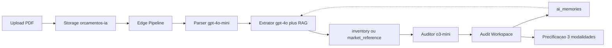

# EXECUTION_PLAN.md — Sistema de Orçamentação com IA (PRD v8)

Plano técnico de execução do módulo **Orçamentos IA**, alinhado a [`orcamento-com-IA/prd_sistema_orcamento_gpt-v8.md`](orcamento-com-IA/prd_sistema_orcamento_gpt-v8.md) e [`.cursorrules`](.cursorrules).

**Stack deste repositório:** Vite + React + TypeScript + Supabase (Edge Functions). O PRD cita Next.js; aqui usamos a SPA existente e Edge Functions no lugar de API Routes.

---

## Fase 1: Infraestrutura de Banco e Storage no Supabase

- [x] Migration DDL com extensão `vector` (pgvector)
- [x] Tabelas: `company_standards`, `inventory_items`, `market_reference_prices`, `ai_memories`, `quote_analyses`, `quote_environments`, `quote_modules`, `quote_materials`
- [x] Função RPC `match_ai_memories`
- [x] Políticas RLS permissivas para autenticados (filtro de tenant via `company_id` na app)
- [x] Seed de `inventory_items` e `market_reference_prices` (Planilha 4.0)
- [x] Bucket Storage `orcamentos-ia` (PDFs + páginas) + policies
- [x] Utilitário cliente `src/lib/orcamentos-ia/storage.ts` (ensure + upload)
- [ ] Aplicar migrations: `pnpm migrate` (`20260921_…` e `20260922_…`)
- [ ] Validar tabelas/RPC/bucket no Supabase (MCP ou SQL)

**Arquivos:**
- [`supabase/migrations/20260921_init_orcamentos_ia.sql`](supabase/migrations/20260921_init_orcamentos_ia.sql)
- [`supabase/migrations/20260922_orcamentos_ia_storage.sql`](supabase/migrations/20260922_orcamentos_ia_storage.sql)

---

## Fase 2: Módulo de Rota Isolada e Layout Base

- [x] Criar pastas `src/pages/orcamentos-ia/`, `src/components/orcamentos-ia/`, `src/lib/orcamentos-ia/`
- [x] Registrar rota lazy autenticada `/orcamentos-ia` em `src/App.tsx` (sem colidir com `/orcamento/:schema/:id` nem `/orcamento-slides`)
- [x] Gate de acesso (admin / vendedor / projetista CRM)
- [x] Item de menu em Orçamentos → Orçamentos IA
- [x] Tela de upload de PDF → Storage
- [x] Criar registro `quote_analyses` em `PENDING`
- [x] Status em tempo real via Supabase Realtime (barra de progresso)
- [x] Modal esqueleto de `company_standards` (Central de Informações)
- [x] UI com Tailwind + Lucide-React, responsiva
- [x] Seletor Modo Max (o3-mini) vs Modo Pro

**Arquivos principais:**
- [`src/pages/orcamentos-ia/index.tsx`](src/pages/orcamentos-ia/index.tsx)
- [`src/components/orcamentos-ia/PdfUploadArea.tsx`](src/components/orcamentos-ia/PdfUploadArea.tsx)
- [`src/components/orcamentos-ia/CompanyStandardsModal.tsx`](src/components/orcamentos-ia/CompanyStandardsModal.tsx)
- [`src/lib/orcamentos-ia/storage.ts`](src/lib/orcamentos-ia/storage.ts)

## Fase 3: Engine Multi-Agente OpenAI e Fallback de Preços

- [x] Dependências: `ai`, `@ai-sdk/openai`, `@langchain/langgraph` (+ `@langchain/core`)
- [x] Edge Function `orcamentos-ia-pipeline` (Parser gpt-4o-mini → Extrator gpt-4o → Auditor o3-mini)
- [x] Orquestração LangGraph em `src/lib/orcamentos-ia/pipeline.ts`
- [x] Zod Schema de extração (caixaria, frentes, fitas, ferragens) em `schemas.ts`
- [x] Resolução de preço: `resolveMaterialPrice` (`inventory_items` → `market_reference_prices`)
- [x] Flag `using_market_price` ao persistir `quote_materials`
- [x] Regra: ferragens/acessórios **sempre por unidade**; puxador perfil em barras de 3 m + tampinhas
- [x] Upload aciona pipeline: `PENDING` → `PROCESSING` / etapas → `COMPLETED` | `FAILED`
- [x] Deploy da Edge Function no Supabase (`orcamentos-ia-pipeline`)
- [ ] Secret `OPENAI_API_KEY` configurada no projeto Supabase (Dashboard → Edge Functions → Secrets)

**Arquivos principais:**
- [`src/lib/orcamentos-ia/pipeline.ts`](src/lib/orcamentos-ia/pipeline.ts)
- [`src/lib/orcamentos-ia/schemas.ts`](src/lib/orcamentos-ia/schemas.ts)
- [`src/lib/orcamentos-ia/pricing.ts`](src/lib/orcamentos-ia/pricing.ts)
- [`src/lib/orcamentos-ia/openai-models.ts`](src/lib/orcamentos-ia/openai-models.ts)
- [`supabase/functions/orcamentos-ia-pipeline/index.ts`](supabase/functions/orcamentos-ia-pipeline/index.ts)

---

## Fase 4: Sistema de Memória e Aprendizado RAG

- [x] Função `saveCompanyMemory` (UI → Edge Function `orcamentos-ia-memory`)
- [x] Função `getCompanyMemories` + RPC `match_ai_memories`
- [x] Embedding `text-embedding-3-small` (1536 dims) → `ai_memories`
- [x] Antes do Extrator: memórias RAG injetadas no System Prompt (`pipeline.ts` + Edge)
- [x] Modal “Explique a correção à IA” no Audit Workspace
- [ ] Índice IVFFlat quando houver volume de memórias (adiado até primeiras correções)

**Arquivos:** [`src/lib/orcamentos-ia/memory.ts`](src/lib/orcamentos-ia/memory.ts), [`supabase/functions/orcamentos-ia-memory/index.ts`](supabase/functions/orcamentos-ia-memory/index.ts), [`ExplainCorrectionModal.tsx`](src/components/orcamentos-ia/ExplainCorrectionModal.tsx)

---

## Fase 5: Audit Workspace Visual (Split Screen)

- [x] Viewer PDF a **200 DPI** (`pdfjs-dist` + canvas)
- [x] Overlay SVG com bbox normalizadas 0.0–1.0
- [x] Highlight neon `#0066FF` + sync lista ↔ página/zoom
- [x] Popout Dual Monitor (`BroadcastChannel` + botão Dual Monitor)
- [x] Lista hierárquica Ambientes → Módulos → Materiais (exato × compra)
- [x] Alerta `using_market_price` com confirmar / informar custo
- [x] Edição de insumos + modal de memória (Fase 4)
- [x] Rota `/orcamentos-ia` alterna para Audit Workspace no `COMPLETED`

**Arquivo:** [`src/components/orcamentos-ia/AuditWorkspace.tsx`](src/components/orcamentos-ia/AuditWorkspace.tsx)

---

## Fase 6: Motor de Precificação (MPC) e Testes

- [x] `src/lib/orcamentos-ia/pricing.ts` — 3 modalidades:
  - [x] Modalidade 1: Margem MPC % (custo / (1 − %MPC))
  - [x] Modalidade 2: Material × N
  - [x] Modalidade 3: R$/m² × metragem
- [x] Seletor de modalidade no header do Audit Workspace
- [x] Lista de Compras Inteira (chapas 2,75×1,85 + perda 15%, rolos 20/50/100, barras 3 m + tampinhas)
- [x] `pnpm build` (tsc + vite) sem erros

---

## Fase 7: Central de Gestão de Preços Globais e Estoque

- [x] `src/lib/orcamentos-ia/inventory.ts` — `getInventoryItems`, `updateInventoryItem`, lote e cadastro
- [x] `InventoryManagerModal.tsx` — listar, filtrar, buscar e editar inline:
  - [x] Chapas de MDF (custo/m² e por chapa)
  - [x] Fitas de Borda (custo/m e tamanho do rolo)
  - [x] Ferragens & Acessórios (custo por unidade)
  - [x] Puxadores Perfil (barra 3 m / tampinhas via preço unitário)
  - [x] Mão de Obra & Serviços Avulsos
- [x] Botão **Tabela de Preços & Estoque** no header de `/orcamentos-ia`
- [x] Salvar alterações no Supabase + cadastrar novos materiais

**Arquivos:**
- [`src/lib/orcamentos-ia/inventory.ts`](src/lib/orcamentos-ia/inventory.ts)
- [`src/components/orcamentos-ia/InventoryManagerModal.tsx`](src/components/orcamentos-ia/InventoryManagerModal.tsx)
- [`src/pages/orcamentos-ia/index.tsx`](src/pages/orcamentos-ia/index.tsx)

---

## Fase 8: Correção CalcmeX (épicos)

### E1 — Extração completa
- [x] `MAX_PIPELINE_PAGES = 40`
- [x] Prompts Extrator/Auditor com Mesa com Saia / bancadas / escrivaninhas
- [x] Deploy Edge `orcamentos-ia-pipeline`

### E2 — Precificação confiável
- [x] Migration `inventory_aliases` + RLS
- [x] `resolveMaterialPrice`: alias → fuzzy → market → contingência diferenciada (quartzo, cola, etc.)

### E3 — De-Para UI
- [x] Aba **Apelidos / De-Para** no `InventoryManagerModal`

### E4 — Treinamento RAG
- [x] `CompanyMemoriesModal` + botão **Treinamento / Memórias** no header

### E5 — Chat contextual
- [x] `AuditChatWidget` (“Pergunte ao Max”)
- [x] Edge Function `orcamentos-ia-chat`

**Arquivos:**
- [`src/lib/orcamentos-ia/pipeline.ts`](src/lib/orcamentos-ia/pipeline.ts)
- [`src/lib/orcamentos-ia/pricing.ts`](src/lib/orcamentos-ia/pricing.ts)
- [`src/lib/orcamentos-ia/inventory.ts`](src/lib/orcamentos-ia/inventory.ts)
- [`src/lib/orcamentos-ia/memory.ts`](src/lib/orcamentos-ia/memory.ts)
- [`src/components/orcamentos-ia/CompanyMemoriesModal.tsx`](src/components/orcamentos-ia/CompanyMemoriesModal.tsx)
- [`src/components/orcamentos-ia/AuditChatWidget.tsx`](src/components/orcamentos-ia/AuditChatWidget.tsx)
- [`supabase/migrations/20260922_orcamentos_ia_inventory_aliases.sql`](supabase/migrations/20260922_orcamentos_ia_inventory_aliases.sql)
- [`supabase/functions/orcamentos-ia-chat`](supabase/functions/orcamentos-ia-chat)

---

## Fase 9: Lista completa de ambientes e itens (sem duplicar)

- [x] Inventário da capa (passo 0) + prompts tipados (guarda-roupa, painel, cabeceira, nicho, ferragens)
- [x] Extração em lotes de 8 páginas + merge/dedupe
- [x] `sanitizeExtractionPayload` mantém módulo nomeado com placeholder
- [x] Checklist Cobertura + botão **Reprocessar PDF** no Audit Workspace
- [x] `reprocessOrcamentosIaPipeline` reutiliza PDF do Storage

**Arquivos:**
- [`src/lib/orcamentos-ia/merge-extraction.ts`](src/lib/orcamentos-ia/merge-extraction.ts)
- [`src/lib/orcamentos-ia/pipeline.ts`](src/lib/orcamentos-ia/pipeline.ts)
- [`supabase/functions/orcamentos-ia-pipeline/index.ts`](supabase/functions/orcamentos-ia-pipeline/index.ts)
- [`src/components/orcamentos-ia/AuditWorkspace.tsx`](src/components/orcamentos-ia/AuditWorkspace.tsx)

---

## Fase 10: Cotação completa + referência visual + upload de imagens

- [x] Auditor em loop (até 3 tentativas) com imagens até BOM de marcenaria (chapas + ferragens)
- [x] Gate: materiais marcenaria com `unit_price > 0`; UI bloqueia preço ≤ 0
- [x] `page_image_path` em `quote_materials` / `quote_modules` + miniatura na auditoria
- [x] Upload PDF + PNG/JPG/WebP (múltiplos) → `sourceFiles` no pipeline
- [x] Reprocess reutiliza `pages/` no Storage

**Arquivos:**
- [`supabase/migrations/20260922_orcamentos_ia_page_image_path.sql`](supabase/migrations/20260922_orcamentos_ia_page_image_path.sql)
- [`src/lib/orcamentos-ia/pipeline.ts`](src/lib/orcamentos-ia/pipeline.ts)
- [`src/lib/orcamentos-ia/storage.ts`](src/lib/orcamentos-ia/storage.ts)
- [`src/components/orcamentos-ia/PdfUploadArea.tsx`](src/components/orcamentos-ia/PdfUploadArea.tsx)
- [`src/components/orcamentos-ia/AuditWorkspace.tsx`](src/components/orcamentos-ia/AuditWorkspace.tsx)
- [`supabase/functions/orcamentos-ia-pipeline/index.ts`](supabase/functions/orcamentos-ia-pipeline/index.ts)

---

## Hotfix: Precificação obrigatória (sem R$ 0,00)

- [x] `resolveMaterialPrice` — fuzzy match + fallback `market` + **tabela de contingência** (nunca retorna 0)
- [x] Flag `using_market_price` + aviso `"Preço estimado via tabela padrão de contingência"`
- [x] Prompts Extrator/Auditor reforçados (módulos/materiais não vazios; qtd > 0)
- [x] Schema Zod: dimensões/quantidades positivas; módulo sem materiais rejeitado
- [x] Ao reabrir `COMPLETED` com itens zerados → `repriceZeroMaterials` preenche na hora

---

## Fase v9 — Paridade CalcmeX (resiliência, preço coerente, fora do escopo)

**Épico 1 — Pipeline & schemas**
- [x] `MAX_PIPELINE_PAGES = 40` (já estava)
- [x] Medidas ≤ 0/nulas estimadas por tipo de peça/frente/módulo (`dimension-defaults.ts` + `.preprocess()` em `schemas.ts`), com flag `dimensions_estimated` / `dimensions.estimated`
- [x] Fim do `15 mm` hardcoded em `coercePositiveList`; aviso em `warnings` quando há medidas estimadas
- [x] Teste ad-hoc: `node scripts/test-orcamentos-ia-schemas.mjs`

**Épico 2 — Precificação**
- [x] Fuzzy match + De-Para + contingência (já estava) → agora via `createPriceResolver` (1 carga de estoque/mercado/apelidos por execução)
- [x] Chapas precificadas por **m²** (área × R$/m²; perda aplicada em `sumMaterialsCost` e na Lista de Compras) — antes cada peça custava uma chapa inteira
- [x] Lista de Compras agrupa chapas pelo material (não pela peça)
- [x] Contingência nova: pé de mesa, passa-cabo, cantoneira; chave de contingência registrada em `notes`
- [x] Aba "Apelidos / De-Para" no `InventoryManagerModal` (já estava)

**Épico 3 — Prompts, mesas e fora do escopo**
- [x] Regras "Mesa com Saia" (tampo/engrosso, saias, pés, fitas, ferragens) no `SYSTEM_EXTRACTOR`/`SYSTEM_AUDITOR` da Edge Function (prompts mortos removidos de `schemas.ts`)
- [x] Pedra, alvenaria, gesso, eletros e decoração → `out_of_scope` (sem ferragem placeholder de R$ 8)
- [x] Migration `20260924_orcamentos_ia_out_of_scope.sql` (`quote_modules.out_of_scope`)
- [x] Seção "Fora do Escopo" no Audit Workspace, excluída do custo
- [ ] Deploy da Edge `orcamentos-ia-pipeline` + `orcamentos-ia-chat`
- [ ] `pnpm migrate` (migration acima) — **antes** de publicar o frontend

**Épico 4 — CalcmeX (Max)**
- [x] `AuditChatWidget` e `CompanyMemoriesModal` (já estavam)
- [x] Botão "Memórias do Max" dentro do Audit Workspace
- [x] Chat recebe fora de escopo, unidade e flag de preço estimado no contexto
- [ ] Chat/memória: validar vínculo do usuário com `companyId` na Edge (hoje só autentica)

**Épico 5 — Validação**
- [x] `pnpm build` ok
- [x] Rota `/orcamentos-ia` via `crmPage` + gates em `crm-identity.ts` (inalterados)
- [ ] Reprocessar PDF real (`orcamento-com-IA/A4_ARQ_DET_QUARTO SUÍTE_CO_REV01.pdf`) e conferir: sem `unit_price ≤ 0`, chapas em m², mesa fatiada, pedras em "Fora do Escopo"

---

## Referências rápidas

| Item | Local |
|------|--------|
| PRD v8 (visão) | `orcamento-com-IA/prd_sistema_orcamento_gpt-v8.md` |
| Relatório CalcmeX | `orcamento-com-IA/relatorio-implementacao-e-correcoes-calcmex.md` |
| Medidas padrão | `src/lib/orcamentos-ia/dimension-defaults.ts` |
| Migration fora do escopo | `supabase/migrations/20260924_orcamentos_ia_out_of_scope.sql` |
| PRD das alterações implementadas | `orcamento-com-IA/PRD_ALTERACOES_IMPLEMENTADAS_GARBO.md` |
| Diretrizes Cursor | `.cursorrules` / `.cursorrule` |
| Migration Fase 1 (DDL) | `supabase/migrations/20260921_init_orcamentos_ia.sql` |
| Migration Storage/Realtime | `supabase/migrations/20260922_orcamentos_ia_storage.sql` |
| Storage util | `src/lib/orcamentos-ia/storage.ts` |
| Memória RAG | `src/lib/orcamentos-ia/memory.ts` |
| Audit Workspace | `src/components/orcamentos-ia/AuditWorkspace.tsx` |
| Página | `src/pages/orcamentos-ia/index.tsx` |
| Estoque / preços | `src/lib/orcamentos-ia/inventory.ts` |
| Modal estoque | `src/components/orcamentos-ia/InventoryManagerModal.tsx` |
| Edge memory | `supabase/functions/orcamentos-ia-memory` |
| Edge pipeline | `supabase/functions/orcamentos-ia-pipeline` |
| Edge chat Max | `supabase/functions/orcamentos-ia-chat` |
| Migration aliases | `supabase/migrations/20260922_orcamentos_ia_inventory_aliases.sql` |
| Memórias UI | `src/components/orcamentos-ia/CompanyMemoriesModal.tsx` |
| Chat auditoria | `src/components/orcamentos-ia/AuditChatWidget.tsx` |
| Embeddings existentes (padrão) | `supabase/functions/_shared/lead-knowledge.ts` |
| PDF → imagem existente | `src/lib/pdf-to-image.ts` |
