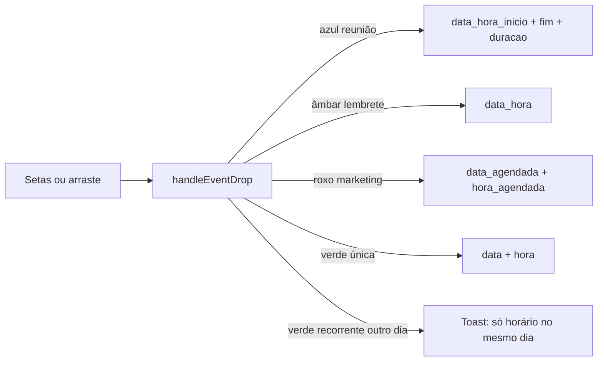

# PRD — Cards da Agenda (prévia, adiar, próximo dia)

**Produto:** CRM Selletos  
**Versão:** 1.0  
**Data:** 01/09/2026  
**Status:** Retrato completo dos cards da Agenda Geral em produção  
**Onde vive:** painel flutuante (ícone de calendário) **e** página `/agenda` aba Geral  
**O que você marcou:** o **balão de vidro** sobre um chip no painel da direita (`FloatingAgendaGeralPopup` + `AgendaEventHoverPreview` compacto)  
**Ficha da página:** [09-agenda.md](09-agenda.md) · **Módulo completo:** `docs/prd/2026-08-01-agenda-e-notificacoes-prd.md`

Este capítulo explica **os cards**: o que cada cor significa, o balão ao passar o mouse, o bloco **Adiar tarefa** (setas de dia e de 15 minutos) e o que o banco grava quando você confirma.

---

## 1. O que é (linguagem simples)

A Agenda Geral é um **quadro de horários** com quatro tipos de compromisso misturados. Cada um vira um **chip colorido** no dia. Ao passar o mouse (ou tocar), abre um **balão** com o nome, o horário e as setas para **adiar**.

O exemplo que você marcou:

`09:15 · Divina silva · Lembrete`

É um **lembrete de lead**: às 09:15, sobre a cliente Divina Silva. As setas `01/09` e `09:15` **não mudam o calendário inteiro** — elas preparam um **novo horário só daquele card**. Só grava quando você aperta **Adiar**.

Há **dois “próximo dia”** diferentes. Não misture:

| Onde | O que faz |
|------|-----------|
| Setas **no topo do calendário** (Dia / Semana / Mês) | Você **olha** outro dia. Os compromissos ficam onde estavam. |
| Setas **no balão**, linha `01/09` | Você **move aquele card** um dia para frente ou para trás. |
| Arrastar o chip na grade | Outro jeito de mudar o horário (encaixa em blocos de 15 min). |

---

## 2. Onde os cards aparecem

```
Ícone calendário (canto da tela)
└── Painel fixo top-14 → fundo da tela
    (vidro bg-background/95, blur, sombra, canto arredondado)
    └── AgendaGeralContent compact
        └── FullCalendar (dia / semana / mês)
            └── chip colorido
                └── hover/toque → balão z-[205]
                    ├── título + “09:15 · Divina silva · Lembrete”
                    ├── Adiar tarefa (StepperRow dia + hora)
                    ├── botão Adiar
                    └── Concluir / Excluir
```

O **mesmo** calendário e os **mesmos** cards existem em `/agenda` (aba Geral), só que maior (`compact={false}`). O balão fica mais largo (~16 rem) e o texto do dia no stepper vira `ter 01/09` em vez de `01/09`.

O painel da direita (ou esquerda) é `FloatingAgendaGeralPopup`: `z-[200]`, `rounded-l-xl` se estiver à direita. Você arrasta a barrinha do topo para trocar de lado.

---

## 3. Quatro cores = quatro origens

Um único tipo na tela (`AgendaEvent`). Quatro gavetas no banco:

| Cor do chip | `type` | Nome no balão | O que é | Onde grava o horário |
|-------------|--------|---------------|---------|---------------------|
| Azul | `tarefa` | Reunião | Atendimento / reunião | `agenda_reunioes.data_hora_inicio` + `_fim` |
| Âmbar | `lembrete` | Lembrete | Follow-up no card do lead | `lead_lembretes.data_hora` (duração fictícia 1 h) |
| Verde | `pessoal` | Pessoal | Tarefa da agenda pessoal | `data` + `hora` (recorrente: **só hora**) |
| Roxo | `conteudo` | Marketing | Tarefa de conteúdo | `data_agendada` + `hora_agendada` |

Título do lembrete no calendário: `[Lead: Divina silva] …`. No balão compacto a linha de meta usa o **nome do lead** no meio: horário · nome · tipo.

Status `concluido`: chip riscado, mais transparente. **Não dá para adiar** item concluído ou cancelado.

---

## 4. Anatomia do chip (o card na grade)

### 4.1 Vista **Dia** (a mais usada no painel)

Bloco absoluto na faixa da hora. Borda esquerda colorida. Compacto: `text-[10px]`, `p-0.5`, altura mínima ~24 px (escala com o zoom 80–140%).

Texto: `09:15 · [título]`. Se couber, uma linha de descrição.

**Toque** abre o balão. **Segurar e arrastar** (mais de 5 px) muda o horário na grade e **não** abre o balão (`disabled` enquanto arrasta).

Itens **sem horário** (pessoal sem `hora`) ficam na faixa **Sem horário** no topo do dia.

### 4.2 Vista **Semana**

Mesma lógica, chips mais baixos. Dá para arrastar **entre colunas** (outro dia da semana) — isso também é “passar para o próximo dia”, só que pelo mouse.

### 4.3 Vista **Mês**

Célula do dia: até 2 chips no painel (3 na página). Resto: `+N`. Clique no **número do dia** entra na vista Dia. No mês **não** se arrasta o chip; adiar é pelo balão.

---

## 5. O balão (HoverCard)

`AgendaEventHoverPreview` — Radix HoverCard.

| | Página `/agenda` | Painel flutuante (`compact`) |
|--|-------------------|------------------------------|
| Delay abrir | 280 ms | 180 ms |
| Delay fechar | 400 ms | 320 ms |
| Lado | esquerda | cima (cabe no painel) |
| Portal | body | **dentro** do painel (`data-floating-agenda-root`) |
| Visual | popover 16 rem | vidro `bg-background/30`, blur, `w` máx. 11,5 rem, `max-h` 20 rem |
| z-index | 50 | **205** (acima do painel 200) |

Primeiro toque no chip **prende** o balão (`pinned`). Toque fora fecha. Toque no **título** do balão abre o diálogo de edição. Toque nas setas **não** abre edição (`data-agenda-postpone`).

Cabeçalho do balão:

1. Bolinha da cor do tipo  
2. Título em negrito (riscado se concluído)  
3. Meta `HH:mm · subtítulo · tipo` — o trecho que você marcou

Depois: bloco Adiar · descrição (se houver) · “Toque para editar” · Concluir / Excluir.

---

## 6. Adiar: as setas de dia e de hora

Componente: `AgendaEventPostponeControls`. Título **Adiar tarefa**.

Isto **não** é um chat. É um rascunho local (`draftStart`). O banco só muda no botão **Adiar**.

### 6.1 Passar para o próximo dia (`StepperRow` de cima)

Seta esquerda = dia anterior (`subDays`).  
Seta direita = **próximo dia** (`addDays`).  
Meio: `01/09` (compacto) ou `ter 01/09` (página).  
`aria-label`: `Dia 01/09/2026`.

Se o rascunho **não** for o mesmo dia do original, aparece a linha extra: `terça-feira, 02/09`.

**Tarefa pessoal recorrente:** as setas de **dia ficam desligadas**. Só o horário no mesmo dia. Motivo: a série vive em regras (toda segunda…); mudar um dia no stepper quebraria a recorrência. Tooltip: “Tarefas recorrentes só podem mudar o horário no mesmo dia”.

### 6.2 Adiar 15 minutos (`StepperRow` de baixo)

Passo fixo **15 minutos** (`TIME_STEP_MINUTES`).  
`09:15` → seta direita → `09:30`.  
`aria-label`: `Horário 09:15`.

A **duração** do compromisso se mantém: reunião das 09:15–10:15 adiada para terça 14:00 vira 14:00–15:00 (`buildPostponedAgendaRange`). Lembrete não tem fim real; o sistema trata como 1 hora só para desenhar o bloco.

### 6.3 Botão Adiar

Desligado até o rascunho **diferir** do horário atual. Enquanto grava: **Adiando…** + spinner.

Ao confirmar, chama o mesmo `handleEventDrop` do arraste.

---

## 7. O que acontece no banco (por tipo)

`useAgendaGeral.handleEventDrop`:



Se o **dia mudou**, o calendário **pula para esse dia** (`setSelectedDate` + `calendarFocusDate`) e o toast diz: `Tarefa adiada para 02/09 às 09:15`.  
Se só o horário mudou: `Horário atualizado para 09:30`.

---

## 8. Arrastar na grade (o outro “adiar”)

`useAgendaTimedEventDrag` + snap de 15 min (`SNAP_MINUTES`).

1. Pointer down no chip.  
2. Move ≥ 5 px → arraste ativo, preview segue o ponteiro, linha dourada com o horário novo.  
3. Solta → mesmo `onEventDrop`.

Na **semana**, o dia-alvo é a coluna embaixo do ponteiro. Isso **é** passar o card para outro dia, sem usar o stepper.

O balão não abre durante o arraste.

---

## 9. Navegar o calendário (não é adiar o card)

Topo do `FullCalendar`: setas + **Hoje** + abas Dia / Semana / Mês.

| Vista | Seta direita |
|-------|----------------|
| Dia | `addDays` no dia visível |
| Semana | próxima semana |
| Mês | próximo mês |

O chip do lembrete da Divina **continua em 01/09**. Você só virou a página da agenda.

Clique numa faixa vazia (painel compacto): abre criar tarefa **naquele horário**.

---

## 10. Layout e efeitos do painel

| Peça | Visual |
|------|--------|
| Painel | `bg-background/95 backdrop-blur-md shadow-2xl`, entra com zoom + slide da direita |
| Chip | Fundo pastel da cor, borda, hover `brightness-95` |
| Chip arrastando | ring primary, `scale-[1.02]`, fantasma tracejado no lugar antigo |
| Balão compacto | vidro, blur `backdrop-saturate-150`, números `tabular-nums` 10 px |
| Setas | botões outline 24×24 (compacto) |
| Linha do agora | marcador na vista dia/semana |

Zoom do painel (80–140%) **escala a grade**, não o CSS `zoom` (evita cortar chip).

---

## 11. Concluir e excluir no balão

| Botão | Reunião | Lembrete | Pessoal | Marketing |
|-------|---------|----------|---------|-----------|
| Concluir | `status: concluido` | `completeLembrete` | ocorrência daquele dia | `completeTask` |
| Excluir | apaga reunião | apaga lembrete | única: apaga; recorrente: só aquela ocorrência | apaga tarefa |

Isso **não** adianta o dia: tira da lista de pendentes. O badge vermelho do ícone (`pendingTodayCount`) cai se era de hoje.

---

## 12. Regras para reconstruir

1. **Dois próximos dias.** Calendário = olhar. Stepper do card = mover o compromisso.  
2. Rascunho no stepper; gravar **só** em Adiar (ou no soltar do arraste).  
3. Passo de tempo **15 minutos** em setas, snap e clique na grade.  
4. Manter a **duração** da reunião. Lembrete: só `data_hora`.  
5. Recorrência pessoal: **proibir** mudar o dia no stepper e no drop.  
6. Concluído/cancelado: sem Adiar.  
7. Depois de mudar o **dia**, o calendário deve **ir atrás** do card.  
8. No painel, o HoverCard **nasce dentro** do painel (senão o balão some atrás ou foge da tela).  
9. Toque no chip ≠ edição. Edição = segundo toque no balão.  
10. Quatro cores estáveis: azul / âmbar / verde / roxo.  
11. Não use o foil WebGL da Biblioteca aqui. Cards da agenda são **chips de calendário**.

---

## 13. Mapa de arquivos

| Peça | Arquivo |
|------|---------|
| Painel da direita | `FloatingAgendaGeralPopup.tsx`, `FloatingAgendaGeralShell.tsx` |
| Calendário + chips | `FullCalendar.tsx` |
| Balão | `AgendaEventHoverPreview.tsx` |
| Setas dia/hora | `AgendaEventPostponeControls.tsx` |
| Unificar fontes + gravar adiar | `useAgendaGeral.ts` (`handleEventDrop`) |
| Arraste | `useAgendaTimedEventDrag.ts`, `agenda-calendar-drag.ts` |
| Conteúdo | `AgendaGeralContent.tsx` |
