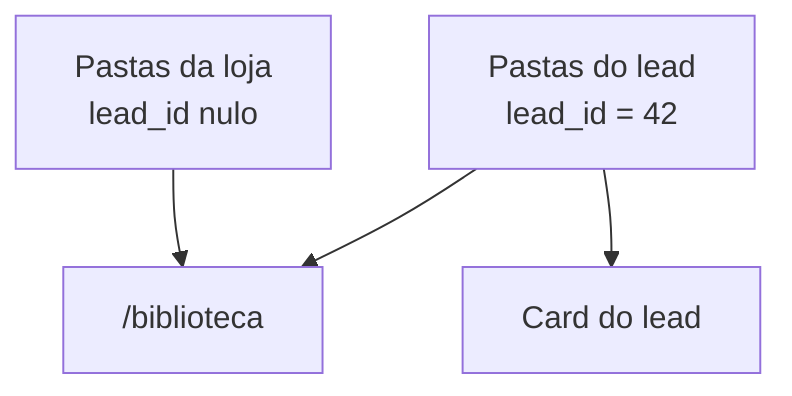

# PRD — Biblioteca: pastas, acervo e layout

**Produto:** CRM Selletos  
**Versão:** 1.0  
**Data:** 31/08/2026  
**Status:** Retrato completo da página `/biblioteca` em produção  
**Rota:** `/biblioteca`  
**Página:** `src/pages/Biblioteca.tsx` → `BibliotecaPageContent.tsx`  
**Ficha curta:** [18-publicas.md](18-publicas.md) · **Menu:** [00b-menu-sidebar.md](00b-menu-sidebar.md)  
**Pastas no card do lead (o outro lado do mesmo armário):** [06c-pastas-lead-completo.md](06c-pastas-lead-completo.md)  
**Domínio:** [biblioteca-cadastros.md](../04-dominios/biblioteca-cadastros.md)

Este capítulo descreve **todo o sistema de pastas da Biblioteca**: o que é o acervo, as duas famílias de gavetas, o alfinete, o upload, os arquivos “fora de pasta” e cada efeito visual.

---

## 1. O que é (linguagem simples)

Pense na Biblioteca como o **armário da loja inteira**.

No card do cliente você vê só as gavetas **daquela pessoa** (Sala, Cozinha). Aqui você vê:

1. as gavetas **da loja** (campanhas, composição de orçamento, orçamentos…);
2. **todas** as gavetas de **todos** os clientes, agrupadas pelo nome;
3. fotos da **lousa** e anexos que ainda não têm gaveta.

É o mesmo armário no banco (`marketing_medias` + bucket `marketing-medias`). O card é a gaveta de um cliente. A Biblioteca é o corredor com todas as portas.

| Na tela | Analogia |
|---------|----------|
| **Pastas** (primeira grade) | Gavetas da loja — `lead_id` vazio |
| **Pastas de leads** | Gavetas dos clientes — as **mesmas** do card |
| **Arquivos fora de pasta** | Mesa da entrada: sem `folder_id` |
| **Alfinete / Prioridade** | “Deixa essa pasta na prateleira de cima” |
| **composição de orçamento** | Gaveta automática dos slides de orçamento |

Apagar uma pasta **não apaga arquivos**. Eles voltam para a mesa (sem pasta).

**Não misturar com:**

| Isto | Onde | O que é |
|------|------|---------|
| Pastas do **card** | LeadModal | Vista de **um** cliente ([06c](06c-pastas-lead-completo.md)) |
| Pastas de **Eventos** | `/controle-eventos` | Cada pasta **é** um evento |
| Aba de mídias do **Marketing** | Conteúdo | Outra tela; campanhas, não o acervo geral |
| Lousa de **ambiente** (IA) | Análise IA | Estúdio 2D, não o arquivo |

---

## 2. Onde clicar (mapa da página)

Menu: **Biblioteca** → `/biblioteca`.

```
/biblioteca
├── Cabeçalho “Acervo digital”
│   └── Contadores: Todas · Imagens · Vídeos · Arquivos
├── Lateral (chips no celular)
│   └── Filtro por tipo
└── Corpo
    ├── [se entrou numa pasta] barra Voltar / nome
    ├── Zona de upload
    ├── Busca (nome ou número do lead)
    ├── [só na raiz]
    │   ├── Pastas da loja (+ Nova pasta, alfinete)
    │   └── Pastas de leads (por cliente)
    └── Arquivos da vista (mesa ou dentro da gaveta)
```

---

## 3. Quem entra e quem mexe

Quase todo colaborador autenticado vê o item (não está escondido de marketing nem de projetista). Prestador não: usa o portal.

| Ação | Admin / vendedor / projetista / superadmin | Marketing só conteúdo |
|------|:------------------------------------------:|:---------------------:|
| Ver pastas e arquivos | Sim | Sim |
| Alfinete, apagar, selecionar, PDF | Sim (`canManage`) | Não |
| **Nova pasta** e zona de upload | Botões **aparecem** para todos que abrem a página | Visíveis; o banco/RLS pode recusar |

No rebuild: esconda upload e **Nova pasta** se `!canManage`, para bater com o aviso do escudo.

---

## 4. Layout (do topo ao rodapé)

### 4.1 Cabeçalho

Kicker `ACERVO DIGITAL` (tracking `0.28em`, âmbar). Título **Biblioteca** display 4xl/5xl creme. Texto explicando que inclui pastas de cada lead, lousa e anexos.

Fundo: radial âmbar 18% à esquerda + laranja 12% à direita.

Quatro cartõezinhos: ícone + número display 2xl + rótulo. Vidro `bg-white/[0.04]`.

Os números são do **acervo inteiro**, não só da pasta aberta.

### 4.2 Filtro

Lateral `lg:w-56`. Celular: faixa com scroll.

Ativo: `border-amber-500/40 bg-amber-500/12` + glow. Badge com a conta.

Categorias (`BIBLIOTECA_CATEGORIAS`):

| Id | Rótulo | O que entra |
|----|--------|-------------|
| `todas` | Todas | Tudo |
| `imagens` | Imagens | `tipo === imagem` |
| `videos` | Vídeos | vídeos |
| `arquivos` | Arquivos | PDF e áudio |

### 4.3 Duas visões

`currentFolderId`:

| Vista | O que você vê |
|------|----------------|
| **Raiz** (`null`) | As duas seções de pastas + arquivos com `folder_id` **nulo** |
| **Dentro** (uuid) | Barra **Voltar / nome** + upload nessa gaveta + só os arquivos dela |

Não existe o cartão tracejado **Sem pasta** do card. Aqui a mesa **é** a grade “Arquivos fora de pasta”.

Barra interna: `rounded-xl`, borda âmbar, `ArrowLeft` + `FolderOpen` + nome truncate.

---

## 5. Família 1 — Pastas da loja

`BibliotecaFoldersBar` — só pastas com `lead_id == null`.

Título **Pastas**. “Organize seus arquivos… Use o alfinete…”. Botão **Nova pasta**.

### 5.1 Criar / editar

Diálogo `#1a1410`:

- Nome — `Ex: Campanhas 2026`
- Descrição (opcional)

Insert com `lead_id: null`.

Ao listar, o hook **cria se faltar** a pasta **composição de orçamento** (wizard de slides). A pasta **orçamentos** dos renders da IA também costuma ser da loja — entra nesta grade, não em “Pastas de leads”.

### 5.2 Cartão

Diferente do card do lead: **ícone** Folder 56×56 (não polaroid). Hover: FolderOpen.

- `rounded-2xl`, gradiente âmbar → laranja
- Hover: sobe 4 px
- Entrada fade + slide, 40 ms por item (máx. 320 ms)
- Fixada: borda mais forte, glow, filete ouro no topo, texto `NO TOPO`
- Arrastando: `scale-[1.02]` + ring

Grade: 2 / 3 / 4 / 5 colunas.

| Controle | Faz |
|----------|------|
| Alfinete | `fixado` + próxima `ordem_topo` |
| Pontinhos (só no topo) | Arrastar ordem (`dnd-kit`, 8 px para pegar) |
| ⋮ | Fixar / Renomear / Excluir |

Excluir: confirmação — arquivos ficam sem pasta, não somem.

Vazio: tracejado + “Nenhuma pasta ainda” + link criar.

### 5.3 Zona Prioridade (pastas)

Se houver alfinete: bloco `from-amber-500/[0.08]`, kicker `PRIORIDADE`, **um** `BibliotecaPinAura` (WebGL). Só as fixadas são arrastáveis. O resto fica na grade de baixo.

---

## 6. Família 2 — Pastas de leads

`BibliotecaLeadFoldersSection` — `lead_id` preenchido. Agrupa por cliente (`useLeadNamesByIds`), ordena pt-BR.

Título **Pastas de leads**. Cada grupo:

```
MARIA SILVA          ← kicker uppercase tracking 0.18em
[ Cozinha ] [ Sala ] [ chat ]
```

Cartão **com polaroids** (até 3 capas giradas), como no card. Nome visível = só a gaveta; `title` = `Maria · Cozinha`.

Play: entra na pasta e abre o detalhe da primeira foto.

**Sem** alfinete, lápis ou excluir. Para mudar o nome da Cozinha, use o **card da Maria**.

---

## 7. Upload

`BibliotecaUploadZone` — tracejado ouro, sempre na página.

| Onde você está | Para onde vai o arquivo |
|---------------|-------------------------|
| Raiz | `folder_id` nulo, **sem** `lead_id` → mesa da loja |
| Dentro da gaveta | `folder_id` da gaveta |

**Comportamento atual:** o insert **não copia** o `lead_id` da pasta. Enviar um PNG **dentro** da Cozinha da Maria mostra o arquivo na Biblioteca, mas o **card** (que filtra `lead_id = 42`) pode **não** listá-lo. No rebuild: se a pasta tiver `lead_id`, grave o mesmo no arquivo.

Aceita: foto, vídeo, áudio, PDF. Máx. **200 MB**. PDF: um de cada vez, páginas viram imagens (`Título — página 2`).

Caminho no Storage: `{timestamp}-{rand}.ext` (sem prefixo `emp_garbo/` do upload do card).

---

## 8. Arquivos da vista

Título `Arquivos em "…"` ou `Arquivos fora de pasta`.

Na raiz, a mesa junta:

- arquivos da loja sem gaveta;
- anexos de lead órfãos;
- fotos da **lousa operacional** (`wb:…`, origem `Lead · Lousa`, `folder_id` sempre nulo neste mapa).

Busca: título, nome do arquivo, número do lead.

### 8.1 Cartão

Aspecto 4/3. Foto: zoom 1.05 / 500 ms. Vídeo: Play no centro. Chip sky se veio do lead.

Checkbox, alfinete, lixeira. Hover: véu + olho ouro.

### 8.2 Prioridade dos arquivos

Mesmo bloco Prioridade + aura. Resto por data (mais novo primeiro).

### 8.3 Lote

Barra sticky mogno: Baixar · Exportar PDF (só imagens, timbrado, nome `Biblioteca · {pasta}`) · Limpar.

iPhone: **Salvar no iPhone**. Vídeo pode virar MP4.

### 8.4 Detalhe

Setas na lista filtrada. Apagar anexo de lead: texto extra “também será removido do card”.

---

## 9. As duas telas se falam assim



| Ação | Biblioteca | Card |
|------|-----------|------|
| Criar “Sala” no card | Grupo do cliente | Gaveta nova |
| Criar “Campanhas 2026” aqui | Grade Pastas | Não aparece |
| Disquete da lousa → Cozinha | Polaroid na Cozinha | Mesmo arquivo |
| Apagar pasta da loja | Arquivos na mesa | Sem efeito no card (não era gaveta dele) |

---

## 10. Dados

| Tabela / fonte | Papel |
|----------------|--------|
| `marketing_media_folders` | Gaveta: nome, descrição, `lead_id`, `fixado`, `ordem_topo` |
| `marketing_medias` | Arquivo + pasta + lead |
| `lead_whiteboard_images` | Segunda lista (lousa ainda aberta) |

Ids na UI: `mm:{uuid}` (mídia) e `wb:{uuid}` (lousa) — o banco não tem esse prefixo.

Alfinete: `fixado` + `ordem_topo` (1, 2, 3…).

WebGL: **um** canvas por zona Prioridade (`low-power`, `pixelRatio 1`). Cores `#f2d892` e `#f59e0b`. `prefers-reduced-motion` = frame parado.

---

## 11. Catálogo visual

| Peça | O olho vê |
|------|----------|
| Cabeçalho | Radiais quentes |
| Filtro ativo | Glow âmbar |
| Pasta da loja | Ícone, hover sobe |
| Pasta de lead | Polaroids |
| Prioridade | Anel WebGL pulsando |
| Alfinete ligado | Pin preenchido + sombra |
| Upload | Tracejado; drag escala 1.01 |
| Vazio | Archive + texto “Nenhum arquivo aqui” |

---

## 12. Celular

Chips de categoria. Grade 2 colunas. Arraste com 8 px de folga. iOS: share sheet, não “download silencioso”.

---

## 13. Regras para reconstruir

1. **Duas famílias.** `lead_id` nulo = loja. Preenchido = cliente. Duas seções, nunca uma lista misturada.
2. **Nova pasta nesta página** nasce da loja.
3. **Não** renomeie/apague gaveta de lead aqui — isso é do card.
4. Apagar pasta só tira o rótulo.
5. Um WebGL por bloco Prioridade, nunca por cartão.
6. Ao carregar pastas, garante **composição de orçamento**.
7. Upload dentro de pasta de lead deve herdar `lead_id` (hoje falta — corrija).
8. Lousa operacional aparece na mesa até o disquete guardar no card.
9. Esconda upload e Nova pasta se a pessoa não puder gerenciar.
10. Não copie o fluxo “escreva o nome da pasta e depois envie” do card. Aqui a gaveta já existe ou o arquivo cai na mesa.
11. Não use o cartão **Sem pasta** do card: a mesa é a grade de arquivos.
12. Não copie pastas de Eventos (lá a pasta é o evento).

---

## 14. Mapa de arquivos

| Peça | Arquivo |
|------|---------|
| Página | `src/pages/Biblioteca.tsx` |
| Orquestrador | `BibliotecaPageContent.tsx` |
| Pastas da loja | `BibliotecaFoldersBar.tsx`, `BibliotecaFolderCard.tsx` |
| Pastas de leads | `BibliotecaLeadFoldersSection.tsx` |
| Grade de arquivos | `BibliotecaMediaGrid.tsx`, `BibliotecaMediaCard.tsx` |
| Upload | `BibliotecaUploadZone.tsx` |
| Detalhe | `BibliotecaDetailDialog.tsx` |
| Alfinete / aura | `BibliotecaPinButton.tsx`, `BibliotecaPinAura.tsx` |
| Hooks | `useMarketingMediaFolders.ts`, `useBibliotecaMedias.ts` |
| Helpers | `biblioteca-utils.ts`, `biblioteca-priority.ts`, `biblioteca-composicao-orcamento.ts` |
| Slides (lê a pasta especial) | `useBibliotecaComposicaoOrcamentoMidias.ts` |
