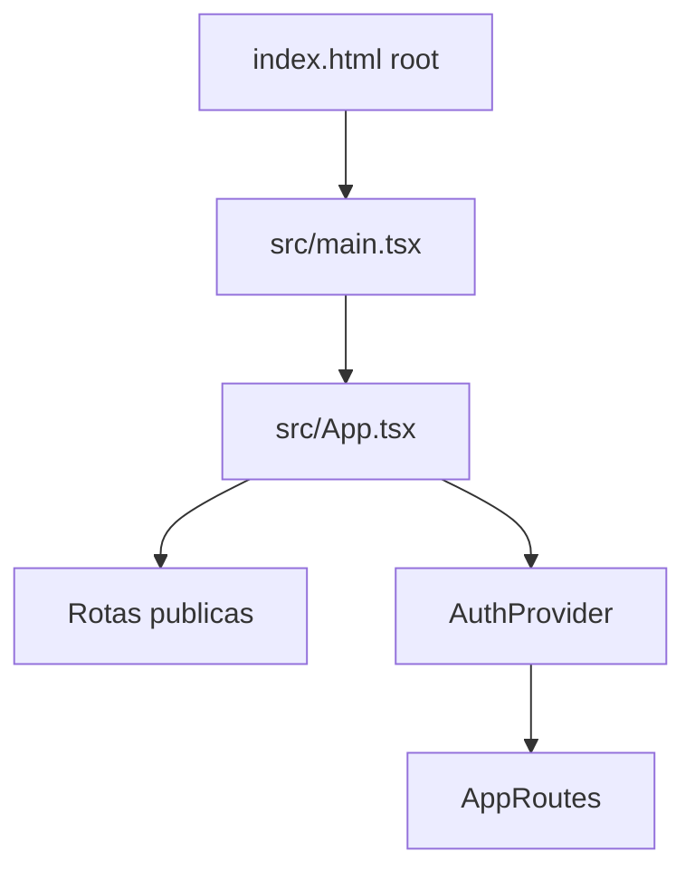
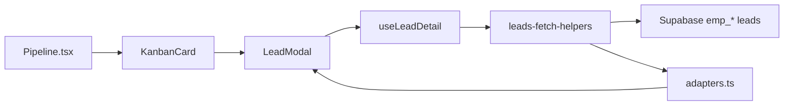

# 07 — Mapa completo do código (CRM Selletos)

**Produto:** CRM Selletos (web Vite/React)  
**Data:** 27/08/2026  
**Público:** quem for ler, copiar ou reconstruir o **código**  
**Irmãos:** visual em [01-design-system.md](01-design-system.md) · telas em [03-telas/](03-telas/) · regras em [04-dominios/](04-dominios/)

Este arquivo não descreve “o que o usuário vê” (isso já está nas fichas). Aqui está **onde mora cada peça no repositório**, o padrão de pastas, e como um clique vira query no Supabase.

Números aproximados no `src/` no momento desta foto:

| Pasta | Arquivos |
|-------|----------|
| `src/lib` | ~204 `.ts` |
| `src/hooks` | ~149 hooks |
| `src/components/leads` | ~75 |
| `src/components/ui` | 52 (Shadcn) |
| `src/components/layout` | 35 |
| `src/components/agenda` | 33 |
| `src/components/orcamento-slides` | 33 |
| `src/components/marketing-conteudo` | 33 |
| `src/pages` | ~40 páginas |

Alias: `@/` = `src/` (`vite.config.ts`).

---

## 1. Como o código está organizado (ideia simples)

Três camadas, sempre nesta ordem:

```
Página (src/pages)  →  Componentes (src/components/<domínio>)
                    →  Hooks (src/hooks/useX.ts)  →  banco / Edge Function
                    →  Lib pura (src/lib/*.ts)     →  cálculo, nomes de tabela, adapters
```

- **Página:** monta a tela e liga eventos.
- **Componente:** desenha um pedaço (card, dialog, aba).
- **Hook:** busca/grava dados com TanStack Query.
- **Lib:** funções sem React (não use `useState` aqui).

Quase toda query de negócio passa por `useEmpresaSupabase()` + um `resolve*QueryConfig` em `src/lib/empresa-tables.ts`. Se você pular isso, lê a empresa errada.

Há **dois formatos de tipo** para o mesmo lead:

| Camada | Exemplo | Onde |
|--------|---------|------|
| Banco (snake_case) | `nome`, `vendedor_responsavel_id`, `valor_negocio` | `DatabaseLead` em `useLeads.ts` |
| UI (camelCase) | `name`, `vendorId`, `dealValue` | `Lead` em `src/types/index.ts` |

A ponte é `adaptLeadFromDatabase` em `src/lib/adapters.ts` (datas no fuso `America/Sao_Paulo`).

`AppContext` ainda tem `mockLeads` de `src/data/mockData.ts` — legado. A lista real vem de `useLeads`. Não copie o mock para um sistema novo.

---

## 2. Boot: do HTML até a primeira tela



### 2.1 `index.html`

Carrega Google Fonts, `theme-color #2a1812`, script PWA standalone (`data-pwa-standalone`), `#root`.

### 2.2 `src/main.tsx`

1. `installPdfJsPolyfills()` (`src/lib/map-polyfills.ts`) — PDF.js no browser.
2. `setupPwaDisplay()` / `setupPwaServiceWorker()` — só em **produção**. Em DEV desregistra service workers (evita tela branca no celular).
3. `createRoot` → `AppErrorBoundary` → `App`.
4. Importa `src/index.css` (Bourbon Daylight).

### 2.3 `src/App.tsx` (o cérebro)

Não existe arquivo `router.tsx`. **Tudo** está aqui:

- `QueryClient` + persistência `localStorage` chave `crm-selletos-rq-cache-v2`, buster `empresa-queries-ready-v3`.
- Só persiste: `kanban-config-pages`, `lead-origins`, `regioes`, `pipeline-custom-stages`.
- Páginas pesadas: `React.lazy`.
- Rotas públicas **fora** do `AuthProvider` (agendar, cadastros, orçamento público, Garbo).
- `AppRoutes()` aplica os gates (login → perfil → empresa → prestador → pending → horário → recortes de papel → MainLayout).

Lista de rotas: [02-arquitetura.md](02-arquitetura.md) e [06-checklist-rebuild.md](06-checklist-rebuild.md).

### 2.4 Vite

`vite.config.ts`: host `::`, **porta 8081**, `strictPort`, alias `@`, PWA plugin (SW desligado em dev), chunks `vendor-supabase` / `vendor-query` / `vendor-react` / `vendor-charts` / `vendor-pdf`. Watch ignora `tmp/` e `mobile/`.

`pnpm dev` roda `predev` (`scripts/kill-port-3000.cjs` — o script atual mata a porta **3043**, nome legado).

---

## 3. Árvore da raiz (o que não é `src/`)

| Pasta / arquivo | Função |
|-----------------|--------|
| `src/` | App web |
| `mobile/` | Expo — segundo cliente (ver [05-mobile.md](05-mobile.md)) |
| `supabase/functions/` | 30 Edge Functions + `_shared/` |
| `supabase/migrations/` | SQL (histórico; schema vivo no remoto) |
| `public/` | favicon, PWA, imagens estáticas |
| `docs/prd/` | esta suíte e PRDs de módulo |
| `scripts/` | utilitários Node (porta, testes) |
| `package.json` | `pnpm@10.32.0`, scripts `dev` / `mobile` / `build` |
| `tailwind.config.ts` | tokens mahogany/gold/cream |
| `components.json` | config Shadcn |
| `tsconfig.json` | paths `@/*` |

Cliente gerado (não editar à mão): `src/integrations/supabase/client.ts` + `types.ts`. Projeto: `zzqgtclvuetemzhqzhbq`. Chave **anon** no client; `service_role` só nas functions.

---

## 4. Contextos (`src/contexts/`)

Ordem no `App.tsx` (rota autenticada):

`AuthProvider` → `PageZoomProvider` → `EmpresaProvider` → `LeadAIAnalysisBackgroundProvider` → `LeadAIRenderBackgroundProvider` → `AppProvider`

| Arquivo | Expõe | Para que serve |
|---------|--------|----------------|
| `AuthContext.tsx` | `user`, `userRole`, `userRoles`, `hasRole`, `isSuperAdmin`, `accessHours`, `tipoUsuario`, `signIn` / `signOut` / Google / senha | Sessão + papéis via `resolveAuthRole` |
| `EmpresaContext.tsx` | `empresa`, `schemaEmpresa`, `queriesReady`, `trocarEmpresa`, `isModoGlobal` | Tenant; storage `crm-empresa-ativa` |
| `AppContext.tsx` | `currentUser` (UI) | Avatar/nome no menu (`resolveAppUser`) |
| `PageZoomContext.tsx` | zoom do quadro kanban | Pipeline / Projetos |
| `LeadAIAnalysisBackgroundContext.tsx` | job de análise em fundo | Popup no MainLayout |
| `LeadAIRenderBackgroundContext.tsx` | job de render em fundo | Idem |
| `FloatingOverlayContext.tsx` | z-index de overlays | Evitar um popup cobrir o outro |
| `PipelineIndicatorsPreferencesContext.tsx` | o que aparece no card | Preferência de indicadores |
| `PipelineDashboardLabelsContext.tsx` | rótulos das métricas | PipelineMetrics |

Hook: `useAuth()`, `useEmpresa()`, `useApp()`. Sem provider = throw.

---

## 5. O padrão multi-empresa no código

Arquivo-âncora: `src/lib/empresa-tables.ts`.

```ts
// Schema emp_*  →  supabase.schema('emp_garbo').from('leads')
// Senão         →  supabase.from('CRM-multi-empresas>leads<')
```

Funções que você vai reencontrar o tempo todo:

| Função | Uso |
|--------|-----|
| `isEmpresaSchema` | regex `^emp_[a-z0-9_]+$` |
| `isSchemaApiExposed` | emp_* **ou** `public` / `graphql_public` / `emp_garbo` |
| `resolveLeadsQueryConfig` | tabela leads + embed vendedor |
| `buildLeadsSelect` | `*` ou `*, vendedor:usuarios!vendedor_responsavel_id(...)` |
| `resolveLeadLembretesQueryConfig` | lembretes |
| `resolveLeadSinalizacoesQueryConfig` | sinalizações |
| `resolveMarketingMediasConfig` | biblioteca / anexos |
| `resolveChatContatosQueryConfig` | WhatsApp |
| `MASTER_TABLES` | mapa master `CRM-multi-empresas>…<` |
| `PUBLIC_WHITEBOARD` / `PUBLIC_EVENTOS` / `PUBLIC_LEAD_AI` | nomes híbridos public |

Hooks:

- `useEmpresaSupabase()` — cliente já no schema certo.
- `useTableName()` — `(nomeLimpo, nomeMaster) => string`.

Ao **trocar empresa:** `invalidateEmpresaScopedQueries` (`src/lib/invalidate-empresa-queries.ts`) invalida `leads`, `kanban-config-pages`, `users`, `agenda`, etc.

Cache de leads: `src/lib/leads-cache.ts`

```
['leads', userId, schema]
['lead-detail', leadId, schema]
['lead-single-enriched', leadId, schema]
```

`patchLeadInAllCaches` atualiza lista + detalhe sem refetch. `markLeadUpdatedBySelf` (`lead-update-guard.ts`) impede o Realtime de sobrescrever o que você acabou de salvar.

---

## 6. Auth no código (não na tela)

| Arquivo | Papel |
|---------|--------|
| `src/lib/resolve-auth-role.ts` | Lê `usuarios` + `user_roles`; devolve `role`, `roles[]`, horário, `tipoUsuario`, super-admin |
| `src/lib/app-roles.ts` | `isMarketingOnly`, `isProjetistaOnly`, `canAccessMarkupCusto`, `canAccessOrcamentoComposicao`, `canAccessProjetosBoard`, labels |
| `src/hooks/usePermissions.ts` | `user_permissions` resource/action; defaults em `vendedor-permission-defaults.ts` |
| `src/lib/app-navigation.ts` | `NAV_MAIN_ITEMS` — **mesma lista** da sidebar e do menu radial |
| `src/lib/titular-access.ts` | se o usuário é “dono” do lead |
| `src/lib/lead-sinalizar-access.ts` | quem pode sinalizar |
| `src/lib/pontua-garbo-access.ts` | ver/gerir financeiro Pontua |
| `src/lib/prestador-visibilidade.ts` | anexos no portal |

Papéis no **banco** são minúsculos (`admin`). Em `src/types/index.ts` o `User.role` da UI antiga é MAIÚSCULO (`ADMIN`) — `resolveAppUser` traduz. Não misture os dois enums.

---

## 7. Páginas (`src/pages/`) — arquivo = rota

Cada arquivo abaixo é o **entry** da rota (lazy no `App.tsx`, salvo Auth/Pending/públicas).

### 7.1 Portas e estados

| Arquivo | Rota efetiva |
|---------|----------------|
| `Auth.tsx` | qualquer path autenticado sem `user` |
| `PendingAccess.tsx` | papel `nenhum` |
| `OutOfAccessHours.tsx` | fora do horário |
| `Prestador.tsx` | `tipo_usuario === prestador_servico` (catch-all) |
| `NotFound.tsx` | `*` no app completo |

### 7.2 Comercial

| Arquivo | Rota |
|---------|------|
| `Pipeline.tsx` | `/pipeline` |
| `PipelineKanbanPage.tsx` | `/pipeline/:kanbanSlug` |
| `PipelineSettings.tsx` | `/pipeline/configuracoes` |
| `Leads.tsx` | `/leads` |

### 7.3 Operação

| Arquivo | Rota |
|---------|------|
| `Projetos.tsx` | `/projetos` |
| `Agenda.tsx` | `/agenda` |
| `Biblioteca.tsx` | `/biblioteca` |
| `Profile.tsx` | `/profile` |

### 7.4 Orçamento / custo

| Arquivo | Rota |
|---------|------|
| `markup/MarkupListPage.tsx` | `/markup` |
| `markup/MarkupConfigPage.tsx` | `/markup/configuracoes` |
| `orcamento-slides/OrcamentoSlidesPage.tsx` | `/orcamento-slides` |
| `orcamento-slides/NovoOrcamentoSlidePage.tsx` | `/novo` e `/:id/editar` |
| `orcamento-slides/ApresentarOrcamentoSlidePage.tsx` | `/:id/apresentar` |
| `orcamento-slides/OrcamentoSlidesConfigPage.tsx` | `/configuracoes` |
| `orcamento-slides/OrcamentoPublicoPage.tsx` | `/orcamento/:schema/:id` |
| `orcamento-slides/IniciarOrcamentoPublicoPage.tsx` | `/iniciar-orcamento/:schema/:token` |

### 7.5 Contratos / admin / $

| Arquivo | Rota |
|---------|------|
| `contratos/ContratosPage.tsx` | `/contratos` |
| `contratos/NovoContratoPage.tsx` | `/contratos/novo` |
| `contratos/ContratosConfigPage.tsx` | `/contratos/configuracoes` |
| `Admin.tsx` | `/admin` |
| `admin/ConfiguracaoMarca.tsx` | `/admin/marca` |
| `admin/GerenciamentoEmpresas.tsx` | `/admin/empresas` |
| `WebhooksConfig.tsx` | `/admin/webhooks` |
| `Financeiro.tsx` | `/financeiro` |
| `ControleGastos.tsx` | `/controle-gastos` |

### 7.6 Marketing / automações / públicos

| Arquivo | Rota |
|---------|------|
| `MarketingConteudo.tsx` | `/marketing-conteudo` |
| `Marketing.tsx` | `/automacoes/marketing` |
| `Automacoes.tsx` | `/automacoes` |
| `ControleEventos.tsx` | `/controle-eventos` |
| `ControleEventoBoard.tsx` | `/controle-eventos/:eventoId` |
| `marketing/ApresentacaoEmpresaPage.tsx` | `/marketing/apresentacao-interna` |
| `marketing/PontuaGarboApresentacaoPage.tsx` | `/marketing/pontua-garbo` |
| `marketing/ApresentacaoEmpresaPublicaPage.tsx` | `/apresentacao/garbo` |
| `AgendamentoPublico.tsx` | `/agendar/...` |
| `CadastroDeAlunos.tsx` | `/cadastro-de-alunos` |
| `cadastro/CadastroPublico.tsx` | `/cadastro/:tipo` |

---

## 8. Componentes por pasta (`src/components/`)

Regra: **não** jogue lógica de domínio em `ui/`. `ui/` = Shadcn genérico (Button, Dialog, Tabs…). Domínio = subpasta.

### 8.1 `layout/` (35) — a casa

| Peça | Arquivo típico |
|------|----------------|
| Shell | `MainLayout.tsx` |
| Menu | `AppSidebar.tsx`, `AppNavRadialMenu.tsx` |
| Topo | `NavigationHeader.tsx` |
| Flutuantes | `FloatingAgendaGeralShell`, `WhatsAppNotificationIcon`, `FloatingPresenceIcon`, `FloatingApprovalIcon`, `FloatingMarketingCalendarIcon`, `FloatingLeadSinalizacoesIcon`, `FloatingLeadAIBackgroundIcon`, `FloatingSaquePedidosIcon` |
| Popups | `MessageNotificationsPopup`, `PresencePopup`, `MarketingApprovalPopup`, `LeadSinalizacoesPopup`, `LeadAIAnalysisBackgroundPopup`, `SaquePedidosAdminPopup` |
| Presença | `StartServiceDialog`, `InactivityCheckDialog` |
| Sino | `NotificationBell` |

Posição CSS: `src/lib/floating-ui-layout.ts`. Z-index: `src/lib/overlay-z-index.ts`.

### 8.2 `leads/` (75) — o card

Orquestrador: **`LeadModal.tsx`** (~2200 linhas). Não extraia “um lead” para outra pasta: quase tudo entra por aqui.

Blocos importantes:

| Área | Arquivos |
|------|----------|
| Estrutura | `LeadModalSection.tsx`, `LeadModalFooter.tsx` |
| Campos | `LeadEditableField`, `LeadNameAutocomplete`, `LeadOrigemField`, `LeadRegiaoField`, `LeadStatusColumnDisplay`, `LeadCustomFieldsSection` |
| Chat | `WhatsAppHistoryCard`, `ChatMessageRenderer`, `MarketingTemplatesDropdown` |
| Anexos | `LeadPDFAttachments`, `LeadPdfPagePickerDialog` |
| Lousa | `LeadWhiteboard.tsx` + `leads/whiteboard/*` |
| Ambiente IA | `leads/ambiente/AmbienteDrawLayer.tsx`, `AmbienteDrawToolbar.tsx`, `LeadAIAmbienteComposer.tsx` |
| IA | `LeadAIAnalysisTab`, `LeadAIAnalysisVisualTab`, `LeadAIRenderTab`, `LeadAIRenderFullscreenDialog`, `LeadAIRenderPointPicker`, `LeadAIPhotoPointEditDialog` |
| Projeto no card | import de `projetos/LeadProjetoConclusaoPanel` etc. |
| Pontua | `LeadPontuaGarboContactPanel`, `LeadPontuaGarboPartnerBadge` |
| Agenda no card | `LeadLembretesSection`, `ScheduleMeetingDialog` |

Chamadas Edge pelo **client** (não pelo componente direto no ideal):  
`src/lib/analyze-lead-photos-api.ts`, `render-lead-project-api.ts`, `render-lead-ambiente-api.ts`, `edit-lead-render-api.ts`, `iris-sky-agent.ts`, `lead-knowledge-index-client.ts`.

### 8.3 `kanban/` (6)

`KanbanColumn.tsx`, `KanbanCard.tsx`, `FloatingHorizontalScrollbar.tsx`, `KanbanPageZoomShell.tsx`, `KanbanPageZoomControls.tsx`. Usado pelo Pipeline **e** por `PipelineKanbanPage`. Projetos tem colunas próprias em `projetos/`.

Resolver de colunas extras: `src/lib/kanban-resolver.ts`, `kanban-status-options.ts`, `kanban-leads-scope.ts`.

### 8.4 `pipeline/` (28)

Métricas (`PipelineMetrics`, `MetricCard`, `JourneyTimeCard`, `VendorRankingCard`), config (`PipelineKanbanSettings`, `PipelineLeadAISettingsCard`, `PipelineNovoLeadTarefaSettingsCard`, `WhiteboardTextSettingsCard`), busca (`PipelineLeadSearch`), export, estágios, vendas/ganhos dialogs.

### 8.5 `projetos/` (20)

`ProjetoKanbanColumn`, `ProjetoKanbanCard`, `projeto-claimed.css`, `ProjetosChatPreview`, `ProjetosChatWaveform.tsx` (Three.js), `CriarLeadProjetoDialog`, `ProjetoStagesConfigDialog`, seções no LeadModal.

### 8.6 `agenda/` (33)

Abas da página Agenda + calendário + form público (`AgendamentoPublicoLayout`) + lembretes + campos dinâmicos sortable.

### 8.7 `orcamento-slides/` (33)

Composer, apresentação (`OrcamentoSlideApresentacao`), cubo (`cubo-magico.css`), ferragens (`ferragens-cards.css`), editores de bloco, preview, export. Tipos: `src/lib/orcamento-slide-types.ts`.

### 8.8 `markup/` (14)

`MarkupCalculatorSheet` (abre no Kanban), `MarkupCardPreview` (faixa verde), `MarkupLeadSection`, strip de agentes IA.

Cálculo puro: `src/lib/markup-calculo.ts`, `markup-compose.ts`. API: `markup-compose-api.ts` → Edge `compose-markup-ia`.

### 8.9 Outras pastas de domínio

| Pasta | Conteúdo |
|-------|----------|
| `contratos/` | documento, vincular lead, `DataBrInput` |
| `admin/` | `PermissionsTable`, `RoleMultiSelect`, `EmpresaBrandingForm`, uso |
| `financeiro/` | mural, saques, `financeiro-styles.ts` |
| `prestador/` | menu radial, portal, saldo, banner |
| `marketing/` | disparos + `apresentacao-empresa/` (Garbo) |
| `marketing-conteudo/` | kanban de posts, planning-board (@xyflow), AI studio |
| `controle-eventos/` | pasta, board, PDF, caderno |
| `controle-gastos/` | fonte, planilha |
| `biblioteca/` | pastas, upload, pin aura |
| `cadastro/` | cards do form público |
| `automacoes/` | negativação |
| `pwa/` | `PwaInstallPrompt` |
| `ui/` | primitivos Shadcn — **não** coloque regra de lead aqui |

Loader da marca: `src/components/ui/garbo-brand-loader.tsx`. Erro: `src/components/AppErrorBoundary.tsx`.

---

## 9. Hooks (`src/hooks/`) — inventário por prefixo

Padrão: `useQuery` / `useMutation`, `queryKey` inclui `schemaEmpresa`, `enabled: queriesReady`.

### Tenant / auth

`useEmpresaSupabase`, `useEmpresaTable`, `useEmpresaBranding`, `usePermissions`, `useCurrentUserProfile`, `useUsers`, `usePendingUsers`, `useUiPreferences`

### Leads / pipeline / kanban

`useLeads`, `useLeadDetail` (no mesmo arquivo `useLeads.ts`), `useLeadsForKanbanPage`, `useLeadsPageFilters`, `useLeadRealtime`, `useKanbanConfig`, `useKanbanRealtimeSync`, `usePipelineCustomStages`, `usePipelineTimeConfig`, `usePipelineStatusSelectOptions`, `usePipelineLeadAIConfig`, `usePipelineNovoLeadTarefaConfig`, `useLeadOrigins`, `useRegioes`, `useWebhooks`, `useDashboardStats`, `useConversionStats`, `useJourneyTimeStats`, `useMetricasColunaConfig`, `useVendasGanhosConfig`, `useVendasGanhosMetricas`, `useManutencaoAttentionCount`, `useBuscaLeads`, `useLeadNamesByIds`

### Card do lead

`useLeadCustomFields`, `useLeadLembretes`, `useLeadSinalizacoes`, `useLeadMeetings`, `useLeadPDFs`, `useLeadMediaFolders`, `useLeadWhiteboard`, `useLeadPhotoChecklist`, `useLeadFormUploadAttachments`, `useLeadAgendaFormResponse`, `useLeadWhatsAppHistory`, `useCRMChatMessages`, `useUnreadMessages`, `useLeadLastMessages`, `useLeadNotifications`, `useSendWhatsAppMessage`, `useCopiarLinkFormularioLead`

### IA

`useLeadAIAnalyses`, `useLeadAIRenders`, `useLeadAIMediaItems`, `useLeadSkyChat`, `useAutoIndexLeadKnowledge`, `useLeadKnowledgeIndexControl`, `useBriefingChecklistGroups`

### Projetos

`useLeadProjetos`, `useProjetoStages`, `useLeadProjetoNotas`, `useLeadProjetoChatBoard`, `useProjetosBuscaLeads`

### Agenda

`useAgenda`, `useAgendaGeral`, `useAgendaPessoal`, `useAgendaFormFields`, `useAgendaWebhook`, `useAgendaRemindersNotifications`, `useRelatoriosReunioes`, `useMeetingsStats`

### Markup / slides / contratos

`useMarkupOrcamentos`, `useMarkupConfig`, `useMarkupProdutos`, `useSyncLeadMarkupValor`  
`useOrcamentoSlides`, `useOrcamentoSlideBlocos`, `useOrcamentoSlideTemplate`, `useOrcamentoSlidePerguntas`, `useOrcamentoSlideCatalogo`, `useOrcamentoSlideMidias`, `useOrcamentoSlideScripts`, `useOrcamentoSlideFormasPagamento`, `useOrcamentoSlideRealtime`, `useOrcamentoMetricas`, `useSyncLeadOrcamentoValor`, `useLeadMidiasParaOrcamento`, `useBibliotecaComposicaoOrcamentoMidias`  
`useContratos`, `useContratosModelo`, `useContratosVariaveis`, `useContratosLead`, `useContratoAnexos`, `useContratosEmpresaConfig`

### Marketing / eventos / gastos

`useMarketingConteudo`, `useMarketingTasks`, `useMarketingMedias`, `useMarketingMediaFolders`, `useMarketingPlanningAdvanced`, `useMarketingBoardTemplates`, `useMarketingCardsRealtime`, `useMarketingApprovalNotifications`, `useMarketingAIStudio`, `useMarketingAIWebhook`, `useAtalhos`, `useTemplatesDisparo`  
`useControleEventos`, `useEventoBoard`, `useEventoTarefas`, `useMarketingGastos`

### Pontua / prestador / admin

`usePontuaGarboFinanceiro`, `usePontuaGarboPartnerLeads`, `usePontuaGarboArquitetosPorLeads`, `usePontuaGarboComissaoLiberacao`, `useLeadPontuaGarboSaleInfo`, `useSaquePedidos`, `useSaquePedidosAdminAlert`, `useLeadPrestadorPermissoes`, `usePrestadorPerfil`, `usePrestadorTitulos`, `usePrestadorBanner`, `usePrestadorBannerSlides`, `useNumerosNegativados`, `useNegativacaoWebhookConfig`

### Shell / presença / lousa técnica

`usePresenceTracking`, `useOnlineUsers`, `useMessageNotifications`, `useNotifications`, `usePageZoom`, `useFloatingAgendaZoom`, `usePdfPageImages`, `useWhiteboardViewport`, `useWhiteboardHistory`, `useWhiteboardTouchLock`, `useWhiteboardTextConfig`, `use-toast`

---

## 10. Lib (`src/lib/`) — grupos de arquivo

Não listei os 204 um a um; o prefixo do nome **é** o módulo.

| Prefixo | Qtd | O que tem |
|---------|-----|-----------|
| `orcamento-slide-*` | 37 | tipos, layout, export, vídeo, ferragens, reveal, link público, duplicar |
| `lead-*` / `leads-*` | 34+ | form, sort, cache, search, AI ambiente/render, knowledge, fotos PDF |
| `markup-*` | 18 | cálculo, compose, IA prompts, PDF, busca, Cortecloud |
| `agenda-*` | 17 | link público, form, uploads, recorrência, layout calendário |
| `pontua-garbo-*` | 7 | acesso, arquiteto, saque, match de parceiro, liberação |
| `prestador-*` | 5 | visibilidade, PIX, etiquetas, busca |
| `kanban-*` | 5 | resolver, scope, status, filtro, layout de coluna |
| `pipeline-*` | 5 | status options, AI config, indicadores, labels |
| `whiteboard-*` | 5 | anotações, texto, export |
| `contrato-*` | 4 | rascunho, print, estilos |
| `iris-*` | 3 | chat Iris Sky, spots |
| `empresa-*` | 3 | tables, branding upload, banner slides |
| `evento-*` | 3 | tipos, foto composta |
| `app-*` | 3 | roles, navigation, branding |

Âncoras que todo mundo importa:

| Arquivo | Por quê |
|---------|---------|
| `utils.ts` | `cn()`, telefone, datas SP |
| `empresa-tables.ts` | tenant |
| `adapters.ts` | banco → UI |
| `app-roles.ts` | gates |
| `leads-cache.ts` | cache React Query |
| `leads-fetch-helpers.ts` | fetch bruto + enrich chat/vendedor |
| `dialog-outside-guard.ts` | não fechar LeadModal com sheet filho |
| `overlay-z-index.ts` | camadas |
| `parse-supabase-function-error.ts` | erro de Edge Function |

Chamada típica de IA:

```ts
// src/lib/analyze-lead-photos-api.ts
supabase.functions.invoke('analyze-lead-photos', { body: { leadId, empresaSchema, itens } })
```

O componente **não** deve `invoke` direto se já existe `*-api.ts`.

---

## 11. Tipos (`src/types/`)

| Arquivo | Conteúdo |
|---------|----------|
| `index.ts` | `Lead`, `User`, `LeadStatus` (union de strings do funil legado escola), origens |
| `kanban-config.ts` | `KanbanPage`, colunas, sources, overrides |
| `cadastro.ts` | cadastro público |

Tipos gerados do Postgres: `src/integrations/supabase/types.ts` (gigante). Hooks de domínio definem `DatabaseLead` / `DbKanbanPage` **locais** quando o nome master quebra o gerador.

---

## 12. Edge Functions (`supabase/functions/`)

Cada pasta tem `index.ts`. Shared em `_shared/`:

| Shared | Uso |
|--------|-----|
| `cors.ts` | headers |
| `admin-auth.ts` | valida admin |
| `empresa-tables.ts` | espelho do front no Deno |
| `iris-sky-prompts.ts` | chat análise |
| `render-prompts.ts` | imagem |
| `openai-image-edit.ts` | edição |
| `edit-mask.ts` | máscara |
| `lead-knowledge.ts` | RAG |
| `markup-ia-*.ts` | compose markup |
| `pontua-garbo-lead.ts` | pontua |

| Pasta | Chamada no front |
|-------|------------------|
| `analyze-lead-photos` | `analyze-lead-photos-api.ts` |
| `chat-iris-sky` | `iris-sky-agent.ts` / `useLeadSkyChat` |
| `render-lead-project` | `render-lead-project-api.ts` |
| `render-lead-ambiente` | `render-lead-ambiente-api.ts` |
| `edit-lead-render` | `edit-lead-render-api.ts` |
| `index-lead-knowledge` | `lead-knowledge-index-client.ts` |
| `compose-markup-ia` | `markup-compose-api.ts` |
| `send-whatsapp-message` | `useSendWhatsAppMessage` |
| `get-lead-whatsapp-history` | `useLeadWhatsAppHistory` |
| `agenda-public-booking` | páginas públicas agenda |
| `create-user-admin` | `Admin.tsx` |
| `register-public` | `CadastroPublico.tsx` |
| `gerar-marketing-copy` | studio de conteúdo |
| `adicionar-numero-negativado` etc. | `/automacoes` |

Receive WhatsApp **não** passa pelo React: n8n → `receber-whatsapp`.

---

## 13. Fluxo de um clique (exemplo: abrir lead no Pipeline)



1. `Pipeline.tsx` usa `useLeads` (lista) + `useLeadRealtime`.
2. Clique → `setSelectedLeadId` (+ `?id=` na URL).
3. `LeadModal` chama `useLeadDetail(leadId)`.
4. Query usa `resolveLeadsQueryConfig(schemaEmpresa)`.
5. UI recebe `Lead` camelCase via adapter.
6. Salvar campo → mutation em `useLeads` → `patchLeadInAllCaches` + `markLeadUpdatedBySelf`.

Kanban extra (`PipelineKanbanPage`): lista filtrada por `useLeadsForKanbanPage` + `resolveKanbanColumns` — **mesmo** `leads.status`, regras de fonte na config.

---

## 14. Realtime

| Hook | Onde liga |
|------|-----------|
| `useKanbanRealtimeSync` | `MainLayout` (sempre) |
| `useLeadRealtime` | `Pipeline.tsx` |
| `useLeadProjetos({ realtime: true })` | `Projetos.tsx` |
| `useOrcamentoSlideRealtime` | composer/apresentação |
| `useMarketingCardsRealtime` | conteúdo |

Guard: `shouldIgnoreRealtimeLeadUpdate` para não piscar o card aberto.

---

## 15. Mobile (`mobile/`) — espelho enxuto

Não importe `@/components` do web. Cópias:

| Web | Mobile |
|-----|--------|
| `src/lib/empresa-tables.ts` | `mobile/src/lib/empresa-tables.ts` |
| `src/integrations/supabase/client.ts` | `mobile/src/lib/supabase.ts` (SecureStore) |
| `useLeads` | `mobile/src/lib/leads.ts` |

Rotas Expo em `mobile/app/`. NativeWind, sem Shadcn DOM. Detalhe: [05-mobile.md](05-mobile.md).

---

## 16. Scripts e qualidade

| Script | Função |
|--------|--------|
| `pnpm dev` | Vite (predev libera porta) |
| `pnpm mobile` | Expo na pasta mobile |
| `pnpm build` | `vite build` |
| `pnpm lint` | ESLint |

Testes pontuais em `scripts/` (ex. cores do draw). Playwright está em `package.json`.

Path alias TypeScript: `tsconfig.json` `"@/*": ["src/*"]`.

---

## 17. Regras para quem for **escrever** código novo

1. Página em `src/pages/<dominio>/` se for rota; senão componente no domínio.
2. Dado: hook `useX` + `queryKey` com `schemaEmpresa`.
3. Nome de tabela: `empresa-tables.ts` ou `useTableName`, nunca string solta `leads` sem schema.
4. UI do lead: camelCase depois do adapter.
5. Edge Function: wrapper `src/lib/*-api.ts`.
6. Componente genérico só em `src/components/ui/`.
7. Não instale pacote sem pedido (regra do projeto: só `pnpm`).
8. Dark-only; classes glass do `index.css`.

---

## 18. Onde **não** procurar

- `src/data/mockData.ts` — não é fonte da verdade.
- `AppContext.leads` — lista morta/legado.
- `CRM-Selletos>` dentro de algumas Edge Functions — débito; o front novo usa `CRM-multi-empresas>` / `emp_*`.
- `src/integrations/supabase/types.ts` — gerado; atualize com o CLI, não no editor.

---

## 19. Índice rápido “quero achar X”

| Quero… | Abra |
|--------|------|
| Rotas e guards | `src/App.tsx` |
| Menu | `src/lib/app-navigation.ts` |
| Login | `src/contexts/AuthContext.tsx` |
| Empresa ativa | `src/contexts/EmpresaContext.tsx` |
| Query leads | `src/hooks/useLeads.ts` + `src/lib/leads-fetch-helpers.ts` |
| Card do cliente | `src/components/leads/LeadModal.tsx` |
| Quadro comercial | `src/pages/Pipeline.tsx` |
| Quadro extra | `src/lib/kanban-resolver.ts` |
| Papéis | `src/lib/app-roles.ts` |
| Tokens visuais | `src/index.css` |
| Cálculo markup | `src/lib/markup-calculo.ts` |
| Slide tipos | `src/lib/orcamento-slide-types.ts` |
| Draw ambiente IA | `src/lib/lead-ai-ambiente-draw.ts` |
| Invoke análise | `src/lib/analyze-lead-photos-api.ts` |
| WhatsApp send | `src/hooks/useSendWhatsAppMessage.ts` |

Volte ao índice da suíte: [00-indice.md](00-indice.md).
