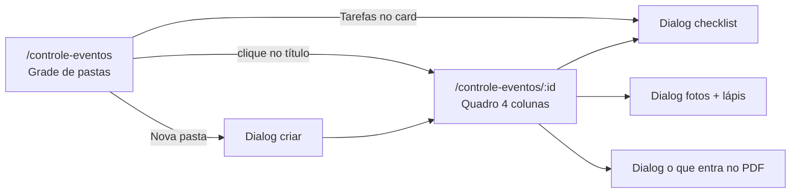
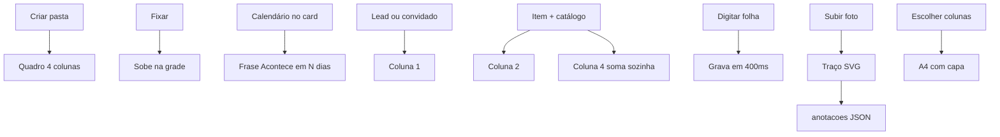

# PRD — Controle de Eventos: pastas, caderno, fotos e efeitos

**Produto:** CRM Selletos  
**Versão:** 1.0  
**Data:** 28/08/2026  
**Status:** Retrato completo do módulo em produção  
**Rotas:** `/controle-eventos` (lista) · `/controle-eventos/:eventoId` (caderno do evento)  
**URL de referência:** `http://localhost:8081/controle-eventos` (a porta do Vite pode ser 8081 ou 3000; o caminho é o mesmo)  
**Páginas:** `src/pages/ControleEventos.tsx` · `src/pages/ControleEventoBoard.tsx`  
**Ficha curta:** [16-eventos-gastos.md](16-eventos-gastos.md) · **Domínio:** [eventos-gastos.md](../04-dominios/eventos-gastos.md)

Este capítulo descreve **a dinâmica inteira** do Controle de Eventos: a grade de pastas, o quadro de quatro colunas, o caderno (folha branca), tarefas, fotos com desenho, PDF e cada efeito visual.

---

## 1. O que é este módulo (linguagem simples)

Pense numa **pasta de papelão** na mesa do marketing. Cada festa, feira ou evento de arquitetos ganha uma pasta. Por fora você vê a data, quantas pessoas, quanto vai gastar e o que ainda falta fazer. Por dentro a pasta abre num **caderno de quatro colunas**: quem vem, o que comprar, o que falar no palco, e o total.

**Não é** o Pipeline (vendas).  
**Não é** o ateliê de Projetos (desenho de móvel).  
**Não é** o Controle de Gastos (`/controle-gastos`, planilha de dinheiro do MKT — só admin).  
**Não é** o Financeiro Pontua Garbo.

Menu: **Marketing ▸ Controle de Eventos**.

### 1.1 Não há chat (leia isto primeiro)

No ateliê de Projetos existe um **rádio** (canal titular ↔ projetista, bolhas ouro/ciano, realtime).

**No Controle de Eventos não existe esse chat.** Não há thread, não há “responder no canal”, não há pasta `chat` do lead.

O que **faz o papel de conversa / registro** aqui:

| Superfície | O que é | Para quem |
|------------|---------|-----------|
| **Caderno** (coluna 3) | Folhas de texto: detalhes, discursos, palestras | O time escreve o roteiro do dia |
| **Tarefas** | Checklist (“confirmar palco”, “ensaiar discurso”) | Dá para abrir **sem entrar** na pasta |
| **Observações** da pasta | Campo livre no criar/editar | Recado curto na capa |
| **Desenho nas fotos** | Lápis em cima da imagem da pessoa ou do item | Anotação visual (seta, círculo), não mensagem |

Se alguém perguntar “onde o time conversa sobre o evento?”, a resposta honesta é: **eles escrevem no caderno e marcam tarefas** — não num WhatsApp interno.

---

## 2. Quem entra

| Papel | Vê o menu / a rota? |
|-------|---------------------|
| Admin | sim |
| Marketing (inclusive marketing-only) | sim — marketing-only **tem** esta rota |
| Vendedor puro | **não** (`hideForVendedor: true` no filho de Marketing) |
| Projetista-only | não |
| Prestador | sem sidebar |

Router: `canAccessMarketingConteudo` (admin **ou** papel marketing). Marketing-only: home do app é conteúdo; eventos continua acessível pela URL e pelo submenu.

---

## 3. Duas telas, um fluxo



Criar pasta **já navega** para o board do evento novo.

---

## 4. Tela 1 — Lista de pastas (`/controle-eventos`)

### 4.1 Layout

```
┌──────────────────────────────────────────────────────────┐
│  MARKETING · DOSSIÊ                                      │
│  Controle de Eventos                    [ Nova pasta ]  │
│  texto de ajuda                                           │
│  [🔍 Buscar evento por nome, tipo ou data… ]             │
├──────────────────────────────────────────────────────────┤
│  [pasta] [pasta] [pasta]     grid 1 / 2 / 3 colunas      │
│  pin + tarefas no topo de cada card                      │
└──────────────────────────────────────────────────────────┘
```

Header: kicker `11px` uppercase tracking `0.22em` ouro-suave. Título `.title-page`. Botão `btn-proforco`. Busca com ícone Search à esquerda, `h-10`.

Grade: `grid-cols-1 sm:2 xl:3`, `gap-5`. Loading: 3 skeletons `h-56`.

Empty: borda tracejada ouro, “Nenhuma pasta ainda”, exemplo “Festa de fim de ano”.  
Busca sem resultado: “A busca ignora acentos.”

### 4.2 Card da pasta (`EventoFolderCard`)

Visual de **arquivo de papel**:

- Aba dourada “PASTA” (`linear-gradient #f0d28c → #c9a07b`, tinta `#2a1812`).
- Corpo mogno: `165deg rgba(92,64,48) → #2a1812 → #1c100c`.
- Grade milimetrada 7% (`repeating-linear-gradient` 11–12 px ouro).
- Hover: sobe 4 px (`group-hover:-translate-y-1`, 300 ms).
- Entrada: `animate-in fade-in slide-in-from-bottom-2 duration-300`.

**Data enorme** (Bebas/display `42px` ouro) + mês · ano + frase humana (`labelEventoQuando`: “Acontece em 12 dias”, “Acontece hoje”, “Foi ontem”). Clique na data abre **calendário** (não entra na pasta). Grava `data_evento` na hora.

Clique no **título** abre o board.

Rodapé do card: pessoas · itens · valor estimado (soma qtd × preço).

Menu `⋯`: fixar, tarefas, editar, excluir.

### 4.3 Pin (topo da grade)

`BibliotecaPinButton` — **CSS**, sem WebGL neste card:

- Solto: vidro escuro, pino vazio.
- Fixado: fundo âmbar, pino preenchido, glow `0_0_18px rgba(245,158,11,0.4)`.
- Card fixado: borda âmbar, linha ouro no topo, `shadow-[0_0_28px_rgba(245,158,11,0.18)]`.

Ordem: pinados primeiro (`ordem_topo`), depois data mais recente. Novo pin recebe `max(ordem) + 1`.

### 4.4 Busca

`eventoCorrespondeBusca`: título, tipo (rótulo), observações, data ISO, frase “acontece em…”. Ignora acentos (`correspondeBuscaFlexivel`).

### 4.5 Criar / editar pasta

Dialog: título, data, tipo (`festa_fim_ano` | `arquitetos` | `outro` + texto custom), observações.  
Excluir: AlertDialog — apaga **participantes, itens, tarefas e caderno** (cascade no banco). Sem volta.

---

## 5. Tela 2 — Board do evento (`/controle-eventos/:eventoId`)

### 5.1 Layout

```
┌─────────────────────────────────────────────────────────────┐
│ ← Pastas                                                     │
│ Título do evento                          [Tarefas N] [PDF] │
│ 12 de março de 2026 · Evento de arquitetos                    │
├──────────┬──────────┬──────────┬──────────┤
│ 1 · Lista│ 2 · Comp.│ 3 · Cad.│ 4 · Tot. │
│ pessoas  │ ras      │ erno    │ Resumo   │
└──────────┴──────────┴──────────┴──────────┘
```

- Mobile / tablet: `grid-cols-1`, scroll vertical, cada coluna `min-h-[420px]`.
- `lg`: 2 colunas.
- `xl`: **4 colunas** lado a lado, `xl:overflow-hidden` (o board não empilha).

Kicker de cada coluna: `1 · Participantes` … `4 · Totais`, tracking `0.18em` ouro-suave. Superfície: `rounded-xl` + `border-gold-border` + `bg-surface-card`.

Header do board: voltar “Pastas”, título `.title-page`, data por extenso (`dd 'de' MMMM 'de' yyyy`). Botão Tarefas mostra **quantas pendentes** em ouro. Exportar PDF = `btn-proforco`.

Pasta inexistente: “Pasta não encontrada” + link ouro.

### 5.2 Coluna 1 — Participantes

Lista de pessoas. **Pessoa** abre dialog:

- Autocomplete de **lead** (`LeadNameAutocomplete`) **ou** nome digitado (convidado).
- Badge **Lead** (ouro) vs **Convidado**.

Card: foto de capa (primeira mídia) `h-28`, senão ícone `UserRound`. Clique na foto → galeria. Ações: editar, fotos, excluir.

Empty: “Ninguém na lista ainda. Busque um lead ou digite o nome.”

### 5.3 Coluna 2 — Itens e preços (compras)

Cada item: nome, quantidade, unidade (`un` / `L` / `kg` / `g`), preço unitário, fornecedor, telefone.

**Catálogo da empresa:** ao salvar, o sistema **grava/atualiza** `evento_catalogo_itens` pelo nome normalizado (minúsculas, espaços colapsados). Da próxima vez o autocomplete (`EventoItemNomeAutocomplete`) sugere preço e fornecedor.

Total da linha: `round(qtd × unitário, 2)`.

Card: capa `h-24`, unitário + total ouro. Fotos no item (recibo, produto).

Empty: “Adicione o que precisa comprar. O preço fica salvo para a próxima vez.”

### 5.4 Coluna 3 — Caderno (o “documento vivo”)

**Isto substitui o chat** como lugar de texto longo.

Três **seções** (abas):

| Aba | Dica na UI |
|-----|------------|
| Detalhes | Roteiro, horários e observações do dia |
| Discursos | Textos para quem vai falar |
| Palestras | Pauta e anotações de palco |

Cada seção tem **várias folhas**. Setas ← → + botão **Folha**. Só dá para apagar folha se houver mais de uma naquela seção.

**Autosave:** 400 ms depois de parar de digitar; também no blur, ao mudar de aba/folha, ao sair da página (`beforeunload` / `visibilitychange`). Estados: “Salva sozinho” · “Salvando…” · “Salvo” · “Não salvou — continue digitando”.

**Folha branca** — **única exceção light do DNA Bourbon**:

| Token | Valor |
|-------|--------|
| Papel | `#ffffff` |
| Tinta | `#000000` |
| Placeholder | `#3d2a1c` |
| Margem vermelha | `#b23b32` 55% à esquerda (`left-9`) |
| Pautas | linhas a cada 28 px, `rgba(80,50,24,0.12)` |
| Fonte | **Cormorant Garamond** 20 px título / 17 px corpo `leading-7` |
| Sombra | `0 18px 40px rgba(0,0,0,0.35)` |
| Largura | `max-w-[420px]`, `min-h-[340px]` |

Classe `.evento-caderno-folha` força `color-scheme: light` e **não** herda `glass-input` (senão a tinta viraria creme no papel branco).

Rodapé da folha: `Folha N · {saveHint}` em `#1a100c`.

Aura WebGL pequena no canto do cabeçalho da coluna — ver §8.

### 5.5 Coluna 4 — Totais

Três números ouro: pessoas, itens, total em R$. Lista de compras com scroll (`h-[280px]`): nome, qtd + unidade · fornecedor, total e unitário.

---

## 6. Tarefas (checklist fora do caderno)

Abre da **lista** (botão no card) ou do **board**. Mesmo dialog (`EventoTarefasDialog`).

- Bloco de data em Cormorant ouro + “Acontece em N dias · título”.
- Incluir tarefa (Enter / botão).
- Checkbox; concluída = riscada.
- Contagem de **pendentes** no card da pasta (pílula âmbar) e no botão do board.

Não é chat: não há autor, não há thread, não há realtime de “fulano escreveu”.

---

## 7. Fotos e desenho (o “quadro branco” do evento)

Sheet/dialog `max-w-5xl`: galeria à esquerda, palco à direita.

### 7.1 Upload

- Só imagem; compacta como lousa (`prepareWhiteboardImageForUpload`).
- Máx. **15 MB**.
- Storage: bucket `marketing-medias`, caminho  
  `eventos/{eventoId}/participantes|itens/{ownerId}/{timestamp}-{rand}.ext`
- Registro em `evento_participante_midias` ou `evento_item_midias` (`anotacoes: []`).

### 7.2 Lápis (`EventoPhotoDrawCanvas`)

SVG `viewBox 0 0 1000 1000` por cima da foto (`absolute inset-0`, `touch-none`).

| Ferramenta | Comportamento |
|-----------|----------------|
| Lápis | Pointer capture; path `M … L …`; ao soltar, grava se houver pelo menos um `L` |
| Borracha | Ao passar no `path` com `data-drawing-id`, remove aquele traço |
| Limpar traços | `anotacoes = []` |
| Cores | `#f0d28c` (ouro) · branco · `#e85d4c` · `#4aa3ff` · `#2a1812` |
| Espessura | range 2–14 (padrão 4) |

Cada traço: `{ id, path_data, cor, stroke_width }`. Persistido em JSON na coluna `anotacoes`. **Salva a cada traço** (não espera um botão “salvar”).

### 7.3 PDF só das fotos

`downloadEventoFotosPdf`: junta foto + traços (`compositeEventoPhoto` — canvas 2D, escala 1000→pixels reais, JPEG). Capa com branding da empresa.

Isto **não** é o PDF do dossiê inteiro (§9).

---

## 8. Catálogo de efeitos visuais

Contrato WebGL (igual ao ateliê, mas **peças únicas**, nunca um canvas por pasta):

- `antialias: false`, `alpha: true`, `powerPreference: 'low-power'`
- `pixelRatio: 1` (eventos é ainda mais econômico que Projetos)
- `pointer-events: none`, `aria-hidden`
- `prefers-reduced-motion` → um frame (`uTime` fixo)

### 8.1 Aura do caderno — `EventoDocumentoAura`

**O que o olho vê:** mancha de **tinta dourada em fibra de papel** (creme `#f4e6c8`, ouro, ink `#3a2418`), 64×64 no canto do cabeçalho da coluna 3.

**Shader:** noise de fibra (`vUv * 18`) + ink (`p * 4.2`), anel, pulso `sin(uTime * 1.6)`, alpha baixo (~0.22–0.5). Um canvas só.

### 8.2 Lacre do PDF — `EventoPdfExportAura`

**O que o olho vê:** **selo de cera** dourado/âmbar no diálogo de exportar. Brilha mais quando quase todas as colunas estão marcadas (`uFill` = marcadas / 5).

**Shader:** wax noise, dois anéis (`r 0.72` e `0.48`), raios `sin(ang * 8)`, pulso. `fillRef` atualiza todo frame sem remount.

### 8.3 Pasta (CSS)

- Aba metal ouro.
- Hatch de prancheta.
- Pin âmbar + glow.
- Hover lift.
- Data 42 px ouro.

**Não** usa `BibliotecaPinAura` (WebGL da Biblioteca). Aqui o pino é só o botão CSS compartilhado.

### 8.4 Folios do PDF (`.evento-pdf-folio`)

Cartões selecionáveis: mogno, hover borda `--color-gold`. Marcado: check ouro em círculo cheio + sombra. Reduced motion: sem transition.

### 8.5 Folha do caderno

Papel branco + margem vermelha + pautas. A “mágica” é **contraste**: o resto do CRM é mogno; esta folha parece caderno escolar de verdade.

### 8.6 Motion pontual

| Onde | Efeito |
|------|--------|
| Grade de pastas | fade + slide 300 ms |
| Hover pasta | `-translate-y-1` |
| Folio PDF | transform 180 ms |
| Tarefas pendentes | pílula âmbar (sem pulse obrigatório) |

**Não copiar** as auras do ateliê (ciano/waveform/lâmpada). Eventos fala **papel, pasta, lacre** — ouro e âmbar, quase sem ciano.

---

## 9. PDF do dossiê (`openEventoPdfPrint`)

Janela de impressão A4 (HTML + CSS, não jsPDF no fluxo principal).

Capa **sempre**: logo, nome da empresa, CNPJ, título do evento, data, tipo, “acontece em…”.

Colunas opcionais (`EVENTO_PDF_COLUNAS`):

1. Participantes  
2. Itens e preços  
3. Caderno (todas as folhas, agrupadas por seção)  
4. Totais  
5. Tarefas  

Precisa marcar **pelo menos uma**. Default: todas.

Visual do PDF: fundo branco, títulos mogno `#2a1812`, filete capa `#c9a07b` — o papel impresso, não o glass da tela.

---

## 10. Modelo de dados

Master: `crm_multiempresas_*`. Empresa (`emp_*`): nomes curtos `eventos`, `evento_*`.

| Tabela | Papel |
|--------|--------|
| `eventos` | Pasta: título, data, tipo, observações, `fixado`, `ordem_topo` |
| `evento_participantes` | Nome + `lead_id` opcional |
| `evento_participante_midias` | Foto + `anotacoes` JSON |
| `evento_itens` | Compra desta pasta |
| `evento_item_midias` | Foto do item + traços |
| `evento_catalogo_itens` | Memória de preço **da empresa** (unique `nome_normalizado`) |
| `evento_tarefas` | Checklist |
| `evento_paginas` | Folhas do caderno (`secao`: detalhes / discurso / palestra) |

Delete da pasta = cascade em filhos. Mídia: apaga storage se houver `storage_path`.

**Não há** tabela de mensagens. Não há Realtime neste módulo (invalidação React Query após mutate).

---

## 11. Dinâmica resumida (o “sistema”)



Regras:

1. Uma pasta = um evento. Não mistura com lead.status.
2. Participante pode ser lead **ou** só um nome.
3. Preço do item alimenta o **catálogo global** da empresa (próximo evento reaproveita).
4. Caderno salva sozinho; PDF é um **retrato**, não o editor.
5. Pin é ordem humana, não algoritmo de data.
6. Data no card usa calendário local (`YYYY-MM-DD` sem fuso a deslocar o dia).

---

## 12. Celular e acessibilidade

- Lista: 1 coluna, pin e tarefas grandes o suficiente para o polegar.
- Board: melhor no tablet/desktop (4 colunas). No celular vira pilha — caderno precisa teclado.
- Lápis: `touch-none` no SVG para não rolar a página no meio do traço.
- Labels: busca, data, nova tarefa, páginas do caderno, “Mais ações da pasta”.
- Reduced motion: shaders congelam; folios sem transition.

---

## 13. Regras para reconstruir

1. **Duas rotas:** grade e board. Criar pasta cai no board.
2. **Caderno branco** é exceção de tema — não pinte de mogno.
3. **Sem chat.** Não invente rádio/WhatsApp interno neste módulo.
4. **WebGL só em 2 lugares** (selo do caderno, lacre do PDF). Pastas = CSS.
5. **Catálogo** é memória de compras, não estoque.
6. **Fotos** guardam traços em JSON; o PDF de fotos **achata** traço + bitmap.
7. Autosave do caderno tem de sobreviver a troca de aba e fechamento da aba do browser.
8. Pin + data editável **na capa**, sem obrigar a abrir o board.
9. Não misturar com `/controle-gastos` nem com Pontua.

---

## 14. Mapa de arquivos

| Peça | Arquivo |
|-------|---------|
| Lista | `src/pages/ControleEventos.tsx` |
| Board | `src/pages/ControleEventoBoard.tsx` |
| Pasta | `EventoFolderCard.tsx`, `EventoFolderDialog.tsx` |
| Cards | `EventoParticipanteCard.tsx`, `EventoItemCard.tsx` |
| Caderno | `EventoDocumentoPanel.tsx` |
| Totais | `EventoTotaisPanel.tsx` |
| Tarefas | `EventoTarefasDialog.tsx` |
| Fotos / lápis | `EventoCardFotosSheet.tsx`, `EventoPhotoDrawCanvas.tsx` |
| PDF UI | `EventoPdfExportDialog.tsx` |
| Auras | `EventoDocumentoAura.tsx`, `EventoPdfExportAura.tsx` |
| CSS folha / folio | `src/index.css` (`.evento-caderno-folha`, `.evento-pdf-folio`) |
| Tipos | `src/lib/evento-types.ts` |
| PDF / composite | `evento-pdf-export.ts`, `evento-photo-composite.ts` |
| Hooks | `useControleEventos`, `useEventoBoard`, `useEventoTarefas` |
| Menu | `NAV_MARKETING` → `/controle-eventos` |
| Migrations | `20260821170000_controle_eventos.sql`, `20260827120000_evento_pin_tarefas_documento.sql` |
