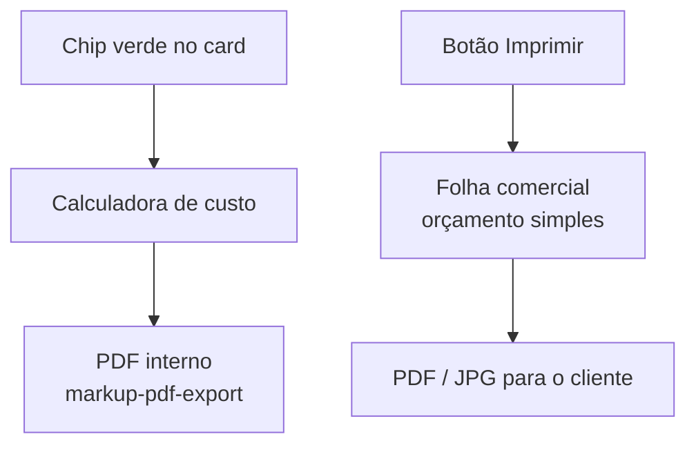

# PRD — Orçamento em PDF no Markup (folha comercial)

**Produto:** CRM Selletos  
**Versão:** 1.0  
**Data:** 01/09/2026  
**Status:** Retrato completo da folha comercial (PDF/JPG) ligada ao markup  
**Onde vive:** card do lead → bloco **Markup (custo interno)** → botão **Imprimir**  
**O chip que você marcou:** faixa verde com calculadora, `R$ 78.082,11` e o título **Regiane Embalagens** (`MarkupCardPreview`)  
**Ficha `/markup`:** [13-markup.md](13-markup.md) · **Caderno de custo / sincronia:** `docs/prd/2026-08-26-markup-sincronizacao-sistema-externo-prd.md`  
**Não é:** slides de orçamento (`/orcamento-slides`) — isso é outra apresentação.

Este capítulo explica **dois PDFs** do markup e, principalmente, a **folha comercial** que o cliente recebe: o chip verde, o botão Imprimir, a prévia A4 e o download.

---

## 1. O que é (linguagem simples)

O Markup é o **caderno de custo da marcenaria** (chapas, horas, margem). O número verde no card é o **preço final** desse caderno.

O cliente **não** deve ver a planilha de custo. Por isso existe uma segunda folha: um **orçamento simples** — lista de itens, desconto, fotos, validade — que vira **PDF ou JPG**.

Pense em dois papéis:

| Papel | Para quem | Como abre | O que mostra |
|-------|-----------|-----------|--------------|
| **Caderno de custo** | Projetista / admin | Clique no chip verde | Materiais, horas, impostos, margem |
| **Folha comercial** | Cliente | Botão **Imprimir** | Itens em linguagem de venda + fotos + total |

O chip **não gera PDF**. Ele só mostra o valor e abre a calculadora. O PDF do cliente nasce no botão **Imprimir** (ícone de impressora), ao lado de **Novo markup**.

No seu exemplo:

- Rótulo **Markup** + ícone de calculadora  
- Valor **R$ 78.082,11** (`preco_final` do caderno mais recente)  
- Dica **Regiane Embalagens** = **título** daquele markup (não é o nome do lead, embora muitas vezes coincida)

---

## 2. Onde clicar (mapa)

```
LeadModal → Detalhes → Materiais do lead
└── Card “Markup (custo interno)”
    ├── Chip verde (MarkupCardPreview)  → calculadora
    ├── Imprimir                         → folha comercial (PDF/JPG)
    └── Novo markup                      → novo caderno (copia o anterior)
```

No **Kanban**, a mesma faixa verde compacta abre a calculadora (quem pode custo). Vendedor **vê** o valor e **não** abre a planilha; ainda assim pode **Imprimir** a folha comercial se já existir markup.

Há um segundo PDF **dentro da calculadora** (botão PDF): esse é o **relatório interno** (materiais, serviços, despesas). Não confunda com a folha comercial.

---

## 3. O chip verde (o que você marcou)

`MarkupCardPreview` — borda `emerald-500/30`, fundo verde 10%, hover 20%.

| Linha | Conteúdo |
|-------|----------|
| 1 | Calculadora + **Markup** + seta `>` se dá para abrir |
| 2 | Preço `formatarMoedaMarkup` (pt-BR, `R$ 78.082,11`) |
| 3 | Título do caderno (só na versão **não** compacta) — no card: “Regiane Embalagens” |

Só aparece se `preco_final > 0`. Clique (projetista/admin) abre `MarkupCalculatorSheet` daquele orçamento. Lixeira ao lado apaga o caderno (com confirmação).

Lista abaixo: markups mais antigos do mesmo lead. O chip grande é sempre o **mais recente**.

Sincronia: esse preço pode preencher o campo **Orçamentos** do lead **se** o campo ainda estiver vazio. Se o vendedor digitou outro valor à mão, o markup **não** sobrescreve (`handleMarkupOrcamentoSync`).

---

## 4. Dois PDFs — não misture



| | PDF da calculadora | PDF **Imprimir** |
|--|--------------------|------------------|
| Arquivo | `markup-pdf-export.ts` | `markup-orcamento-simples-export.ts` |
| Conteúdo | Chapas, horas, impostos, margem | Descrição comercial, qtd, unitário, fotos |
| Fonte | `modulos` da calculadora | `modulos.meta.orcamento_simples` |
| Primeira vez | Sempre o caderno atual | Se nunca editou a folha: **1 item** = título + `preco_final` |

A folha comercial **não recalcula** o markup. Você pode escrever “Cozinha completa” a R$ 40 mil mesmo o caderno ter outro detalhamento. O total da folha é soma dos itens − desconto.

---

## 5. Abrir a folha (botão Imprimir)

`MarkupOrcamentoSimplesTrigger` — desabilitado se **não há** nenhum markup (“Calcule um markup primeiro”).

Abre `MarkupOrcamentoSimplesDialog` em tela quase cheia (`sm:h-[92vh] max-w-6xl`). Não fecha ao clicar fora. Flag `data-markup-orcamento-simples` impede o LeadModal de fechar.

Cabeçalho: kicker **Folha comercial** (Cormorant, tracking ouro) + título **Orçamento simples**. Aura WebGL de madeira/latão (`MarkupOrcamentoSimplesAura`).

Dois lados:

| Esquerda | Direita |
|----------|---------|
| Formulário (itens, desconto, fotos, obs) | Prévia A4 papel creme (`#140e0b` atrás) |

Se o lead tem **vários** markups: select **Markup de origem**. A folha fica salva **dentro daquele** caderno.

---

## 6. O que se edita na folha

Documento `MarkupOrcamentoSimples`:

| Campo | Padrão | Limite |
|-------|--------|--------|
| Título da proposta | Título do markup | — |
| Itens (descrição, qtd, unitário) | 1 linha = preço final | Pelo menos 1 item |
| Desconto | 0, tipo % ou R$ | % até 100; R$ não passa do subtotal |
| Validade | **15 dias** | ≥ 1 |
| Fotos | vazias | **18** |
| Observações | vazio | texto livre |

Totais (centavos):

`subtotal` = soma (qtd × unitário)  
`desconto` = % do subtotal **ou** valor em reais  
`total` = subtotal − desconto  

Na tela: o total ouro grande (Cormorant) não é o `preco_final` do chip, a menos que você não tenha mudado os itens.

### 6.1 Fotos

- Grade das **fotos do lead** (anexos, não PDF): clique inclui / clique de novo tira. Anel ouro se já está na folha.  
- **Do computador:** JPEG/PNG/WebP/GIF, máx. **4 MB** cada. Viram data URL: entram **só nesta impressão**, **não** no banco.  
- Fotos do lead (URL pública) **sim** gravadas.  
- URLs remotas são **embutidas em JPEG** na prévia (`incorporarImagemOrcamento`, lado máx. 1400 px) para o PDF não sair sem foto.

---

## 7. A folha (layout do PDF)

Tamanho de trabalho: **794 × ≥1123 px** (A4 em 96 dpi). Fundo creme `#fbf6ec` → `#efe4d0`, filete latão `#c4a35a`.

1. **Cabeçalho:** logo (timbrado do markup **ou** logo da empresa) · nome da empresa · CNPJ · *Orçamento* itálico · data de hoje  
2. **Três colunas:** Cliente (nome do lead) · Proposta (título) · Validade até (hoje + N dias)  
3. **Galeria** (se houver fotos): 1 / 2 / 3 colunas, número `01` ouro no canto  
4. **Tabela:** Item · Qtd · Unitário · Total  
5. Subtotal, desconto (se houver), **Total** grande  
6. Observações  
7. Duas linhas de assinatura: Cliente | nome da empresa  

Prévia: a folha real é desenhada em 794 px e **escalada** para caber na coluna (`transform: scale`). Sombra forte.

Export: iframe invisível + `html2canvas` (scale 2.4) + `jsPDF`. Se a folha for mais alta que uma página, **fatiada**. Nome do arquivo: `orcamento-{titulo}-{yyyy-MM-dd}.pdf` (ou `.jpg`).

---

## 8. Onde isso fica no banco

**Não** há tabela nova. Vai no JSON do caderno:

`markup_orcamentos.modulos.meta.orcamento_simples`

Comment da migration `20260826184457_markup_orcamento_simples_meta.sql`.

Ao fechar o diálogo ou ao baixar PDF/JPG, `salvarOrcamento` com `silent: true` (sem toast de “salvo”). O `preco_final` do caderno **não** muda.

---

## 9. Quem pode o quê

| Papel | Chip | Calculadora | Imprimir folha |
|-------|------|-------------|----------------|
| Admin / projetista | Abre custo | Sim + PDF interno | Sim |
| Vendedor | Só lê | Não | Sim, se já existe markup |
| Marketing / prestador | Conforme permissão do card | Não | Em geral não |

Sem markup: Imprimir apagado. Sem `preco_final > 0`: chip some.

---

## 10. Efeitos visuais

| Peça | O olho vê |
|------|----------|
| Chip | Verde esmeralda (exceção consciente no CRM ouro) |
| Diálogo | Vidro mogno + **aura** madeira/latão (um WebGL no header, outro suave na caixa de fotos) |
| Folha | Papel de marcenaria, Cormorant no título, Raleway no corpo |
| `prefers-reduced-motion` | Aura congela |

Custo: **um** canvas por aura, `low-power`. Não um por foto.

---

## 11. O que **não** é este sistema

| Sistema | Diferença |
|---------|-----------|
| Orçamento em **slides** | Apresentação página a página, link público |
| PDF da **calculadora** | Custo interno, não para o cliente |
| Miniatura **Kanban** | Mesmo número do chip, sem botão Imprimir |
| Render IA | Imagem do móvel; pode **entrar como foto** na folha se estiver nos anexos |

---

## 12. Regras para reconstruir

1. Chip = resumo do **caderno**. Imprimir = **folha comercial**. Dois botões, dois PDFs.  
2. Folha vive em `meta.orcamento_simples`, não em tabela extra.  
3. Primeira abertura: um item com o `preco_final`. Depois o usuário manda.  
4. Total da folha ≠ obrigatoriamente o chip.  
5. Máx. 18 fotos; upload local não persiste.  
6. Embutir imagens em JPEG antes do canvas (CORS).  
7. Não fechar o LeadModal com o diálogo aberto.  
8. Timbrado: `config.timbrado_url` primeiro, senão logo da empresa.  
9. Vendedor não vê a planilha de custo; pode mandar o PDF se o caderno já existe.  
10. Não misture com `/orcamento-slides`.

---

## 13. Mapa de arquivos

| Peça | Arquivo |
|------|---------|
| Chip no card | `MarkupCardPreview.tsx` |
| Seção no lead | `MarkupLeadSection.tsx` |
| Diálogo + botão Imprimir | `MarkupOrcamentoSimplesDialog.tsx` |
| Folha / prévia | `MarkupOrcamentoSimplesFolha.tsx` |
| Modelo + totais | `markup-orcamento-simples.ts` |
| PDF/JPG | `markup-orcamento-simples-export.ts` |
| Aura | `MarkupOrcamentoSimplesAura.tsx` |
| PDF interno | `markup-pdf-export.ts` + botão na `MarkupCalculatorSheet` |
| Tipos | `markup-types.ts` (`meta.orcamento_simples`) |
| Guard do modal | `markup-ui.ts`, `dialog-outside-guard.ts` |
