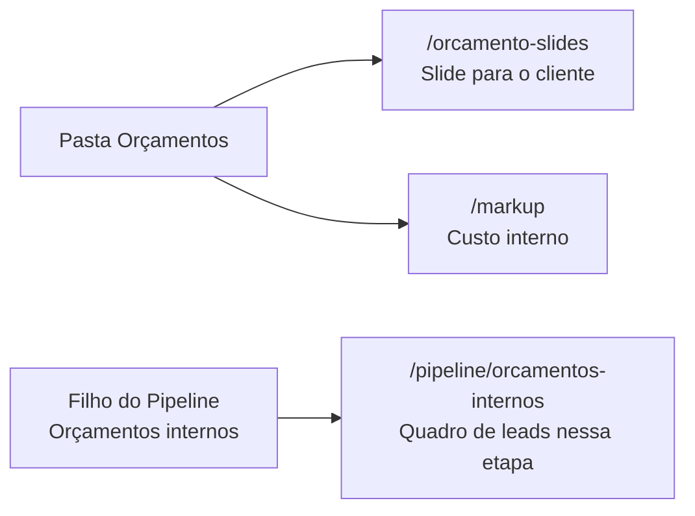

# PRD — Menu lateral (sidebar)

**Produto:** Garbo (CRM Selletos + Casa / fábrica)  
**Versão:** 2.0  
**Data:** 27/08/2026  
**Status:** Menu fundido em produção  
**Público:** produto, operação e quem for reconstruir o sistema  
**Fonte no código:** `src/lib/app-navigation.ts` + `src/components/layout/AppSidebar.tsx`

Este documento explica **cada item da barra esquerda** e **para onde o clique leva**.  
A casa agora tem **dois sistemas no mesmo menu**: o CRM (vendas) e a fábrica (caixa, obras, equipe).  
Por isso a barra se divide em dois blocos: **Comercial** (verde) e **Casa** (ouro).

---

## 1. O que é essa barra (linguagem simples)

Pense no sistema como um **prédio com duas alas**. Depois do login, a pessoa entra num corredor. A **sidebar** é o **diretório do elevador**.

- A placa **Comercial** é a ala de vendas: pipeline, leads, agenda, contratos, marketing.
- A placa **Casa** é a ala da fábrica: dashboard, caixa, funcionários, obras, configurações.
- Só um bloco abre por vez (o da página atual). As duas placas continuam visíveis — clique na outra para trocar de ala.
- No rodapé, o **avatar** abre o perfil (CRM `/profile` ou fábrica `/meu-perfil`).

Nem todo mundo vê a mesma lista. É como um crachá: vendedor, projetista, marketing, montador e admin sobem em andares diferentes.

**Importante:** alguns nomes do Pipeline **não estão gravados no código**.  
“Orçamentos internos”, “Prospecção” e “Manutenção” são **quadros extras** que a empresa cadastrou. Se criar outro quadro, aparece outro botão.

### O que o retrato Selletos original tinha e o Garbo trata diferente

| Item original | Situação no Garbo |
|---------------|-------------------|
| Agenda `/agenda` | Virou **Agenda comercial** `/agenda-comercial` (a agenda de obras é outra) |
| Biblioteca `/biblioteca` | No CRM é **Biblioteca CRM** `/biblioteca-crm`. A Biblioteca da Casa é o acervo da fábrica. |
| Projetos `/projetos` | **OK** — quadro reconstruído sobre `emp_garbo.lead_projetos` |
| Controle de eventos `/controle-eventos` | Equivale a **Eventos** `/eventos-crm` |
| Empresas `/admin/empresas` | **Omitido de propósito** — casa única Garbo |
| Financeiro Pontua `/financeiro` | Rota Garbo: `/financeiro-pontua` (não mistura com o Caixa da casa) |

---

## 2. Mapa do menu (como aparece na tela)

Árvore vista por um **admin / vendedor** típico. Itens com `▸` abrem submenu.

```
┌─────────────────────────────────────┐
│  [logo]  GARBO                      │  ← cabeçalho + faixa dourada
├─────────────────────────────────────┤
│  COMERCIAL                          │  placa verde — vendas e CRM
│    Pipeline                     ▸   │
│      Kanban                         │  → /pipeline
│      (quadros extras da empresa)    │  → /pipeline/{slug}
│      Configurações      (admin)     │  → /pipeline/configuracoes
│    Leads                            │  → /leads
│    Agenda comercial                 │  → /agenda-comercial
│    Eventos                          │  → /eventos-crm
│    Chat interno                     │  → /chat-crm
│    Contratos                        │  → /contratos
│    Orçamentos                   ▸   │
│      Slides de orçamento            │  → /orcamento-slides
│      Markup (custo)                 │  → /markup
│    Automações                   ▸   │
│      Negativação                    │  → /automacoes
│      Marketing                      │  → /automacoes/marketing
│    Marketing                    ▸   │
│      Marketing de conteúdo          │  → /marketing-conteudo
│      Biblioteca CRM                 │  → /biblioteca-crm
│      Apresentação para arquitetos   │  → /marketing/apresentacao-interna
│      Pontua Garbo                   │  → /marketing/pontua-garbo
│      Financeiro Pontua              │  → /financeiro-pontua
│      Controle de gastos  (admin)    │  → /controle-gastos
│      Administração CRM   (admin) ▸  │
│        Marca                        │  → /admin/marca
│        Usuários CRM                 │  → /admin
│        Webhooks                     │  → /admin/webhooks
├─────────────────────────────────────┤
│  CASA                               │  placa ouro — fábrica
│    Dashboard                        │  → /dashboard
│    Financeiro                   ▸   │  caixa da casa (não é o Pontua)
│      Clientes                       │  → /clientes
│      Cobranças                      │  → /cobrancas
│      Fornecedores                   │  → /fornecedores
│      Contas a Pagar                 │  → /contas-pagar
│      Caixa Fornecedor               │  → /caixa-fornecedor
│      Caixa                          │  → /caixa
│    Funcionários                 ▸   │
│    Obras                        ▸   │
│    Biblioteca                       │  → /biblioteca
│    Visualização                     │  → /visualizacao
│    Configurações                    │  → /configuracoes
├─────────────────────────────────────┤
│  [avatar] Nome · abrir perfil       │  → /profile
└─────────────────────────────────────┘
```

---

## 3. Como o clique funciona

| Tipo de item | O que acontece ao clicar |
|--------------|--------------------------|
| **Link simples** (Leads, Agenda, Contratos…) | Troca a página. A URL muda. O conteúdo da direita muda. |
| **Pasta com setinha ▸** (Marketing, Orçamentos, Pipeline, Automações) | **Não** troca de página. Só abre a lista de filhos. O destino real é o filho. |
| **Filho de pasta** | Troca a página, como um link simples. |

A setinha gira 90° quando a pasta está aberta. Se você já está numa rota daquela pasta (ex.: `/pipeline/manutencao`), o sistema **abre a pasta sozinho**.

---

## 4. MENU PRINCIPAL — item a item

### 4.1 Leads

| | |
|---|---|
| **Rótulo na barra** | Leads |
| **URL** | `/leads` |
| **Página** | `src/pages/Leads.tsx` |
| **Ficha** | [07-leads.md](07-leads.md) |

**Para que serve.**  
É a **planilha** de todos os clientes em negociação (não o quadro com colunas). Serve para achar alguém pelo nome/telefone, filtrar, exportar CSV e gerir origens de tráfego (aba Cadastro).

**O que você vê.**  
Duas abas: **Leads** (tabela) e **Cadastro** (origens). Clicar num lead abre a ficha grande (`LeadModal`). Dá para passar `?id=` na URL e abrir o card direto.

**Quem vê no menu.**  
Quem tem permissão `leads` / `view`. Escondido para **marketing-only** e **projetista-only**.

**Não confundir com.**  
Pipeline (quadro) e Projetos (prancheta da marcenaria). O lead é a mesma pessoa; a tela é outra forma de olhar.

---

### 4.2 Agenda

| | |
|---|---|
| **Rótulo na barra** | Agenda |
| **URL** | `/agenda` |
| **Página** | `src/pages/Agenda.tsx` |
| **Ficha** | [09-agenda.md](09-agenda.md) |

**Para que serve.**  
Calendário da empresa: reuniões, tarefas de atendimento, lembretes ligados ao lead e agenda pessoal. O cliente pode marcar sozinho pelo **link público** (`/agendar/...`), que **não** passa por este menu.

**O que você vê.**  
Abas: **geral** · **tarefas** · **lembretes** · **pessoal**. Dá para copiar o link de marcação pública.

**Quem vê.**  
App completo e projetista. **Marketing-only não.** Prestador não (ele tem portal próprio, sem sidebar).

**Atalho.**  
Há um ícone de calendário flutuante no canto da tela que abre a Agenda Geral **sem sair** da página atual.

---

### 4.3 Contratos

| | |
|---|---|
| **Rótulo na barra** | Contratos |
| **URL** | `/contratos` |
| **Página** | `ContratosPage.tsx` |
| **Ficha** | [12-contratos.md](12-contratos.md) |

**Para que serve.**  
Lista, gera e acompanha **contratos** ligados a leads (modelo, variáveis, assinatura, status).

**Para onde mais leva (dentro da tela, não na sidebar).**

| Destino | URL |
|---------|-----|
| Novo contrato | `/contratos/novo` |
| Configurar modelo | `/contratos/configuracoes` |

**Quem vê.**  
App completo (vendedor/admin). Escondido para marketing-only e projetista-only.

---

### 4.4 Biblioteca

| | |
|---|---|
| **Rótulo na barra** | Biblioteca |
| **URL** | `/biblioteca` |
| **Página** | `Biblioteca.tsx` |
| **Ficha** | [18-publicas.md](18-publicas.md) (seção Biblioteca) |

**Para que serve.**  
Um **armário de arquivos**: pastas, mídias, PDFs. É o acervo compartilhado da empresa (bucket `marketing-medias`), não o funil de vendas.

**Quem vê.**  
Quase todos os colaboradores autenticados, inclusive projetista. Marketing-only também pode ver este item (não está marcado para esconder).

---

### 4.5 Projetos

| | |
|---|---|
| **Rótulo na barra** | Projetos |
| **URL** | `/projetos` |
| **Página** | `src/pages/Projetos.tsx` |
| **Ficha** | [08-projetos.md](08-projetos.md) |

**Para que serve.**  
Quadro do **setor de projetos** (visita, desenho, feito). Não é o Pipeline comercial. O lead “entra na prancheta”, alguém pega para projetar, desenha, solta ou reabre.

**Quem vê.**  
Quem pode acessar o board: admin, vendedor ou papel de projetista (`canAccessProjetosBoard`). Marketing-only **não**.

**Home especial.**  
Para quem é **só projetista**, o sistema nem mostra Pipeline: a home (`/`) redireciona para `/projetos`.

---

### 4.6 Marketing (pasta)

Clicar em **Marketing** **não** abre uma página. Abre os filhos abaixo.  
Ícone: megafone.

| Filho | URL | O que é |
|-------|-----|---------|
| **Marketing de Conteúdo** | `/marketing-conteudo` | Kanban + calendário + mídias de posts. Home de quem é só marketing. |
| **Apresentação para Arquitetos** | `/marketing/apresentacao-interna` | Slideshow institucional Garbo (fullscreen, com botão de copiar o link público). |
| **Pontua Garbo** | `/marketing/pontua-garbo` | Só o programa de pontos/comissão (também fullscreen). |
| **Controle de Eventos** | `/controle-eventos` | Pastas de feiras/ações. Clique numa pasta → `/controle-eventos/:eventoId`. |
| **Controle de Gastos** | `/controle-gastos` | Planilha de gastos. **Só admin.** |

**Fichas:** [15-marketing.md](15-marketing.md) · [16-eventos-gastos.md](16-eventos-gastos.md)

**Quem vê cada filho.**

| Filho | Admin | Vendedor puro | Marketing | Projetista-only |
|-------|:-----:|:-------------:|:---------:|:---------------:|
| Marketing de Conteúdo | sim | não | sim | não |
| Apresentação para Arquitetos | sim | sim | sim | não |
| Pontua Garbo | sim | sim | sim | não |
| Controle de Eventos | sim | não | sim | não |
| Controle de Gastos | sim | não | não | não |

Se **nenhum** filho for visível, a pasta Marketing some inteira.

**Link público (não está no menu).**  
A apresentação que o arquiteto vê sem login é `/apresentacao/garbo`. O item interno só serve para pré-visualizar e copiar esse link.

---

### 4.7 Orçamentos (pasta)

Outra pasta. **Não** é o quadro “Orçamentos internos” do Pipeline (esse é outra coisa — ver §5).

| Filho | URL | O que é |
|-------|-----|---------|
| **Slides de Orçamento** | `/orcamento-slides` | Apresentação bonita para o **cliente** (fotos, cubo, preço, PIX). |
| **Markup (custo)** | `/markup` | Caderno de **custo interno** (chapas, ferragens, hora). Não vai para o cliente. |

**Fichas:** [14-orcamento-slides.md](14-orcamento-slides.md) · [13-markup.md](13-markup.md)

**Para onde mais leva (botões dentro da tela).**

| Ação | URL |
|------|-----|
| Novo slide | `/orcamento-slides/novo` |
| Editar slide | `/orcamento-slides/:id/editar` |
| Apresentar (tela cheia) | `/orcamento-slides/:id/apresentar` |
| Config dos slides (admin) | `/orcamento-slides/configuracoes` |
| Config do markup | `/markup/configuracoes` |
| Link que o cliente abre sem login | `/orcamento/:schema/:id` |

**Quem vê.**  
- Slides: admin, vendedor, projetista (`canAccessOrcamentoComposicao`).  
- Markup: **admin ou projetista**. Vendedor **não** entra em `/markup` (ele vê o preço no card do Pipeline, não a calculadora de custo).  
- Marketing-only: pasta some.

---

### 4.8 Pipeline (pasta) — o coração comercial

Clicar em **Pipeline** abre os filhos. O quadro principal **não** é o rótulo da pasta: é o filho **Kanban**.

**Quem vê a pasta.**  
Permissão `pipeline` / `view`. Escondida para marketing-only e projetista-only.

#### Filhos fixos (sempre iguais no código)

| Filho | URL | Quem vê | O que é |
|-------|-----|---------|---------|
| **Configurações** | `/pipeline/configuracoes` | **Só admin** | Painel do funil: criar outros kanbans, origens, cores de tempo, lousa, IA do lead. Ficha: [05-pipeline-config.md](05-pipeline-config.md) |
| **Kanban** | `/pipeline` | Quem vê Pipeline | O **funil comercial padrão** (Novo Lead → … → venda). Home do app (`/` redireciona para cá). Ficha: [03-pipeline.md](03-pipeline.md) |

#### Filhos dinâmicos (vêm do banco)

Cada **página kanban ativa** vira um botão extra:

```
/pipeline/{slug}
```

O `slug` é o apelido da URL (sem acento, com hífen). O **nome** que aparece no menu é o campo `nome` cadastrado em Configurações.

Na captura que você enviou, a empresa tinha estes três:

| Nome no menu | URL típica | O que costuma ser |
|--------------|------------|-------------------|
| **Orçamentos internos** | `/pipeline/orcamentos-internos` | Quadro de orçamentos **do time**, não o slide do cliente. Mesmos leads, outro recorte de colunas. |
| **Prospecção** | `/pipeline/prospeccao` | Quadro de quem ainda está sendo prospectado (antes ou ao lado do funil principal). |
| **Manutenção** + número **5** | `/pipeline/manutencao` | Quadro de pós-venda / assistência. O **5** é um **aviso**: quantos cards estão em colunas que pedem atenção (ex.: “Manutenção solicitada”, “Manutenção agendada”). Não é o nome da página. |

**Ficha dos quadros extras:** [04-pipeline-kanban.md](04-pipeline-kanban.md)

**Como nascer um novo botão.**  
Admin → Pipeline → Configurações → criar página kanban (nome + slug) → ativar. No dia seguinte o menu ganha a linha. Não precisa alterar código.

**Home.**  
`/` (raiz do site logado) **não** aparece no menu. O sistema manda automaticamente para `/pipeline`.

---

### 4.9 Automações (pasta)

| Filho | URL | O que é |
|-------|-----|---------|
| **Negativação** | `/automacoes` | Lista de telefones **bloqueados** (não disparar / não atender como lead novo). |
| **Marketing** | `/automacoes/marketing` | **Disparos** de WhatsApp (templates, áudios, PDFs). Nome fácil de confundir com a pasta Marketing. |

**Ficha:** [19-webhooks-automacoes.md](19-webhooks-automacoes.md)

**Quem vê.**  
App completo. Escondida para marketing-only e projetista-only.

**Não confundir.**

| No menu | URL | Mundo |
|---------|-----|-------|
| Pasta **Marketing** → Conteúdo | `/marketing-conteudo` | Produzir post, calendário, mídia |
| Pasta **Automações** → Marketing | `/automacoes/marketing` | Disparar mensagem no WhatsApp |

São duas portas diferentes.

---

### 4.10 Financeiro · Pontua Garbo (no Menu Principal)

Só aparece **no Menu Principal** se a pessoa é **vendedor e não é admin**.  
Para admin, o mesmo link mora no grupo Administração (evita duplicar).

| | |
|---|---|
| **URL** | `/financeiro` |
| **Ficha** | [17-financeiro.md](17-financeiro.md) |

**Para que serve.**  
**Não é um ERP** (não é conta a pagar / Nota Fiscal). É o mural do programa **Pontua Garbo**: arquitetos/parceiros, comissões e saques PIX.

---

## 5. ADMINISTRAÇÃO (só admin)

Este grupo **não** estava no pedaço de DOM que você colou, mas faz parte da mesma sidebar.

| Item | URL | O que é |
|------|-----|---------|
| **Financeiro · Pontua Garbo** | `/financeiro` | Igual ao §4.10, com painéis de liberar comissão e aprovar saque. |
| **Logo e Nome** | `/admin/marca` | Logo, nome do sistema e cor primária da empresa (o ouro do topo da sidebar). |
| **Gestão de Usuários** | `/admin` | Pessoas, papéis, ponto/presença, marca (abas internas). |
| **Configuração de Webhooks** | `/admin/webhooks` | URLs que ligam WhatsApp/n8n à origem/região do lead. |
| **Empresas** | `/admin/empresas` | **Só super-admin.** Trocar de empresa ou modo cadastro global. |

**Ficha:** [11-admin.md](11-admin.md)

---

## 6. Rodapé da sidebar (não é “MENU PRINCIPAL”, mas é menu)

| Item | URL | O que é |
|------|-----|---------|
| **Nome da empresa** (ou “Cadastro global”) | `/admin/empresas` | Super-admin. Mostra em qual “caderno” você está trabalhando. |
| **Avatar + nome + papéis** | `/profile` | Foto, telefone, papéis em maiúsculas (`VENDEDOR + MARKETING`), sair da conta. |

Prestador de serviço **não tem sidebar**. Ele cai no portal `/` exclusivo (`Prestador.tsx`).

---

## 7. Tabela-resumo: rótulo → URL

Use esta tabela como índice rápido. Filhos dinâmicos do Pipeline mudam por empresa.

| Onde no menu | Rótulo | Destino |
|--------------|--------|---------|
| Principal | Leads | `/leads` |
| Principal | Agenda | `/agenda` |
| Principal | Contratos | `/contratos` |
| Principal | Biblioteca | `/biblioteca` |
| Principal | Projetos | `/projetos` |
| Marketing ▸ | Marketing de Conteúdo | `/marketing-conteudo` |
| Marketing ▸ | Apresentação para Arquitetos | `/marketing/apresentacao-interna` |
| Marketing ▸ | Pontua Garbo | `/marketing/pontua-garbo` |
| Marketing ▸ | Controle de Eventos | `/controle-eventos` |
| Marketing ▸ | Controle de Gastos | `/controle-gastos` |
| Orçamentos ▸ | Slides de Orçamento | `/orcamento-slides` |
| Orçamentos ▸ | Markup (custo) | `/markup` |
| Pipeline ▸ | Configurações | `/pipeline/configuracoes` |
| Pipeline ▸ | Kanban | `/pipeline` |
| Pipeline ▸ | *(nome cadastrado)* | `/pipeline/{slug}` |
| Pipeline ▸ *(exemplo)* | Orçamentos internos | `/pipeline/orcamentos-internos` |
| Pipeline ▸ *(exemplo)* | Prospecção | `/pipeline/prospeccao` |
| Pipeline ▸ *(exemplo)* | Manutenção | `/pipeline/manutencao` |
| Automações ▸ | Negativação | `/automacoes` |
| Automações ▸ | Marketing | `/automacoes/marketing` |
| Principal *ou* Admin | Financeiro · Pontua Garbo | `/financeiro` |
| Admin | Logo e Nome | `/admin/marca` |
| Admin | Gestão de Usuários | `/admin` |
| Admin | Configuração de Webhooks | `/admin/webhooks` |
| Admin | Empresas | `/admin/empresas` |
| Rodapé | Perfil | `/profile` |

---

## 8. Três nomes parecidos (vale decorar)

No seu print aparecem **Orçamentos** (pasta) e **Orçamentos internos** (filho do Pipeline). São mundos diferentes:



1. **Orçamentos** (pasta) → montar proposta / calcular custo.  
2. **Orçamentos internos** (Pipeline) → **mover cards** de quem está nessa etapa do funil.  
3. **Kanban** (Pipeline) → o funil comercial **principal**, não um quadro extra.

---

## 9. Quem vê o quê (visão por crachá)

| Item | Admin | Vendedor | Projetista-only | Marketing-only | Prestador |
|------|:-----:|:--------:|:---------------:|:--------------:|:---------:|
| Leads | sim | sim* | não | não | sem sidebar |
| Agenda | sim | sim | sim | não | — |
| Contratos | sim | sim | não | não | — |
| Biblioteca | sim | sim | sim | sim | — |
| Projetos | sim | sim | sim (home) | não | — |
| Marketing (pasta) | sim | parcial | não | parcial | — |
| Orçamentos (pasta) | sim | slides | slides + markup** | não | — |
| Pipeline (pasta) | sim | sim | não | não | — |
| Automações | sim | sim | não | não | — |
| Administração | sim | não | não | não | — |
| Financeiro | sim | sim | não | não | portal próprio |
| Perfil | sim | sim | sim | sim | no portal |

\* Leads no menu também exige permissão `leads` / `view`.  
\** Markup só se o papel incluir projetista (ou admin). Vendedor puro não entra em `/markup`.

---

## 10. Regras para reconstruir

1. **Uma lista só para os links simples** — `NAV_MAIN_ITEMS` em `app-navigation.ts`. Sidebar e menu radial (mobile/atalho) leem a mesma fonte.
2. **Pastas não são rotas.** Marketing, Orçamentos, Pipeline e Automações só abrem filhos.
3. **Kanbans extras são dados, não código.** Não hardcode “Prospecção” / “Manutenção”. Leia `kanban_pages` ativas e monte `/pipeline/{slug}`.
4. **Badge laranja na Manutenção** — se o nome ou o slug for `manutencao`, contar cards nas colunas “Manutenção solicitada” e “Manutenção agendada” (`src/lib/manutencao-attention.ts`).
5. **Filtrar por papel no menu e no router.** Esconder o botão não basta: `App.tsx` também bloqueia a URL.
6. **Pasta some se estiver vazia.** Se nenhum filho de Marketing/Orçamentos for visível, não deixe um botão morto.
7. **Item ativo** — classe `.sidebar-item-active` (barra ouro à esquerda). `NavLink` com `end` em `/pipeline` e `/automacoes` para não marcar o pai quando o filho está aberto.

---

## 11. Arquivos-fonte

| Assunto | Arquivo |
|---------|---------|
| Links principais + filhos de Marketing/Orçamentos/Automações | `src/lib/app-navigation.ts` |
| Render da barra, pastas, kanbans dinâmicos, admin, rodapé | `src/components/layout/AppSidebar.tsx` |
| Quem pode ver cada papel | `src/lib/app-roles.ts` |
| Rotas reais (o “andar” depois do clique) | `src/App.tsx` |
| Páginas kanban extras | `src/hooks/useKanbanConfig.ts` |
| Número no item Manutenção | `src/hooks/useManutencaoAttentionCount.ts` |
| Largura / recolher ícone | `src/components/ui/sidebar.tsx` |
