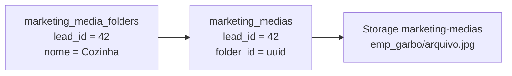
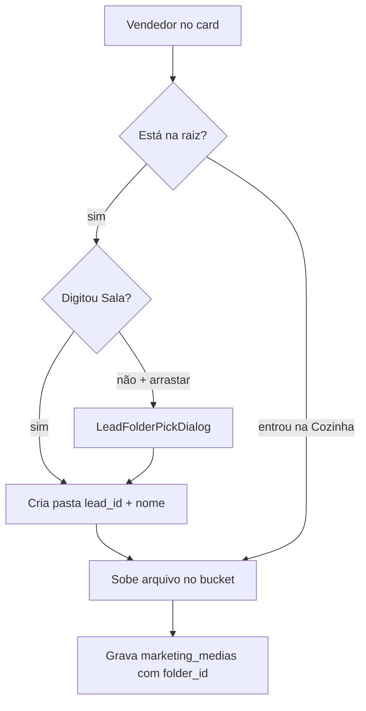

# PRD — Pastas do card do lead (anexos)

**Produto:** CRM Selletos  
**Versão:** 1.0  
**Data:** 31/08/2026  
**Status:** Retrato completo do sistema de pastas em produção  
**Onde vive:** não é rota — bloco **Materiais do lead** dentro da aba **Detalhes** do `LeadModal`  
**Componente:** `src/components/leads/LeadPDFAttachments.tsx`  
**Ficha do card:** [06-lead-modal.md](06-lead-modal.md) · **Lousa (salva nesta pasta):** `docs/prd/2026-08-03-lousa-whiteboard-prd.md`  
**Render IA (copia PNG nos anexos):** [06b-renderizacao-ia-completo.md](06b-renderizacao-ia-completo.md)

Este capítulo descreve **todo o sistema de pastas do card**: o que é uma pasta, o layout da grade, o upload, o diálogo “onde guardar”, a lousa, o chat de projetos, a Biblioteca e o que **não** é pasta.

---

## 1. O que é (linguagem simples)

Pense no card do cliente como uma **pasta de papelão** no escritório. Dentro dela, a equipe não joga tudo num monte: cria **gavetas** com nome de cômodo.

| Nome na tela | Analogia |
|------------|----------|
| **Sala**, **Cozinha**, **Fachada** | Gavetas com nome. Você escolhe. |
| **Sem pasta** | A mesa da entrada: arquivos que ainda não foram guardados. |
| **chat** | Gaveta automática: fotos que o titular e o projetista mandam no rádio do ateliê. |
| **orçamentos** (Biblioteca da empresa) | Armário compartilhado da loja. Os renders da IA costumam cair aqui **e** ficar visíveis no card. |

Uma pasta **não apaga arquivos** quando some. Apagar a gaveta só tira o rótulo: os arquivos voltam para **Sem pasta**.

**Não misturar com:**

| Isto | Onde | O que é |
|------|------|---------|
| Pastas de **Eventos** | `/controle-eventos` | Evento da empresa (festa, feira), não o cliente |
| Pastas da **Biblioteca** sem lead | `/biblioteca` | Acervo da loja (`lead_id` vazio) |
| **Composição de orçamento** | Biblioteca | Pasta especial dos slides, sem dono de lead |
| Checklist da visita | Lousa | Lista “já fotografei a cozinha?” — **não** cria gaveta |
| Lousa de **ambiente** (IA) | Aba Análise IA | Estúdio 2D para render, não o arquivo do card |

---

## 2. Onde clicar (mapa da ficha)

```
LeadModal → aba Detalhes
└── Seção “Materiais do lead” (ícone FolderOpen)
    ├── Contratos
    ├── Orçamentos em slides
    ├── Markup
    ├── Anexar PDFs, fotos e vídeos   ← as pastas moram aqui
    │   ├── Vista raiz: grade de gavetas
    │   └── Dentro da gaveta: grade de arquivos
    ├── Memória IA
    ├── WhatsApp
    └── Lousa (disquete → escolhe pasta)
```

Título da seção: **Materiais do lead**. No ateliê de Projetos o texto muda (“Markup e orçamento ficam no topo”).

---

## 3. Duas visões (raiz × dentro da gaveta)

O estado `currentFolderId` decide o que você vê:

| Vista | `currentFolderId` | O que aparece |
|-------|-------------------|---------------|
| **Raiz** | `null` | Grade de pastas + zona de upload com campo “Nome da pasta” |
| **Dentro de uma pasta** | uuid da pasta | Barra “← Pastas / Nome” + arquivos só daquela gaveta |
| **Sem pasta** | `'__unfiled__'` | Arquivos cujo `folder_id` não é de nenhuma pasta **deste** lead |

Na raiz **não** lista os arquivos soltos no meio das gavetas. Eles ficam no card tracejado **Sem pasta**. Clique nele para entrar.

---

## 4. Layout da grade (raiz)

Grid `grid-cols-2` / `sm:grid-cols-3`. Cada gaveta é `LeadAttachmentFolderCard`.

### 4.1 Cartão de pasta nomeada

Visual de **álbum de fotos em mogno**:

- Borda ouro sutil, fundo `from-mahogany-card/80 to-mahogany-elevated/40`
- Sombra interna ouro + sombra preta 18%
- Véu de “grão de filme” (`repeating-radial-gradient`, opacity 7%)
- Entrada: fade + slide de baixo, atraso 40 ms por card (máx. 280 ms)
- Hover: sobe 2 px, borda âmbar

**Capa:** até **3 fotos** empilhadas, giradas −7° / 0° / +7°, como polaroids. Sem foto: ícone **Folder** âmbar; no hover vira **FolderOpen**.

Rodapé: nome (truncate) + “N arquivo(s)”.

Ações (quem pode gerenciar anexos):

| Controle | Onde | Faz |
|----------|------|-----|
| Lápis | canto superior esquerdo | Renomeia no próprio card |
| ⋮ | canto superior direito | Renomear / Excluir pasta |
| Play | canto inferior direito | Slideshow das fotos da pasta |

### 4.2 Cartão “Sem pasta”

Borda **tracejada**, fundo quase transparente. Título **Sem pasta**. O lápis **dá um nome**: cria a gaveta de verdade e **move** os arquivos órfãos para ela (não move render virtual nem upload de formulário da agenda).

Só aparece se `unfiledCount > 0`.

### 4.3 Nova pasta (atalho)

Botão **Nova pasta** no cabeçalho. Abre um card tracejado ouro com o mesmo editor de nome (Enter salva, Esc cancela). Placeholder: `Ex.: Sala`.

Nome duplicado no **mesmo lead** (ignora maiúsculas): toast “Já existe uma pasta com esse nome neste lead”.

---

## 5. Dentro da pasta

Barra `rounded-xl` mogno:

`← Pastas`  `/`  ícone FolderOpen  **nome**  [lápis] [lixeira] [Tela cheia]

- Lápis: mesmo editor da raiz. Em **Sem pasta**, o lápis **batiza** a gaveta (igual ao card).
- Lixeira: só pasta real, não “Sem pasta”. Confirma: arquivos vão para Sem pasta.
- **Tela cheia**: abre o visualizador na primeira imagem da gaveta; setas andam só nas fotos da vista atual.

Upload, com você já **dentro**: os arquivos caem **nessa** gaveta. Não pede nome de novo. Texto: `Enviar para “Cozinha” · máx. 200MB`.

---

## 6. Como entra arquivo na pasta

### 6.1 Arrastar ou “Selecionar arquivos” (raiz)

1. Campo **Nome da pasta** (`#lead-upload-folder-name`). Exemplos: Sala, Cozinha, Fachada.
2. Se o nome estiver preenchido: cria a gaveta se faltar, entra nela, sobe os arquivos.
3. Se o nome estiver vazio e você clicar em selecionar: toast “Escreva o nome da pasta…”.
4. Se você **arrastar** sem nome: abre o diálogo **LeadFolderPickDialog** (“Onde guardar?”). Não deixa “Sem pasta” neste fluxo (`allowUnfiled={false}`).

Tipos: PDF, imagem, vídeo (mp4/webm). Teto **200 MB**.

Lead **ainda não salvo**: arquivos ficam **pendentes** (borda pontilhada, selo Pendente). Só sobem ao gravar o card (`flushPendingPdfs`).

### 6.2 Diálogo “Onde guardar?” (mogno escuro)

`LeadFolderPickDialog` — `data-lead-folder-picker=""`. Fundo `#1a100c`, kicker `PASTAS DO LEAD`, blur ouro no topo.

Usado em dois momentos:

| Origem | Pede nome do arquivo? | Observações da visita? |
|--------|----------------------|-------------------------|
| Upload na raiz | Nome da pasta (cria se faltar) | Não |
| Disquete da **lousa** | Nome da **foto** + pasta | Sim: PDF + imagem no papel timbrado |

Grade de escolha: 2 / 3 colunas, polaroids menores. Card **Sem pasta** tracejado (quando permitido). Botão **Nova pasta** embaixo.

Na lousa em tela cheia o diálogo sobe de z-index (`z-[9800]`), para não ficar atrás da lousa.

### 6.3 Lousa (disquete)

A lousa **não é** a pasta. Ela **despeja** na pasta:

1. Você desenha na foto.
2. Disquete → escolhe nome + gaveta.
3. Entram: foto (e, se marcado, observações em PDF e em imagem, papel timbrado).
4. A lousa limpa.

Botão **Do projeto** na lousa: puxa foto **já** anexada; se ela já tinha pasta, a cópia volta para a **mesma** gaveta (`WhiteboardProjectImagePicker`).

Botão **Editar na lousa** no thumbnail do anexo: abre a lousa com aquela foto e já sugere a pasta atual.

### 6.4 Chat do ateliê (pasta automática `chat`)

Quando titular ou projetista manda imagem no rádio de Projetos:

1. `getOrCreateLeadChatFolder` garante a gaveta **chat** daquele lead (`lead_id` preenchido).
2. Arquivo no Storage: `{schema}/chat/{leadId}/{timestamp}.jpg`.
3. Registro em `marketing_medias` com `folder_id` da gaveta chat.

A gaveta **chat** aparece na grade como qualquer outra. Não apague sem querer: as fotos do canal continuam no histórico do chat.

### 6.5 Render IA

A Edge Function grava o PNG no bucket e tenta a pasta da **empresa** chamada **orçamentos** (`lead_id` **nulo** — pasta da Biblioteca, não uma gaveta do lead).

O arquivo **tem** `lead_id` do cliente. No card:

- a gaveta **orçamentos da empresa** **não** entra na grade do lead (a lista só mostra pastas com `lead_id` = este lead);
- o PNG aparece em **Sem pasta** (ou na vista raiz misturado via “não está numa pasta deste lead”).

Ou seja: o time acha o render nos anexos do card **e** na Biblioteca, pasta Orçamentos.

Renders antigos ainda não copiados aparecem como anexo **virtual** (`ai-render:{uuid}`) até sincronizar.

### 6.6 Formulário da agenda

Uploads do agendamento público entram nos anexos do lead (dedupe por URL). Costumam chegar **sem** gaveta do lead → **Sem pasta**.

---

## 7. Grade de arquivos (dentro da vista)

`grid-cols-2 sm:grid-cols-3`. Thumbnail + nome. Clique: PDF / foto / vídeo em tela cheia.

| Ação | Quem |
|------|------|
| Ampliar | todos que veem o anexo |
| Baixar | admin / quem gerencia anexos; no modo só leitura do prestador, se liberado |
| Lápis (lousa) | quem envia anexos |
| Lixeira | **admin e projetista** (`canDeleteLeadAttachments`) — vendedor **não** apaga |
| Selecionar fotos | ≥ 2 imagens na vista → exportar PDF (com ou sem notas da visita) |

Upload de formulário da agenda: **não** tem lixeira neste bloco (`isFormUpload`).

---

## 8. Quem pode o quê

| Ação | Quem |
|------|------|
| Ver pastas e arquivos | Quem abre o card |
| Criar / renomear / enviar | Admin, vendedor, projetista, ou permissão `leads` **edit** |
| Apagar **arquivo** | Admin ou projetista |
| Apagar **pasta** | Quem gerencia anexos (os arquivos sobrevivem) |
| Prestador | Só o que `lead_prestador_permissoes` liberar (foto/PDF um a um) — **não** gerencia gavetas |

Lead novo: dá para escolher arquivos, mas **criar pasta no banco** exige `leadId`. Mensagem: “Salve o lead antes de criar pastas”.

---

## 9. Espelho na Biblioteca

`/biblioteca` lista **Pastas de leads** (`BibliotecaLeadFoldersSection`): agrupadas pelo nome do cliente, rótulo `Maria · Cozinha`.

É o **mesmo** registro. Mudou no card, muda na Biblioteca. Pastas da loja (`lead_id` nulo) ficam na seção de cima, misturadas com “composição de orçamento”.

---

## 10. Dados (como é feito por baixo)

Uma pasta **não é** uma pasta de arquivo no disco. É uma **etiqueta** no banco.



| Tabela | Papel |
|--------|--------|
| `marketing_media_folders` (ou `crm_multiempresas_marketing_media_folders` no master) | Gaveta: `id`, `nome`, `descricao`, `lead_id` |
| `marketing_medias` | Arquivo: `folder_id`, `lead_id`, tipo, URL |

- `lead_id` **preenchido** na pasta = gaveta do card.  
- `lead_id` **nulo** = pasta da Biblioteca da empresa.  
- Arquivo **sempre** pode ter `lead_id` mesmo com pasta da empresa (caso dos renders).

Consulta do card: pastas `.eq('lead_id', leadId)` ordenadas por nome. Arquivos do lead: `useLeadPDFs` filtra mídias daquele `lead_id`.

Storage de upload comum: `{schema}/{timestamp}-{rand}.ext` (não cria subpasta física “Cozinha”). Só o chat usa subpasta `chat/{leadId}/`.

Migration: `20260821120000_lead_media_folders_lead_id.sql` (coluna `lead_id` nas tabelas de pastas).

Índice: `lead_id` nas pastas. Nome único **não** é constraint do banco — a regra “sem duplicata neste lead” é no hook.

Apagar pasta: `DELETE` da pasta; `folder_id` dos arquivos fica órfão → UI trata como Sem pasta (`isAttachmentInLeadFolder` só aceita ids da lista atual).

---

## 11. Fluxo completo (do clique ao banco)



Depois do upload: `bumpLeadKnowledgeReindex` — a Íris Sky passa a “enxergar” o arquivo na memória do lead.

---

## 12. Catálogo visual (efeitos)

| Peça | O que o olho vê |
|------|------------------|
| Cartão de pasta | Gradiente mogno, filete ouro interno, grão de filme |
| Hover pasta | Sobe 2 px, Folder → FolderOpen |
| Polaroids | 3 capas rotacionadas, sombra |
| Sem pasta | Tracejado, ícone Images |
| Zona de upload | Tracejado; no drag vira borda primary |
| Diálogo escolher pasta | Mogno `#1a100c`, radial ouro, glow âmbar no selecionado |
| Barra “dentro da pasta” | Vidro mogno, breadcrumb Pastas / nome |
| Thumbnail | Hover mostra lápis e lixeira |

**Não** use o foil WebGL do compositor de ambiente aqui. Pastas do lead são **álbum**, não lousa 3D.

`prefers-reduced-motion`: a entrada `animate-in` some se o sistema pedir menos movimento (Tailwind).

---

## 13. Celular

Grade 2 colunas. Lápis e ⋮ em 28 px. Upload pelo seletor do sistema (`runWithFilePickerGuard` para o LeadModal **não fechar**). Tirar foto na lousa usa a câmera; o destino continua sendo a gaveta escolhida no disquete.

---

## 14. Regras para reconstruir

1. **Pasta = etiqueta + `lead_id`.** Não crie diretório físico “Cozinha” no Storage (exceto o prefixo `chat/{leadId}`).
2. **Lista do card** só pastas daquele lead. Pastas da empresa não viram cartão no card.
3. **Apagar pasta ≠ apagar arquivo.** Sempre SET NULL / órfão → Sem pasta.
4. **Nome único por lead** (case-insensitive, trim de espaços).
5. **Sem pasta** é id virtual `'__unfiled__'` — **não** grave isso no banco.
6. Upload na raiz **exige nome** (campo ou diálogo). Não despeje tudo solto sem perguntar.
7. Vendedor envia; **só admin/projetista apaga arquivo**.
8. Lousa e chat **reusam** o mesmo `folder_id`. Não duplique tabela.
9. Render IA pode usar pasta **orçamentos da empresa**; o PNG ainda tem `lead_id` e aparece no card.
10. Prestador não gerencia gavetas; só vê o que a permissão marcar.
11. Lead sem id: fila pendente, pasta só depois de salvar.
12. Não copie o modelo de pastas de **Eventos** (lá a pasta **é** o evento).

---

## 15. Mapa de arquivos

| Peça | Arquivo |
|------|---------|
| Grade + upload | `src/components/leads/LeadPDFAttachments.tsx` |
| Cartão da gaveta | `LeadAttachmentFolderCard.tsx` |
| Diálogo escolher | `LeadFolderPickDialog.tsx` |
| Hook pastas | `src/hooks/useLeadMediaFolders.ts` |
| Hook arquivos | `src/hooks/useLeadPDFs.ts` |
| Helpers | `src/lib/lead-media-folders.ts` |
| Chat → pasta chat | `src/lib/lead-projeto-chat.ts` |
| Render → orçamentos | `supabase/functions/render-lead-project` (e ambiente / edit) |
| Biblioteca | `BibliotecaLeadFoldersSection.tsx` |
| Tipos pasta | `MarketingMediaFolder` em `useMarketingMediaFolders.ts` |
| Permissões | `canManageLeadAttachments` / `canDeleteLeadAttachments` |
| Prestador | `src/lib/prestador-visibilidade.ts` |
| Seção no card | `LeadModal.tsx` → Materiais do lead |
| Migration | `supabase/migrations/20260821120000_lead_media_folders_lead_id.sql` |
