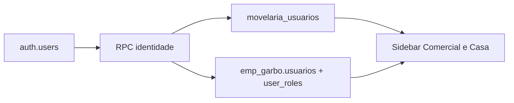

# Plano vivo — Vistoria de integração + identidade dual + Projetos

**Status:** E0–E4 aplicados e testados no browser (28/08/2026)  

**Caderno de vistoria:** [vistoria-integracao.md](vistoria-integracao.md)  
**Regra:** consulte este arquivo antes de cada épico. Não pulá-los. Testar ao fim de cada um. Não commitar até o usuário pedir.

Sou **Auto (Cursor Grok 4.6)**. Nada entra no banco em produção sem um relatório seco (só leitura) e o ok do dono da casa — salvo quando o usuário pediu explicitamente para aplicar o plano inteiro.

---

## Como o prédio funciona hoje

Um login (`auth.users`) carrega **duas fichas** pela RPC `movelaria_obter_minha_identidade` (`supabase/migrations/172_identidade_unificada.sql`):

- **Casa (fábrica):** `public.movelaria_usuarios` — `perfil` + `perfis_extras` (Administrador, Financeiro, Montador…).
- **Comercial (CRM):** `emp_garbo.usuarios` + `emp_garbo.user_roles` — `admin`, `vendedor`, `projetista`, `marketing`…
- O menu em `src/lib/app-navigation.ts` é a **união** dos dois crachás (`OR`). Quem só tem Casa **não** deve ver Pipeline; quem só tem CRM **não** deve ver Caixa.

| Quem era no mundo antigo | O que ganha no sistema fundido |
|--------------------------|--------------------------------|
| Só fábrica | Entra. Vê **só Casa**. Sem papéis CRM. |
| Só CRM | Entra. Vê **só Comercial**. Sem perfil de fábrica. |
| Existia nos dois | **Duas funções** no mesmo `auth.users.id`: ficha Casa **e** ficha CRM, cada uma com o que a pessoa já tinha. |

O perigo real: **mesmo e-mail, dois UUIDs** — a RPC junta só por `id`, então a pessoa perde um dos mundos.

## Congelado de propósito

Sem seletor de empresas, sem Expo, sem Stripe, schema `emp_garbo`.

## Épico 0 — Relatório de vistoria (só leitura)

Caderno: `docs/vistoria-integracao.md`

1. Matriz PRD × código × rota × menu × teste (`scripts/test-crm-*.mjs`).
2. Inventário de Edge Functions vs PRD (`docs/documentoprd.md` §12).
3. LeadModal: abas e painéis vs painel Projetos.
4. Census SQL (sem UPDATE): Casa, CRM, match por id e e-mail.
5. Advisors RLS no MCP Supabase.

**Pronto quando:** o relatório lista cada pessoa problemática e cada módulo com OK / PARCIAL / AUSENTE.

**Feito em 28/08/2026:** `docs/vistoria-integracao.md` + `scripts/audit-identidades.mjs`. Census: 5 duais, 7 só Casa, 23 só CRM (prestadores), 0 e-mails com ids diferentes. Sem merge de UUID.

## Épico 1 — Banco: duas funções, sem misturar crachás

Arquivos: `172_identidade_unificada.sql`, `useAuth.ts`, `crm-identity.ts`, `Configuracoes.tsx`, `useUsuarios.ts`.

1. Relatório seco (`scripts/audit-identidades.mjs`).
2. Migração: merge por e-mail no mesmo `auth.uid`; não promover admin da fábrica a admin CRM.
3. Tela: duas colunas Função Casa / Função CRM; projetista no `/admin`.
4. Teste por persona no browser (porta 3001).

## Épico 2 — Trazer Projetos (ateliê)

**Feito:** `/projetos` + item no Comercial + painel no LeadModal + home do projetista-only.

## Épico 3 — Fechar furos de casco

**Feito:** `/agenda` → `/agenda-comercial`; `/admin/empresas` → `/admin/marca`; AuthContext aceita projetista; gate tipo `lead` sem Casa fica pendente.

## Épico 4 — Certificação E2E

**Feito no browser (selvomichael, dual):** Projetos com 12 cards reais, Configurações com Função Casa/CRM, admin com checkboxes de projetista, `/agenda` redireciona, Caixa abre. Scripts: `audit-identidades.mjs`, `test-identidade-unificada.mjs`, `test-crm-sidebar.mjs`, `test-crm-projetos.mjs`.

## Ordem

E0 → E1 → E2 e E3 em paralelo após E1 → E4.

## O que não fazer

- Não commitar até o usuário pedir.
- Não promover todo mundo a admin CRM.
- Não reabrir seletor de empresas / Expo / Stripe.
- Não editar o plano antigo de unificação em `.cursor/plans`.
