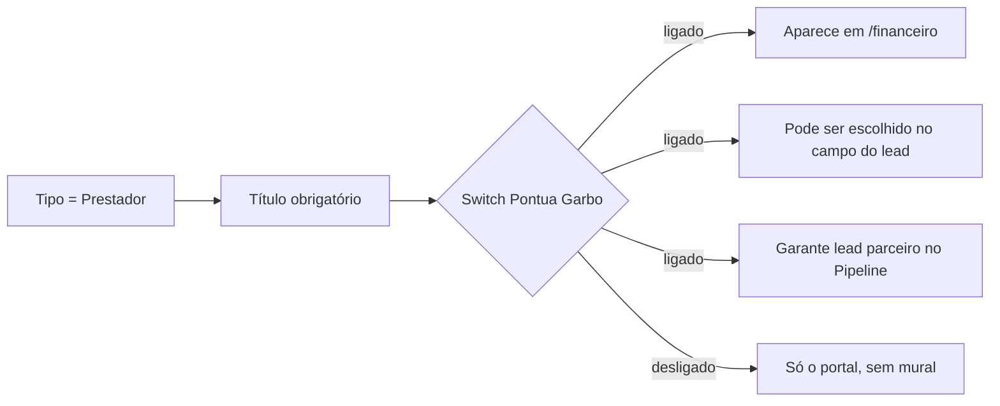

# PRD — Gestão de Usuários: pessoas, papéis e porta do Pontua Garbo

**Produto:** CRM Selletos  
**Versão:** 1.0  
**Data:** 28/08/2026  
**Status:** Retrato completo do módulo em produção  
**Rota:** `/admin`  
**URL de referência:** `http://localhost:8081/admin`  
**Página:** `src/pages/Admin.tsx`  
**Ficha curta:** [11-admin.md](11-admin.md) · **Domínio:** [admin-multi-empresa.md](../04-dominios/admin-multi-empresa.md)  
**Quem aparece no mural financeiro:** [17b-financeiro-pontua-garbo-completo.md](17b-financeiro-pontua-garbo-completo.md)

Este capítulo descreve **a dinâmica inteira** da Gestão de Usuários: os três tipos de pessoa, os papéis do colaborador, a tabela, os botões de cada linha, o cadastro (incluindo o interruptor Pontua Garbo), os links públicos, origens, títulos e a grade de permissões.

---

## 1. O que é esta tela (linguagem simples)

Pense na **portaria do prédio**.

O Financeiro é a vitrine dos arquitetos. **Gestão de Usuários** é o caderno da portaria: quem pode entrar, com qual crachá, em que horário, e se o arquiteto participa do Pontua Garbo.

Menu: **Administração ▸ Gestão de Usuários** (`/admin`).

Três abas no topo:

| Aba | O que é |
|-----|---------|
| **Usuários** | Cadastro, tabela, links, origens, títulos, permissões |
| **Gerenciamento de Uso** | Presença (quem está logado) e ponto |
| **Logo e Nome** | Marca no menu lateral (mesmo formulário de `/admin/marca`) |

Este PRD aprofunda a aba **Usuários** — é ela que alimenta o Pontua Garbo. As outras duas ficam resumidas no final.

Referência real (Garbo, ago/2026): empresa ativa **Garbo Movelaria** (`emp_garbo`), **28** usuários = **5** colaboradores + **0** leads + **23** prestadores. Os 23 prestadores com comissão ligada são os 23 cartões do mural em `/financeiro`.

### 1.1 Tipo ≠ papel (leia isto primeiro)

São **duas gavetas diferentes**. Misturá-las quebra o sistema.

**Tipo de usuário** (`tipo_usuario`) — *o que a pessoa é na casa*:

| Tipo | Quem é | Entra no CRM como |
|------|--------|-------------------|
| `colaborador` | Equipe interna | Sidebar normal, papéis (admin, vendedor…) |
| `prestador_servico` | Profissional externo (arquiteto, consultor) | **Portal próprio**, sem sidebar |
| `lead` | Cliente/prospect com login | Acesso **desligado** por padrão |

**Papel** (`user_roles`) — *o que o colaborador pode fazer*:

`admin` · `vendedor` · `projetista` · `projetista_admin` · `marketing` · `nenhum`

Uma pessoa pode ter **vários papéis** (ex.: vendedor + marketing). Prestador **não escolhe papel** no formulário: o sistema grava `vendedor` só para o registro existir, mas o crachá da tela é o **título** (Arquiteto, Consultor…) + badge ouro **Pontua Garbo** se `comissao_ativa`.

---

## 2. Quem entra

| Papel | Vê `/admin`? |
|-------|:------------:|
| Admin / super-admin | sim |
| Vendedor, projetista, marketing sem admin | **não** — card “Acesso Restrito” |
| Prestador | sem sidebar |

Código: `canAccessAdmin` = `userRole === 'admin' || isSuperAdmin`. Super-admin **sem** empresa selecionada vê alerta: “vá em Gerenciamento de Empresas → Entrar”. O botão **Cadastrar Usuário** fica desabilitado até haver empresa.

Linha abaixo das abas: `Empresa ativa: Garbo Movelaria (emp_garbo)`.

---

## 3. Layout da aba Usuários

Padding `p-8 space-y-6`. Visual Bourbon (glass cards), **sem** o header itálico mogno do Financeiro — aqui é oficina administrativa, não vitrine.

```
┌─────────────────────────────────────────────────────────────────┐
│  [Usuários] [Gerenciamento de Uso] [Logo e Nome]                 │
│  Empresa ativa: …                                                │
├─────────────────────────────────────────────────────────────────┤
│  Usuários do Sistema                          [+ Cadastrar]      │
│  [Todos 28] [Colaboradores 5] [Leads 0] [Prestadores 23]         │
│  tabela: avatar, e-mail, telefone, tipo/papel, horário, ações    │
├─────────────────────────────────────────────────────────────────┤
│  Links de Cadastro  (4 cards: prestador, lead, colaborador, mkt) │
├─────────────────────────────────────────────────────────────────┤
│  Tipos de usuário (legenda)  │  Origens de Leads                 │
│  Títulos de Prestador        │                                   │
├─────────────────────────────────────────────────────────────────┤
│  Gestão de Permissões  [Vendedor | Nenhum]  grade de switches    │
└─────────────────────────────────────────────────────────────────┘
```

---

## 4. Filtros por tipo

Pílulas com contagem:

- **Todos** — lista inteira (`status_convite = ATIVO`).
- **Colaboradores** — equipe (badges de papel: ADMIN vermelho, VENDEDOR ouro, MARKETING verde, PROJETISTA ciano…).
- **Leads** — badge azul LEAD.
- **Prestadores** — subtítulo “Prestador de Serviço”, badge violeta com o **título** (Arquiteto), e se estiver no programa: badge âmbar Trophy **Pontua Garbo**.

O filtro só esconde linhas. Não apaga ninguém.

---

## 5. Tabela

Colunas: **Usuário** · **Email** · **Telefone** · **Tipo / Papel** · **Horários de acesso** · **Ações**.

Usuário: avatar com iniciais + nome. Prestador/lead ganham uma linha miúda com o tipo.

Telefone: formatado `+55 (31) 9xxxx-xxxx` quando tem 11+ dígitos.

Horário: `08:00 - 18:00` ou **Sem restrição** (os dois campos vazios). Fora desse intervalo o colaborador cai na tela de horário (ficha 02).

Você **não pode editar nem apagar a si mesmo** (lápis e lixeira desabilitados na própria linha).

### 5.1 Cinco ações da linha (esquerda → direita)

| Ícone | Nome na dica | O que faz de verdade |
|-------|--------------|----------------------|
| Cadeado aberto | Corrigir acesso | Edge `fix-user-access` (e-mail). Conserta login travado. |
| Copiar | Copiar site, login e senha (telefone) | Redefine a senha **para os dígitos do telefone** e copia um texto pronto (site + e-mail + senha) para mandar à pessoa. Sem telefone válido: recusa. |
| Chave | Redefinir senha | Dialog com senha nova + confirmação (`PASSWORD_RULES_HINT`). |
| Lápis | Editar | Dialog de edição. |
| Lixeira vermelha | Excluir | Confirmação. Se a pessoa tiver leads, obriga **transferir** para outro admin/vendedor antes. |

Edge de exclusão: `delete-user`. Senha: `reset-user-password`. Criação: `create-user-admin`.

Lista só quem está **ATIVO**. Convite pendente não aparece nesta tabela.

---

## 6. Cadastrar usuário

Botão ouro **+ Cadastrar Usuário**. Dialog `sm:max-w-[520px]`, corpo rolável.

### 6.1 Três cartas de tipo (obrigatório escolher uma)

```
┌─────────────┐  ┌─────────────┐  ┌─────────────┐
│ Colaborador │  │    Lead     │  │  Prestador  │
│ Admin/Vend. │  │  prospecto  │  │ título+PIX  │
└─────────────┘  └─────────────┘  └─────────────┘
```

Selecionada: borda primary + fundo primary/5.

Campos comuns: **Nome completo** (mín. 3), **Email**, **Telefone** opcional (só dígitos, 11–15, DDI).

### 6.2 Se for Colaborador

Aparece `RoleMultiSelect`: pode marcar vários papéis. Não deixa gravar só `nenhum`.

### 6.3 Se for Lead

Alerta: cadastrado **sem acesso**. Admin pode ligar depois editando (na prática o tipo não muda no edit — o edit mostra o tipo só como leitura).

Papel gravado: `nenhum`.

### 6.4 Se for Prestador (porta do Pontua Garbo)

1. **Título obrigatório** (`PrestadorTituloField`) — escolhe da lista (Arquiteto, Consultor, Coach…) ou cadastra um novo no `+`. Sem título o save recusa.
2. Faixa âmbar com Trophy:

   **Comissão — Programa Pontua Garbo**  
   “Permite receber comissão sobre orçamentos de leads.”  
   Switch `comissao_ativa`.

   - Ligado → a pessoa **entra no mural** `/financeiro` e pode ser escolhida no campo Pontua Garbo do lead.
   - Desligado → é prestador (portal), mas **não** é “reconhecido” no programa.

Papel gravado nos bastidores: `['vendedor']` (não aparece como VENDEDOR na tabela; aparece o título).

Validação Zod no front; a criação de fato é a Edge Function (precisa `empresaId` + `schemaNome`).

---

## 7. Editar usuário

Tipo **não troca** (faixa informativa: “Tipo: Prestador de Serviço”).

Campos: nome, e-mail, telefone.

- Colaborador: de novo os papéis.
- Prestador: título + o **mesmo switch Pontua Garbo**.
- Todos: horário início / fim (`HH:mm`, vazio = sem trava).

Se o admin **ligar** o switch Pontua num prestador já existente, chama `ensurePontuaGarboLead`: garante o card parceiro no Pipeline (origem Pontua Garbo, vínculo `pontua_garbo_usuario_id`).

---

## 8. Links de cadastro público

Quatro cartões coloridos (não é o tema mogno; são pastéis para diferenciar o *tipo* do link):

| Tipo na URL | Rótulo | Cor | Vira no banco |
|-------------|--------|-----|----------------|
| `/cadastro/prestador` | Prestador de Serviço | violeta | `prestador_servico` |
| `/cadastro/lead` | Cliente / Lead | azul | `lead` |
| `/cadastro/colaborador` | Colaborador & Vendedor | esmeralda | `colaborador` + papel vendedor |
| `/cadastro/marketing` | Marketing | âmbar | `colaborador` + papel marketing |

Cada um: **Copiar** (URL absoluta com `?e={empresaId}&s={schema}`) e **Abrir**. Página pública: `CadastroPublico.tsx` → Edge `register-public`. Paleta própria “Carbo” (chocolate/creme) — não é o CRM logado.

Sem empresa selecionada: aviso âmbar e os links saem sem query string (cadastro quebra ou cai no master).

O formulário da **apresentação Pontua Garbo** (`/marketing/pontua-garbo`) usa o mesmo `register-public` como prestador — é o equivalente “bonito” deste link violeta.

---

## 9. Legenda de tipos, origens e títulos

Três cards no rodapé da aba (grade 2 colunas no desktop):

### 9.1 Informações sobre Tipos de Usuário

Legenda estática: o que ADMIN / VENDEDOR / PROJETISTA ADMIN / PROJETISTA / MARKETING / LEAD / PRESTADOR enxergam. Não grava nada.

### 9.2 Origens de Leads

Lista de fontes (`useLeadOrigins`). Badge **Padrão** não apaga. **Nova Origem** (mín. 3 letras). Origem **Pontua Garbo** é a que o sistema usa no card do parceiro — não misturar com “Instagram” etc.

### 9.3 Títulos de Prestador

Chips da tabela `prestador_titulos`. Remover no ×. Criar novos pelo `+` dentro do campo de título no cadastro/edição. Exemplos em produção: Arquiteto, Consultor, Analista, Coach, Coordenador…

O mural financeiro mostra esse título no selo ouro. Sem título cadastrado na pessoa, o mural escreve **Arquiteto** só para exibir.

---

## 10. Gestão de Permissões

Card com sub-abas **Vendedor** | **Nenhum**. Componente `PermissionsTable`.

Não é “pode entrar no Financeiro”. É **o que o vendedor (ou o papel nenhum) vê/edita no lead e no dashboard**.

Categorias:

- Dashboard (completo, valor total, gráfico por origem)
- Dados do Lead (telefone, e-mail, empresa, origem, valor, vendedor, status, nome, observações, WhatsApp)
- Acesso Geral (todos os leads, página leads, pipeline)
- Automações (números negativados)

Cada linha: switch **Pode Ver** e, quando faz sentido, **Pode Editar**. Grava `user_permissions` (resource + action + allowed) por `role`.

Admin **ignora** essa grade: tem acesso total. Prestador usa outra lista (`lead_prestador_permissoes` no portal).

---

## 11. Abas vizinhas (resumo)

### 11.1 Gerenciamento de Uso

`GerenciamentoUsoContent`. Duas tabelas:

- **Presença** — sessões (`presence_sessions`), recorte 7 dias (ajustável).
- **Ponto** — `ponto_registros` (entrada/saída).

Não mexe em comissão. É o relógio de ponto da equipe.

### 11.2 Logo e Nome

`EmpresaBrandingForm`: logo, cor primária (acento da sidebar, **não** recolore o CRM inteiro), banners. Super-admin sem empresa é mandado para `/admin/empresas`.

Rotas irmãs (não são esta aba): `/admin/marca`, `/admin/empresas` (só super-admin), `/admin/webhooks`.

---

## 12. Como esta tela alimenta o Pontua Garbo



Na tabela, o badge ouro **Pontua Garbo** ao lado de “Arquiteto” é o mesmo interruptor. Os 23 prestadores da Garbo com o badge são os 23 cartões **Reconhecido** do mural.

Copiar acesso / redefinir senha **não** mudam comissão. Apagar um prestador tira a pessoa do mural (e pede transferir leads se houver).

---

## 13. Tabelas, Edges e arquivos

| Destino | O quê |
|---------|--------|
| `usuarios` | nome, e-mail, telefone, tipo, título, `comissao_ativa`, horário, `status_convite`, PIX |
| `user_roles` | papéis (vários) |
| `user_permissions` | grade vendedor/nenhum |
| `prestador_titulos` | lista de títulos |
| `lead_origins` | origens |
| `presence_sessions` / `ponto_registros` | aba Uso |

| Edge Function | Quando |
|---------------|--------|
| `create-user-admin` | Cadastrar |
| `delete-user` | Excluir (+ transferir leads) |
| `reset-user-password` | Chave e botão copiar |
| `fix-user-access` | Cadeado |
| `register-public` | Links `/cadastro/:tipo` e form da apresentação |

Arquivos: `Admin.tsx`, `useUsers.ts`, `RoleMultiSelect`, `PrestadorTituloField`, `PermissionsTable`, `GerenciamentoUsoContent`, `EmpresaBrandingForm`, `CadastroPublico.tsx`.

---

## 14. Regras que não podem quebrar

1. Só admin (ou super-admin) abre `/admin`.
2. Super-admin precisa **entrar na empresa** antes de cadastrar.
3. Tipo e papel são coisas diferentes; prestador não é “um vendedor com outro nome”.
4. Prestador no Pontua = `comissao_ativa`. Sem isso, não vai ao mural.
5. Título obrigatório no cadastro de prestador.
6. Não editar/apagar a si mesmo.
7. Apagar dono de lead exige transferir para admin/vendedor.
8. Senha do botão copiar = telefone (comportamento atual; documentar, não “melhorar” no rebuild sem pedido).
9. Cor primária da marca **não** pinta o CRM todo.
10. Lista só `status_convite = ATIVO`.

---

## 15. Vazio / erro / loading

| Situação | Tela |
|----------|------|
| Sem permissão | Card central “Acesso Restrito” |
| Carregando tabela | “Carregando usuários…” |
| Filtro vazio | “Nenhum prestador encontrado” (etc.) |
| Sem empresa | Alerta + Cadastrar desabilitado |
| Zod | toast com a primeira mensagem |
| Edge falhou | toast de erro |
| Copiar acesso ok | “Credenciais copiadas!” |

---

## 16. Celular vs computador

A tabela pede **desktop** (muitas colunas + cinco ícones). No telefone, dialogs vão `max-h-[90dvh]` com corpo rolável. Filtros e links publicam em coluna. Permissões e ponto quase inutilizáveis no mobile — reconstruir com a mesma restrição: “esta tela é de escritório”.

---

## 17. Definição de pronto (rebuild)

- [ ] Três abas; Usuários é o padrão.
- [ ] Filtros Todos / Colaboradores / Leads / Prestadores com contagem.
- [ ] Badge Pontua Garbo só com `comissao_ativa`.
- [ ] Cinco ações da linha + bloqueio da própria conta.
- [ ] Cadastro com 3 tipos; prestador exige título + switch.
- [ ] Editar religa o lead parceiro ao ligar o switch.
- [ ] Quatro links públicos com empresa na query.
- [ ] Origens e títulos CRUD.
- [ ] Grade de permissões vendedor/nenhum.
- [ ] Transferência de leads na exclusão.
- [ ] Empresa ativa visível no topo.
