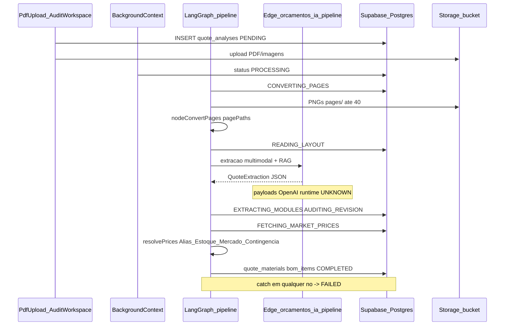

# PRD v11 — Sistema de Orçamentação e Precificação IA Modular & Transparente (Corte Claude)

| Campo | Valor |
| ------ | ------ |
| **Versão** | **11.3-cortecloud-evidence** |
| **Data** | 13 de Outubro de 2026 |
| **Status** | **Canônico** — fonte única do módulo Orçamentos IA (aplicação em épicos / teste ELITON GOURMET) |
| **Base normativa** | PRD v10 (`orcamento-com-IA/prd_sistema_orcamento_gpt-v10 (1).md`), relatório CalcmeX, PRD Corte Claude 11.0, captura HAR Cortecloud |
| **Evidências REA** | [`docs/evidence/orcamentos-ia-rea-index.json`](evidence/orcamentos-ia-rea-index.json), [`docs/evidence/cortecloud-caixaria-report.md`](evidence/cortecloud-caixaria-report.md) |
| **Stack** | Vite + React + TypeScript + Supabase (PostgreSQL, pgvector, Edge Functions, Realtime, Storage) + LangGraph JS + Vercel AI SDK (OpenAI + Anthropic) |
| **Isolamento** | Módulo em `/orcamentos-ia`. Markup/ERP principal intocados. |

### Legenda de evidência

| Tag | Significado |
| --- | --- |
| **[SEEN]** | Comprovado em schema Zod, TypeScript, migration SQL ou grafo REA estático |
| **[INFERRED]** | Derivado da lógica estática sem observação de runtime |
| **[UNKNOWN]** | Limite residual (probe REA recomendado) |

---

## 1. Visão Geral e Mudança de Paradigma

### 1.1. Abandono da Precificação por Metro Quadrado de Fachada ($m^2$)

A precificação tradicional por $m^2$ considera unicamente a área frontal externa do móvel (largura $\times$ altura), gerando distorções graves:

- **Prejuízo operacional:** móveis internos complexos (gavetas, corrediças, divisórias, fitas) cobrados como caixa vazia.
- **Perda comercial:** móveis simples de grande porte ficam caros demais.

**Regra v11 [SEEN]:** venda ativa só por BOM com margem MPC `%` (`mpc_margin`) ou multiplicador ×N (`material_multiplier`). `$m^2$` existe apenas para **consumo de chapa** (área da peça ÷ área útil da chapa + perda). Modalidade `sqm_rate` / R$/m² de fachada foi removida do tipo `PricingModality` em `pricing.ts`.

### 1.2. Solução: Precificação Modular por Componentes (HelloMob / Cortecloud)

1. **Reconhecimento modular** — tipologia a partir do projeto (`typology` no schema Zod). **[SEEN]**
2. **Preferências construtivas** — `system_preferences` (+ legado `company_standards`). **[SEEN]**
3. **Desmonte BOM** — `bom-engine/` + persistência em `bom_items`. **[SEEN]** (cobertura Módulos 5–11: **[UNKNOWN]** `unk_b01086fd…`)

### 1.2.1. Paridade Cortecloud — Caixaria e Precificação (HAR 2026-10-13)

Fonte: captura Playwright `captura_cortecloud.har` + relatório [`cortecloud-caixaria-report.md`](evidence/cortecloud-caixaria-report.md). REA: `inspect_web_network_capture` (`ev_fdae8404…`, HAR micro 7 records).

#### Fatiamento de peças **[SEEN]**

API `GET /api-servicos-carpenter/services/{id}/parts/list` devolve peças com:

| Campo Cortecloud | Significado | Nosso contrato |
| ---------------- | ----------- | -------------- |
| `function` | Papel tipográfico (Lateral direita, Base, Fundo, Prateleira, Divisória, Travessa, Tampo, peças de gaveta…) | `caixaria[].function` / `frentes_portas` |
| `c` / `l` | Comprimento × largura da peça (mm) no plano de corte | `width_mm` / `height_mm` (prompt: C→largura útil da peça, L→altura útil conforme orientação) |
| `board` / `board_id` | Chapa | `material_name` + espessura |
| `has_thickening` | Engrosso | fita 35/45 mm + peça dobrada no BOM |
| `machining_compiled` | Usinagens/furos | futuro CNC; hoje **[UNKNOWN]** no persist |

Catálogo `functions/list` **[SEEN]**: Base, Contra Frente/Fundo de Gaveta, Divisória, Lateral de Gaveta, Lateral Direita/Esquerda, Porta, Prateleira, Tampo, Tira, Travessa.

#### Fitas C1/C2/L1/L2 **[SEEN]**

Por peça: booleanos `c1,c2,l1,l2` + `c1_edge_id…l2_edge_id` (+ `thicken_edge_id`).

- Eixos **C** = comprimento da peça; **L** = largura da peça.
- C1/C2 = arestas do comprimento; L1/L2 = arestas da largura.
- Mapeamento direto para `edge_banding.{C1,C2,L1,L2}` em `schemas.ts`.
- Padrão dominante na amostra: só C1 (borda frontal/visível); fundos frequentemente `0000`; frentes/portas podem ser `1111`.

Regras de coladeira **[SEEN]** (`edging_machines/.../rules`): `board_thickness` × `edge_thickness` com `min_board` / `min_side` (ex.: 70 / 100 mm).

#### Precificação **[SEEN]** / **[INFERRED]** / **[UNKNOWN]**

- Campos de serviço: `price`, `machining_price`, `thickening_price`, `packing_price`, `delivery_price`, `markup`, `boards_labour`. **[SEEN]**
- Otimização: chapas + consumo de fita + `components[]` (ferragens com `quantity`/`price`/`rounding`). **[SEEN]**
- Margem via `markup` / TCC carpenter **[INFERRED]**.
- Fórmula fechada material+serviço+lucro com valores reais nesta captura **[UNKNOWN]** (`price` nulo/zero no serviço amostrado).
- Preços de colagem R$/m e corte na empresa Garbo no Supabase **[UNKNOWN]** (continuam `inventory_items` / `market_reference_prices`).

**Regra v11 mantida:** ferragens sempre por unidade individual (o `rounding` do Cortecloud é embalagem do fornecedor — não espelhamos na venda).

### 1.3. Paridade competitiva CalcmeX (meX) — referência pública apenas

Landing pública [calcme.com.br/mex](https://www.calcme.com.br/mex/) e relatório CalcmeX informam UX desejada (chat contextual, auditabilidade, fora de escopo, RAG). **Não** houve engenharia reversa do produto privado Calcme. **[INFERRED]** a partir de marketing + gaps do relatório.

---

## 2. Motor de Preferências Construtivas (System Preferences Engine)

Antes do processamento, a marcenaria configura preferências globais. Campos canônicos na tabela `system_preferences` **[SEEN]** (`20261006_orcamentos_ia_v11_bom.sql`):

| Campo | Valores / default |
| ----- | ----------------- |
| `base_assembly` | `under_sides` \| `between_sides` (default `under_sides`) |
| `top_assembly` | `over_sides` \| `between_sides` \| `inside` |
| `mounting_device` | `screw` \| `minifix_dowel` \| `dowel_only` |
| `back_panel_type` | `grooved` \| `rebated` \| `screwed` \| `reinforced` |
| `back_panel_thickness` | 3 / 6 / 15 (default 6) |
| `drawer_slide_type` | `telescopic` \| `telescopic_light` \| `hidden_soft_close` \| `touch` |
| `front_gap_mm` | default 2.0 |
| `box_thickness_mm` | default 15 |
| `shelf_recess_mm` | default 10.0 |
| `edgeband_policy` | default `visible_edges` |

**Coexistência [SEEN]:** `company_standards` (Planilha 4.0 / init 20260921) permanece para regras de escopo (`scope_rules` jsonb) e defaults legados; o motor BOM v11 lê `system_preferences`.

---

## 3. Regras de Montagem — Módulos 1 ao 11 (visão de produto)

> Status de implementação do motor: Módulos 1–4 e tipologias Zod (`balcao`, `aereo`, `armario_correr`, …) têm suporte parcial em `bom-engine/` e `schemas.ts` **[SEEN]**. Cobertura completa dos Módulos 5–11 (etiquetas industriais, engenharia fina de correr/giro, tags 3D de vão) permanece **[UNKNOWN]** — `unk_b01086fd9af7e76f4e82d990823cad4abd99f6f7777d7ec8e73f0b0342b82db6`.

### Módulo 1: Leitura e montagem básica da caixa
Captura L×A×P, base/tampo conforme preferências, explosão em laterais/base/tampo/fundo.

### Módulo 2: Multiplicação, duplicação e puxadores cava/passante
`Qtd > 1`, cópia de engenharia, recuos de cava (0/20/40 mm), avanço em aéreos.

### Módulo 3: Caixas avançadas e vãos variáveis
Engrosso duplo, travessa em L, colunas assimétricas (`column_widths_mm` no schema **[SEEN]**).

### Módulo 4: Preferências e hardware por família
Políticas de bordeamento, conectores por tipologia, recuo de prateleira ≥ 10 mm.

### Módulos 5–6: Ambientes e etiquetas
Multi-ambiente via `quote_environments` **[SEEN]**; etiquetas físicas fabris **[UNKNOWN]**.

### Módulo 7: Armários de correr
Tamponamento envoltório, submódulos embutidos, `sliding_doors` 2\|3\|4 **[SEEN]** no schema; engenharia completa **[INFERRED]/[UNKNOWN]**.

### Módulo 8: Armários de giro
Colunas independentes; Raio-X 3D (`ModuleXrayScene`) **[SEEN]** na UI.

### Módulos 9–11: Vãos dinâmicos, 3D, nichos/alto padrão
Visão de produto; verificação runtime pendente **[UNKNOWN]**.

---

## 4. Motor BOM e Cálculo de Insumos

### 4.1. Chapas **[SEEN]** / **[INFERRED]**
- Área real = soma das peças desmembradas.
- Conversão: área ÷ **5,0875 m²** (2,75 × 1,85) + margem de perda (padrão ~15% no motor / `loss_pct` no estoque).
- `$m^2$` só para consumo de chapa — **nunca** para preço de venda do móvel.

### 4.2. Fitas de borda **[SEEN]**
Metragem linear dos topos configurados; fita 22 mm padrão; fitas largas 35/45 mm para engrosso.

### 4.3. Ferragens unitárias **[SEEN]**
Parafusos, cavilhas, Minifix, VB35, corrediças e dobradiças por **unidade individual** (`ferragemItemSchema`). Puxador perfil → barras de 3 m + ponteiras.

---

## 5. Suite de Observabilidade (Cockpit)

Componentes existentes em `src/components/orcamentos-ia/` **[SEEN]**:

| Ferramenta | Arquivo |
| ---------- | ------- |
| Chain of Thought | `AiThoughtConsole.tsx`, `ThoughtShaderCanvas.tsx` |
| Prompt Studio | `PromptStudioModal.tsx` + tabela `ai_prompt_overrides` |
| Price Auditor | `PriceAuditorPanel.tsx` |
| Response Inspector | `ResponseInspectorPanel.tsx` |
| Audit Cockpit | `AuditCockpit.tsx` |

---

## 6. Ciclo de Vida e Orquestração LangGraph

### 6.1. Status de `quote_analyses.status` **[SEEN]**

Tipo TS (`storage.ts`) + CHECK SQL (`20260922_orcamentos_ia_processing_status.sql`):

```
PENDING → PROCESSING → CONVERTING_PAGES → READING_LAYOUT →
EXTRACTING_MODULES → FETCHING_MARKET_PRICES → AUDITING_REVISION →
COMPLETED | FAILED
```

| Status | Quem escreve (fonte) |
| ------ | -------------------- |
| `PENDING` | Criação do job / reprocess |
| `PROCESSING` | `OrcamentosIaBackgroundContext` (fora do grafo) |
| `CONVERTING_PAGES` | `nodeConvertPages` |
| `READING_LAYOUT` | início de `nodeInvokeAgents` |
| `EXTRACTING_MODULES` | lotes de extração |
| `AUDITING_REVISION` | auditor + pós-persist |
| `FETCHING_MARKET_PRICES` | `nodeResolvePricesAndPersist` |
| `COMPLETED` / `FAILED` | fim do grafo / catch dos nós |

Etapas finas em `totals.pipeline_stage` (`PipelineStageId`): `upload`, `converting_pages`, `reading_inventory`, `extracting_batch`, `auditing`, `fetching_prices`, `persisting`, `completed`, `failed`. **[SEEN]**

`MAX_PIPELINE_PAGES = 40` **[SEEN]** (`pipeline.ts`).

### 6.2. Grafo LangGraph — 3 nós reais **[SEEN]**

```
START → convertPages → invokeAgents → resolvePrices → END
```

Implementações: `nodeConvertPages`, `nodeInvokeAgents`, `nodeResolvePricesAndPersist` em `src/lib/orcamentos-ia/pipeline.ts`. Extração multimodal / auditoria rodam **dentro** de `invokeAgents` via Edge Function `orcamentos-ia-pipeline` (não são nós LangGraph separados).

### 6.3. Payload do estado (`PipelineState`) **[SEEN]**

| Campo | Tipo | Notas |
| ----- | ---- | ----- |
| `analysisId` | `string` | PK do job |
| `companyId` | `string` | tenant CRM |
| `mode` | `'max' \| 'pro'` | DB ainda aceita `'fast'` |
| `sourceFiles` | `File[]` | PDF e/ou imagens |
| `pdfFile` | `File \| null` | deprecated |
| `pagePaths` | `string[]` | paths no bucket `orcamentos-ia` |
| `extraction` | `QuoteExtraction \| null` | saída Zod |
| `materialsSaved` | `number` | contagem persistida |
| `error` | `string \| null` | short-circuit nos nós seguintes |

API pública:

```ts
RunOrcamentosIaPipelineParams {
  analysisId, companyId, mode, sourceFiles?, pdfFile?, reuseExistingPages?
}
RunOrcamentosIaPipelineResult { ok, error?, materialsSaved? }
```

### 6.4. Diagrama de sequência



### 6.5. Modelos de IA **[SEEN]** / **[UNKNOWN]**

Fonte: `openai-models.ts` + Edge Functions.

| Papel | Modelo |
| ----- | ------ |
| Visão / Extração (modo pro / fallback) | `gpt-4o` |
| Extração + auditoria (modo max + `ANTHROPIC_API_KEY`) | `claude-opus-5-5` |
| Parser / inventário | `gpt-4o` (pro: `gpt-4o-mini` no client) |
| Auditor supervisor (sem Anthropic) | `o3-mini` |
| Chat Max (com Anthropic) | `claude-opus-5-5` |
| Embeddings RAG | `text-embedding-3-small` (1536 dims) |

Claude Opus 5.5: **[SEEN]** — `@ai-sdk/anthropic` + `supabase/functions/_shared/llm-json.ts` + roteamento em `orcamentos-ia-pipeline` / `orcamentos-ia-chat`. Requer secret `ANTHROPIC_API_KEY` no projeto Supabase.

---

## 7. Schemas Zod Resilientes (cotas ausentes)

Arquivos: `schemas.ts`, `dimension-defaults.ts`. **[SEEN]**

### 7.1. Estratégia

1. **`boundingBoxSchema`:** objeto inválido → `undefined`; `page < 1` descarta; x/y/w/h clamp 0–1.
2. **`fillPieceMm`:** `width_mm`/`height_mm` ≤0/nulos → default por `function`/`kind`; marca `dimensions_estimated`.
3. **`edge_banding.meters`:** NaN/null → 0.
4. **`moduleExtractionSchema`:** se `out_of_scope`, só mantém dims se L/A/P todas >0; senão `estimateModuleDimensions(nome)` + `estimated: true`.
5. **`superRefine`:** módulo in-scope sem caixaria/frente/ferragem/fita → erro Zod (ponto de quebra consciente).

### 7.2. Defaults de módulo (nome) **[SEEN]**

| Padrão no nome | L × A × P (mm) |
| -------------- | -------------- |
| Mesa / escrivaninha | 1200 × 750 × 600 |
| Armário / closet | 2000 × 2400 × 600 |
| Painel / cabeceira | 2000 × 1800 × 50 |
| Balcão / ilha | 1800 × 900 × 600 |
| Aéreo / basculante | 1200 × 700 × 350 |
| Fallback | 1000 × 800 × 500 |

### 7.3. Pontos de quebra residuais **[INFERRED]**

| Situação | Comportamento |
| -------- | ------------- |
| Cotas ausentes em peça in-scope | Preenche default — **não quebra** |
| Módulo in-scope vazio (sem materiais) | **Quebra** validação Zod |
| Fora de escopo sem cotas | `dimensions` omitido — OK |
| Extração com 0 ambientes | `quoteExtractionSchema` exige `min(1)` — **quebra** |

---

## 8. Precificação e De-Para (`resolveMaterialPrice`)

Arquivo: `pricing.ts` — `createPriceResolver` / `resolveMaterialPrice`. **[SEEN]**

### 8.1. Ordem obrigatória (nunca retorna R$ 0)

1. **Alias De-Para** — tabela `inventory_aliases`; fuzzy `alias_normalized` threshold **55** → preço do item de estoque.
2. **Estoque** — `inventory_items` (empresa + global `company_id IS NULL`); thr. **28** na categoria preferida; thr. **75** cross-categoria; espessura preferida para chapas.
3. **Mercado** — `market_reference_prices`; thr. 28/75; se ≥2 refs score ≥28 → **média**; `usingMarketPrice: true`, `source: 'market'`.
4. **Contingência** — `CONTINGENCY_PRICES` por família (`chapa_mdf_15mm_branco`, `dobradica`, …); `source: 'contingency'`, `usingMarketPrice: true`.

Normalização: `normalizeName` (remove acentos, códigos `CHAPA-…`, SKU/ref). Score fuzzy 0–100 com tokens significativos + bônus de espessura.

### 8.2. Tipo de retorno **[SEEN]**

```ts
ResolvedMaterialPrice {
  unitPrice, unit, usingMarketPrice, inventoryItemId,
  matchedName, source: 'inventory'|'market'|'contingency',
  warning, pricePerM2, contingencyKey
}
```

`repriceZeroMaterials` reaplica o resolver em materiais ≤ 0 ao reabrir COMPLETED. **[SEEN]**

### 8.3. Modalidades de venda **[SEEN]**

```ts
type PricingModality = 'mpc_margin' | 'material_multiplier'
```

---

## 9. Contratos de Interface (UI)

### 9.1. `AuditChatWidget` (“Pergunte ao Max”) **[SEEN]**

Arquivo: `src/components/orcamentos-ia/AuditChatWidget.tsx`

```ts
interface AuditChatWidgetProps {
  companyId: string
  analysisId: string
  selectionSummary?: string
}
```

| Estado interno | Tipo |
| -------------- | ---- |
| `open` | `boolean` |
| `input` | `string` |
| `busy` | `boolean` |
| `messages` | `{ role: 'user'\|'assistant'; text: string }[]` |

Fluxo: `askMaxChat` → Edge `orcamentos-ia-chat` com body `{ companyId, analysisId, question, selectionSummary }`. Resposta: `{ ok, answer?, error? }`.

> Rascunho do relatório CalcmeX usava `isOpen`/`onClose` e action `chat_query` no pipeline — **obsoleto** frente ao código real.

### 9.2. `CompanyMemoriesModal` (Painel RAG) **[SEEN]**

Arquivo: `src/components/orcamentos-ia/CompanyMemoriesModal.tsx`

```ts
interface CompanyMemoriesModalProps {
  open: boolean
  onOpenChange: (open: boolean) => void
  companyId: string
}
```

| Estado interno | Tipo |
| -------------- | ---- |
| `loading` / `saving` | `boolean` |
| `memories` | `AiMemoryRow[]` |
| `instruction` | `string` |
| `category` | `string` (default `regra_oficina`) |

CRUD: `listCompanyMemories` / `saveCompanyMemory` / `deleteCompanyMemory` (`memory.ts`). Save/match via Edge `orcamentos-ia-memory` (`action: 'save' | 'match'`, embedding `text-embedding-3-small`). RPC `match_ai_memories` threshold default **0.7**. **[SEEN]**

### 9.3. `AuditWorkspace` (contexto) **[SEEN]**

```ts
interface AuditWorkspaceProps {
  analysisId: string
  companyId: string
  onBack?: () => void
}
```

Monta `AuditChatWidget` com `selectionSummary` e abre `CompanyMemoriesModal` sob demanda.

---

## 10. DDL Canônico (PostgreSQL + pgvector)

Fonte: migrations `20260921_init_orcamentos_ia.sql` … `20261006_orcamentos_ia_v11_bom.sql`. **[SEEN]**  
(DDL idealizado do PRD v10 com `aliases text[]` / `cost_per_*` / `is_out_of_scope` está **obsoleto**.)

```sql
-- Extensão
CREATE EXTENSION IF NOT EXISTS vector;

-- Padrões Planilha 4.0 (legado + scope_rules)
CREATE TABLE IF NOT EXISTS public.company_standards (
  id uuid PRIMARY KEY DEFAULT gen_random_uuid(),
  company_id uuid NOT NULL UNIQUE,
  box_thickness text NOT NULL DEFAULT '15mm',
  back_panel_thickness text NOT NULL DEFAULT '6mm',
  assembly_method text NOT NULL DEFAULT 'minifix_cavilha',
  bottom_fixing text NOT NULL DEFAULT 'rebaixo',
  tamponamento_rule text NOT NULL DEFAULT 'empresa_25mm',
  door_handle_discount_mm integer NOT NULL DEFAULT 35,
  handle_bar_length_m numeric(3, 1) NOT NULL DEFAULT 3.0,
  constructive_method text NOT NULL DEFAULT 'metodo_a',
  shelf_support text NOT NULL DEFAULT 'suporte_2_furos',
  wall_fixing text NOT NULL DEFAULT 'cantoneira_3_furos',
  drawer_slide text NOT NULL DEFAULT 'telescopica_450_45kg',
  scope_rules jsonb NOT NULL DEFAULT '{"led":"incluir","serralheria":"nao_faz","pedras":"nao_faz"}'::jsonb,
  created_at timestamptz NOT NULL DEFAULT now(),
  updated_at timestamptz NOT NULL DEFAULT now()
);

-- Estoque (preços: unit_price / price_per_m2 / price_per_sheet)
CREATE TABLE IF NOT EXISTS public.inventory_items (
  id uuid PRIMARY KEY DEFAULT gen_random_uuid(),
  company_id uuid, -- NULL = catálogo global
  category text NOT NULL CHECK (category IN (
    'chapa','fita_borda','ferragem','puxador','consumivel','servico','mao_obra','outro'
  )),
  name text NOT NULL,
  sku text,
  unit text NOT NULL DEFAULT 'un',
  unit_price numeric(10, 2),
  price_per_m2 numeric(10, 2),
  price_per_sheet numeric(10, 2),
  sheet_area_m2 numeric(8, 3),
  thickness_mm numeric(6, 2),
  width_mm numeric(8, 2),
  length_mm numeric(8, 2),
  loss_pct numeric(5, 2) DEFAULT 0,
  active boolean NOT NULL DEFAULT true,
  metadata jsonb NOT NULL DEFAULT '{}'::jsonb,
  created_at timestamptz NOT NULL DEFAULT now(),
  updated_at timestamptz NOT NULL DEFAULT now()
);

-- De-Para (tabela separada — NÃO coluna aliases[])
CREATE TABLE IF NOT EXISTS public.inventory_aliases (
  id uuid PRIMARY KEY DEFAULT gen_random_uuid(),
  company_id uuid NOT NULL,
  alias_raw text NOT NULL,
  alias_normalized text NOT NULL,
  inventory_item_id uuid NOT NULL REFERENCES public.inventory_items (id) ON DELETE CASCADE,
  created_at timestamptz NOT NULL DEFAULT now(),
  updated_at timestamptz NOT NULL DEFAULT now(),
  UNIQUE (company_id, alias_normalized)
);

CREATE TABLE IF NOT EXISTS public.market_reference_prices (
  id uuid PRIMARY KEY DEFAULT gen_random_uuid(),
  category text NOT NULL,
  item_pattern text NOT NULL,
  unit text NOT NULL DEFAULT 'un',
  estimated_market_price numeric(10, 2) NOT NULL,
  notes text,
  updated_at timestamptz NOT NULL DEFAULT now(),
  UNIQUE (category, item_pattern)
);

CREATE TABLE IF NOT EXISTS public.ai_memories (
  id uuid PRIMARY KEY DEFAULT gen_random_uuid(),
  company_id uuid NOT NULL,
  category text NOT NULL,
  user_instruction text NOT NULL,
  embedding vector(1536) NOT NULL,
  created_at timestamptz NOT NULL DEFAULT now()
);
-- Índice ivfflat criado quando houver dados (migration init)

CREATE TABLE IF NOT EXISTS public.quote_analyses (
  id uuid PRIMARY KEY DEFAULT gen_random_uuid(),
  company_id uuid NOT NULL,
  mode text NOT NULL DEFAULT 'max' CHECK (mode IN ('fast','max','pro')),
  status text NOT NULL DEFAULT 'PENDING' CHECK (status IN (
    'PENDING','PROCESSING','CONVERTING_PAGES','READING_LAYOUT',
    'EXTRACTING_MODULES','FETCHING_MARKET_PRICES','AUDITING_REVISION',
    'COMPLETED','FAILED'
  )),
  source_pdf_path text,
  error_message text,
  pricing_modality text,
  pricing_params jsonb NOT NULL DEFAULT '{}'::jsonb,
  totals jsonb NOT NULL DEFAULT '{}'::jsonb,
  created_by uuid,
  created_at timestamptz NOT NULL DEFAULT now(),
  updated_at timestamptz NOT NULL DEFAULT now()
);

CREATE TABLE IF NOT EXISTS public.quote_environments (
  id uuid PRIMARY KEY DEFAULT gen_random_uuid(),
  analysis_id uuid NOT NULL REFERENCES public.quote_analyses (id) ON DELETE CASCADE,
  name text NOT NULL,
  sort_order integer NOT NULL DEFAULT 0,
  created_at timestamptz NOT NULL DEFAULT now()
);

CREATE TABLE IF NOT EXISTS public.quote_modules (
  id uuid PRIMARY KEY DEFAULT gen_random_uuid(),
  environment_id uuid NOT NULL REFERENCES public.quote_environments (id) ON DELETE CASCADE,
  name text NOT NULL,
  description text,
  dimensions jsonb NOT NULL DEFAULT '{}'::jsonb,
  bounding_box jsonb,
  page_number integer,
  sort_order integer NOT NULL DEFAULT 0,
  out_of_scope boolean NOT NULL DEFAULT false,
  page_image_path text,
  created_at timestamptz NOT NULL DEFAULT now()
);

CREATE TABLE IF NOT EXISTS public.quote_materials (
  id uuid PRIMARY KEY DEFAULT gen_random_uuid(),
  module_id uuid NOT NULL REFERENCES public.quote_modules (id) ON DELETE CASCADE,
  raw_name text NOT NULL,
  category text NOT NULL,
  system_material_id uuid REFERENCES public.inventory_items (id) ON DELETE SET NULL,
  using_market_price boolean NOT NULL DEFAULT false,
  market_price_confirmed boolean NOT NULL DEFAULT false,
  unit_price numeric(10, 2) NOT NULL DEFAULT 0,
  exact_quantity numeric(12, 3) NOT NULL DEFAULT 0,
  full_units_quantity integer NOT NULL DEFAULT 0,
  unit_measure text NOT NULL DEFAULT 'un',
  bounding_box jsonb,
  notes text,
  page_image_path text,
  created_at timestamptz NOT NULL DEFAULT now(),
  updated_at timestamptz NOT NULL DEFAULT now()
);

-- v11 BOM
CREATE TABLE IF NOT EXISTS public.system_preferences (
  id uuid PRIMARY KEY DEFAULT gen_random_uuid(),
  company_id uuid NOT NULL UNIQUE,
  base_assembly varchar(50) NOT NULL DEFAULT 'under_sides',
  top_assembly varchar(50) NOT NULL DEFAULT 'over_sides',
  mounting_device varchar(50) NOT NULL DEFAULT 'minifix_dowel',
  back_panel_type varchar(50) NOT NULL DEFAULT 'grooved',
  back_panel_thickness int NOT NULL DEFAULT 6,
  drawer_slide_type varchar(50) NOT NULL DEFAULT 'telescopic',
  front_gap_mm numeric(4, 1) NOT NULL DEFAULT 2.0,
  box_thickness_mm int NOT NULL DEFAULT 15,
  shelf_recess_mm numeric(5, 1) NOT NULL DEFAULT 10.0,
  edgeband_policy varchar(50) NOT NULL DEFAULT 'visible_edges',
  created_at timestamptz NOT NULL DEFAULT now(),
  updated_at timestamptz NOT NULL DEFAULT now()
);

CREATE TABLE IF NOT EXISTS public.bom_items (
  id uuid PRIMARY KEY DEFAULT gen_random_uuid(),
  project_id uuid NOT NULL REFERENCES public.quote_analyses (id) ON DELETE CASCADE,
  module_id uuid NOT NULL REFERENCES public.quote_modules (id) ON DELETE CASCADE,
  item_category varchar(50) NOT NULL CHECK (item_category IN (
    'board','edgeband','hardware','fastener','labor','other'
  )),
  item_description varchar(255) NOT NULL,
  quantity numeric(12, 3) NOT NULL DEFAULT 0,
  unit_of_measure varchar(20) NOT NULL DEFAULT 'unit' CHECK (unit_of_measure IN (
    'm2','m','unit','pair','bar','sheet','roll'
  )),
  unit_cost numeric(10, 2) NOT NULL DEFAULT 0,
  total_cost numeric(12, 2) GENERATED ALWAYS AS (quantity * unit_cost) STORED,
  metadata jsonb NOT NULL DEFAULT '{}'::jsonb,
  created_at timestamptz NOT NULL DEFAULT now()
);

CREATE TABLE IF NOT EXISTS public.ai_prompt_overrides (
  id uuid PRIMARY KEY DEFAULT gen_random_uuid(),
  company_id uuid NOT NULL,
  agent_key varchar(50) NOT NULL CHECK (agent_key IN ('extractor','disassembler','auditor')),
  system_prompt text NOT NULL,
  active boolean NOT NULL DEFAULT true,
  created_at timestamptz NOT NULL DEFAULT now(),
  updated_at timestamptz NOT NULL DEFAULT now(),
  UNIQUE (company_id, agent_key)
);

-- RPC RAG (threshold default 0.7 na migration)
CREATE OR REPLACE FUNCTION public.match_ai_memories (
  query_embedding vector(1536),
  filter_company_id uuid,
  match_threshold float DEFAULT 0.7,
  match_count int DEFAULT 10
)
RETURNS TABLE (id uuid, category text, user_instruction text, similarity float)
LANGUAGE sql STABLE SECURITY DEFINER SET search_path = public
AS $$
  SELECT ai_memories.id, ai_memories.category, ai_memories.user_instruction,
    (1 - (ai_memories.embedding <=> query_embedding))::float AS similarity
  FROM public.ai_memories
  WHERE ai_memories.company_id = filter_company_id
    AND 1 - (ai_memories.embedding <=> query_embedding) > match_threshold
  ORDER BY ai_memories.embedding <=> query_embedding
  LIMIT match_count;
$$;

-- Storage: bucket autenticado `orcamentos-ia` (100 MB; pdf/png/jpeg/webp)
```

---

## 11. Mapa de Arquivos

```
src/lib/orcamentos-ia/
  pipeline.ts, pricing.ts, schemas.ts, dimension-defaults.ts,
  memory.ts, inventory.ts, storage.ts, openai-models.ts,
  bom-engine/*, bom-persist.ts, system-preferences.ts, …

src/components/orcamentos-ia/
  AuditWorkspace.tsx, AuditChatWidget.tsx, CompanyMemoriesModal.tsx,
  InventoryManagerModal.tsx, CompanyStandardsModal.tsx,
  AiThoughtConsole.tsx, PromptStudioModal.tsx, PriceAuditorPanel.tsx, …

supabase/functions/
  orcamentos-ia-pipeline/, orcamentos-ia-memory/, orcamentos-ia-chat/

supabase/migrations/
  20260921_init_orcamentos_ia.sql … 20261006_orcamentos_ia_v11_bom.sql
```

REA inventariou **29** arquivos JS/TS em `src/lib/orcamentos-ia` (digest `fa05d4de…`, evidence `ev_335fa6f4…`). **[SEEN]**

---

## 12. Matriz de Evidências (SEEN / INFERRED / UNKNOWN)

| ID | Afirmação | Tag | Fonte |
| -- | --------- | --- | ----- |
| E01 | LangGraph tem exatamente 3 nós: convertPages → invokeAgents → resolvePrices | **SEEN** | `pipeline.ts` + REA modules |
| E02 | Status inclui PROCESSING + 8 estágios de pipeline | **SEEN** | `storage.ts`, migration 20260922 |
| E03 | MAX_PIPELINE_PAGES = 40 | **SEEN** | `pipeline.ts:71` |
| E04 | Zod preprocess evita width_mm ≤ 0 | **SEEN** | `schemas.ts`, `dimension-defaults.ts` |
| E05 | out_of_scope isola pedra/decoração | **SEEN** | migration 20260924 + schema |
| E06 | Preço: Alias→Estoque→Mercado→Contingência | **SEEN** | `pricing.ts` createPriceResolver |
| E07 | De-Para em `inventory_aliases` (não `aliases[]`) | **SEEN** | migration 20260922 |
| E08 | Modalidades venda: mpc_margin \| material_multiplier | **SEEN** | `pricing.ts` |
| E09 | Banimento R$/m² fachada | **SEEN** | tipo PricingModality + regra produto |
| E10 | Modelos OpenAI gpt-4o / mini / o3-mini / embeddings | **SEEN** | `openai-models.ts` |
| E11 | Claude Opus 5.5 em produção | **SEEN** (código) | `claude-opus-5-5` + `@ai-sdk/anthropic` + `llm-json.ts`; secret Anthropic no Edge |
| E12 | AuditChatWidget props companyId/analysisId/selectionSummary | **SEEN** | componente + `askMaxChat` |
| E13 | CompanyMemoriesModal open/onOpenChange/companyId | **SEEN** | componente |
| E14 | match_ai_memories threshold default 0.7 | **SEEN** | migration init + memory.ts |
| E15 | system_preferences + bom_items + ai_prompt_overrides | **SEEN** | migration 20261006 |
| E16 | Payload OpenAI runtime (tokens/JSON preview) | **SEEN** | Edge `prompt_traces.response_preview` + `usage` |
| E17 | Cobertura Módulos HelloMob 2/5–8/11 no bom-engine | **SEEN** parcial | labels, envelope, cava, trilhos, gapTag |
| E18 | Colunas inventory `unit_price`/`price_per_m2` (não cost_per_*) | **SEEN** | migration init |
| E19 | quote_analyses.source_pdf_path (não pdf_storage_path) | **SEEN** | migration init |
| E20 | quote_modules.out_of_scope (não is_out_of_scope) | **SEEN** | migration 20260924 |
| E21 | Edge chat/memory/pipeline existem e parseiam | **SEEN** | REA 3 directories |
| E22 | Paridade UX CalcmeX (chat, RAG, fora de escopo) | **INFERRED** | marketing + código nosso |
| E23 | RLS policies “USING (true)” (tenant filtrado na app) | **SEEN** | migrations |
| E24 | Contingência garante unitPrice > 0 | **SEEN** | CONTINGENCY_PRICES + assertPriced |
| E25 | HAR Cortecloud parts/list com C1–L2 e functions | **SEEN** | `captura_cortecloud.har` + report |
| E26 | Catálogo functions/list HelloMob/Cortecloud | **SEEN** | API carpenter `functions/list` |
| E27 | Regras coladeira min_board/min_side | **SEEN** | `edging_machines/.../rules` |
| E28 | Fórmula preço final Cortecloud (markup preenchido) | **UNKNOWN** | serviço amostrado com price null/0 |
| E29 | Paridade schemas edge_banding ↔ Cortecloud c1–l2 | **SEEN** | `schemas.ts` + HAR |

---

## 13. Correções factuais vs PRD v10

| Claim v10 | Correção v11.1 |
| --------- | -------------- |
| `aliases text[]` em inventory | Tabela `inventory_aliases` |
| `cost_per_unit` / `cost_per_m2` | `unit_price` / `price_per_m2` / `price_per_sheet` |
| `pdf_filename` / `pdf_storage_path` | `source_pdf_path` (+ nome no Storage/UI) |
| `is_out_of_scope` | `out_of_scope` |
| `price_notes` | `notes` |
| `sqm_area` em environments | inexistente |
| Preço: Estoque→Alias→Contingência | Alias→Estoque→Mercado→Contingência |
| Claude Opus 5.5 | Integrado: modo max usa `claude-opus-5-5` se `ANTHROPIC_API_KEY` existir |
| Subgrafos LangGraph nomeados | 3 nós lineares reais |
| Modalidade R$/m² venda | Removida; só MPC % e ×N |
| match_threshold 0.65 no DDL v10 | Migration usa **0.7** |

---

## 14. Checklist de Aceite v11.1 / v11.3

| Requisito | Critério | Status |
| --------- | -------- | ------ |
| Resiliência Zod | Cotas ≤0/nulas não derrubam pipeline | Atendido **[SEEN]** |
| Fora do escopo | Aba / flag `out_of_scope` | Atendido **[SEEN]** |
| PDF 40 páginas | `MAX_PIPELINE_PAGES = 40` | Atendido **[SEEN]** |
| Zero R$ 0,00 | Contingência obrigatória | Atendido **[SEEN]** |
| Chat Max + RAG UI | Widgets e Edges | Atendido **[SEEN]** |
| Venda sem m² fachada | Só mpc_margin / material_multiplier | Atendido **[SEEN]** |
| DDL alinhado | Migrations = fonte | Atendido **[SEEN]** |
| `edgeband_policy` no motor | front_only / visible / all | Atendido **[SEEN]** |
| Tipologia propagada na explosão | `explodeFromExtractionModule` | Atendido **[SEEN]** |
| M2 cava / avanço aéreo | `handle_recess_mm`, `door_overhang_mm` | Atendido **[SEEN]** |
| M7 trilhos + tamponamento | hardware + envelope | Atendido **[SEEN]** |
| M5–6 etiquetas industriais | `buildIndustrialLabels` + botão UI | Atendido **[SEEN]** (sem ZPL/CNC) |
| M8–10 tags/colunas/maleiro | column_index + gapTag + top_shelf | Atendido parcial **[SEEN]** |
| VB35 no BOM | `fastenersForBox` | Atendido **[SEEN]** |
| RLS por company_id | migration `20261013_orcamentos_ia_rls_company.sql` | Atendido **[SEEN]** (aplicar `pnpm migrate`) |
| Payloads OpenAI no Inspector | `response_preview` + `usage` em `prompt_traces` | Atendido **[SEEN]** |
| Claude Opus | Integração Anthropic | Atendido **[SEEN]** (código) — configurar `ANTHROPIC_API_KEY` no Supabase |
| Caixaria Cortecloud C1–L2 | Extração + enrich; ≥50% módulos com ≥3 chapas | Atendido **[SEEN]** — ELITON `7f377e15…` scorecard 62,5% |
| Fitas em módulos com caixa | ≥30% dos ricos com `fita_borda` | Atendido **[SEEN]** — ELITON 100% |
| `bom_items` persistidos | count > 0 após explode | Atendido **[SEEN]** — ELITON 55 linhas |
| Scorecard ELITON GOURMET | 6/6 limiares v11.3 | Atendido **[SEEN]** — evidências `docs/evidence/eliton-gourmet-*.json` |
| Etiquetas CNC/ZPL / impressora | Hardware de fábrica | Ainda aspiração de produto |

---

## 15. Evidências REA (sessão 2026-10-13)

| Artefato | SHA-256 (directory) | Evidence parent |
| -------- | ------------------- | --------------- |
| `src/lib/orcamentos-ia` | `fa05d4de1fbbb32ca2d9b0fa49ac76ec2e2b232d6b5bc4ff5ecbc96460f4985e` | `ev_335fa6f4…` |
| `orcamentos-ia-pipeline` | `7ed09ba0ab48ec062c83d4ab61ff4956823f5b9ad820cbd0015353560891b56b` | `ev_e2d63c23…` |
| `orcamentos-ia-memory` | `82ab11620034b8a5c5ba5c67a2cead8f915f0cb4262410746722ee0c7e428ec9` | `ev_66980fb0…` |
| `orcamentos-ia-chat` | `c37669ebcae90f6e6313e7063fff93f02d8641bafccc8b081c186861810abea0` | `ev_06483b40…` |

Índice versionado: [`docs/evidence/orcamentos-ia-rea-index.json`](evidence/orcamentos-ia-rea-index.json).  
Bundle completo (~46 MB): gerado localmente via `export_evidence_bundle` (ignorado no git).

**Limitações REA:** parsing inerte (sem execução); grafo semântico parcial; Calcme privado fora de escopo.

---

## 16. Conclusão e Próximos Passos

O **PRD v11.3-cortecloud-evidence** incorpora a mecânica de caixaria/fitas observada no Cortecloud (HAR) e alinha prompts/schemas ao padrão C1–L2. Aplicação em épicos no projeto **ELITON GOURMET** (`7f377e15-ff4f-4dcc-a7ed-26663aea7975`) concluiu com scorecard **PASS 6/6** (E0–E5; EG pulado).

Próximos passos recomendados:

1. Capturar um serviço Cortecloud já cotado (`price` preenchido) para fechar a fórmula de margem **[UNKNOWN]** E28 (opcional — não bloqueia aceite v11.3).
2. Fixtures contínuos (`scripts/test-bom-engine-modules.mjs`) e engenharia fina M9–11 (submódulos embutidos, ZPL).
3. Mapear `machining_compiled` → etiquetas/CNC quando houver demanda de fábrica.

---

*Documento canônico do módulo Orçamentos IA — Movelaria GARBO / CRM Selletos. Atualizado com evidências REA em 13/10/2026.*
