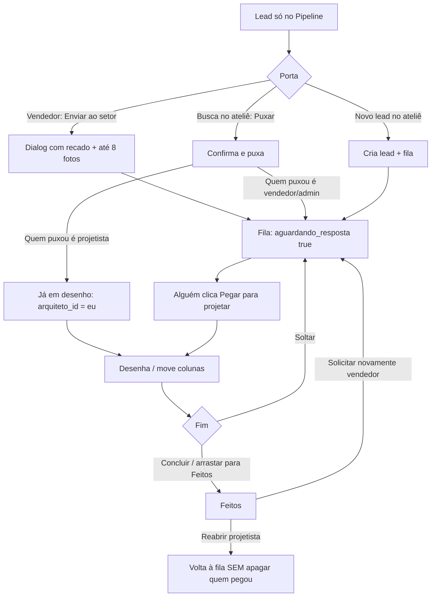

# PRD — Projetos: ateliê, layout, chat e efeitos

**Produto:** CRM Selletos  
**Versão:** 1.0  
**Data:** 28/08/2026  
**Status:** Retrato completo do módulo em produção  
**Rota:** `/projetos`  
**Página:** `src/pages/Projetos.tsx`  
**Ficha curta:** [08-projetos.md](08-projetos.md) · **Domínio:** [projetos.md](../04-dominios/projetos.md)

Este capítulo descreve **a dinâmica inteira** do setor de projetos: o quadro, o ciclo de vida do card, o chat titular ↔ projetista, cada efeito visual e o que muda no card comercial da Pipeline.

---

## 1. O que é este módulo (linguagem simples)

Imagine uma **marcenaria**. Na frente da loja está o **Pipeline**: o vendedor conversa com o cliente. No fundo existe o **ateliê**: a prancheta onde alguém desenha o móvel.

**Projetos** é essa prancheta.

- O **lead** continua sendo a mesma pessoa (mesmo cadastro).
- O **status comercial** (`lead.status`) mora no Pipeline e **não** se mistura com o estágio do ateliê.
- No ateliê o lead ganha um **segundo caderno**: `lead_projetos` (quem pegou o desenho, em qual coluna está, se está na fila).

Três metáforas que o visual usa o tempo todo:

| Palavra na tela | Significado |
|-----------------|-------------|
| **Ateliê** | O quadro `/projetos` |
| **Prancheta / lâmpada** | Alguém pegou o card e está desenhando (card aceso) |
| **Rádio / canal** | Chat entre o titular (vendedor) e o projetista |

Tintas do ateliê (além do Bourbon Daylight):

| Tinta | Hex | Quem “fala” |
|-------|-----|--------------|
| Ouro | `#f2d892` | Titular, marca, títulos |
| Ciano | `#7dd3fc` | Projetista, “em desenho”, mensagens do ateliê |
| Âmbar | `#fbbf24` | Fila, “aguardando projetista” |
| Teal | `#5eead4` | Coluna de visita em obra |
| Esmeralda | `#34d399` | Feito / concluído |
| Tinta | `#120c09` / `#1a120e` | Fundo da prancheta |

**Regra de ouro:** ouro = comercial; ciano = desenho. O chat e os efeitos cruzam as duas tintas de propósito.

---

## 2. Quem entra

| Papel | Vê `/projetos`? | Home | Configura colunas | Pega / solta / reabre | Envia da Pipeline | Solicita de novo |
|-------|:---------------:|------|:-----------------:|:---------------------:|:-----------------:|:----------------:|
| Admin / super-admin | sim | `/pipeline` | sim | sim | sim | sim |
| Vendedor | sim | `/pipeline` | não | não | sim | sim |
| Projetista / projetista_admin | sim | `/projetos` se for **só** projetista | só `projetista_admin` | sim | não (puxa no ateliê) | não |
| Marketing-only | não | conteúdo | — | — | — | — |
| Prestador | sem sidebar | portal | — | — | — | — |

Código: `canAccessProjetosBoard`, `isProjetistaOnly`, `isProjetistaAdminRole` em `src/lib/app-roles.ts`.

Quando o projetista abre a ficha pelo ateliê, o LeadModal entra em **`contextoProjeto`** (sempre) e **`modoProjeto`** (se for projetista-only). Isso esconde contratos/envio comercial e sobe markup + slides + painel de conclusão.

---

## 3. Layout da página `/projetos`

A página **não** é um card solto no `main`. Ela ocupa a altura toda (`flex-1 overflow-hidden`) por cima da aura WebGL.

```
┌─────────────────────────────────────────────────────────────────┐
│  ProjetosBoardAura (WebGL, absolute inset-0, z abaixo)        │
│                                                                 │
│  ┌──────────────┐  ┌──────────────┐  ┌──────────────┐  ┌─────┐ │
│  │ Título SETOR │  │ AbertosCard  │  │ Chat rádio  │  │ +   │ │
│  │ Projetos     │  │ (medidor)    │  │ (preview)    │  │Zoom │ │
│  │ texto ajuda  │  │             │  │             │  │Novo │ │
│  └──────────────┘  └──────────────┘  └──────────────┘  │Col. │ │
│                                                       └─────┘ │
│  [  Busca de leads: neste quadro | todos os leads  ]           │
│                                                                 │
│  ┌─ KanbanPageZoomShell ─────────────────────────────────────┐ │
│  │  [ Fila ] [ Visita ] [ … colunas extras ] [ Feitos ]        │ │
│  │   cards     cards                    cards                 │ │
│  │  scrollbar horizontal flutuante                             │ │
│  └───────────────────────────────────────────────────────────┘ │
└─────────────────────────────────────────────────────────────────┘
```

### 3.1 Cabeçalho (z-30, acima da aura)

Da esquerda para a direita, em desktop (`md:flex-row`):

1. **Identidade**
   - Kicker `SETOR` — Bebas `11px`, `tracking-[0.28em]`, `text-sky-200/80`.
   - Título `Projetos` — Bebas `text-2xl md:text-3xl text-gold`.
   - Texto de ajuda: todos os projetistas veem o mesmo quadro; puxar o lead marca o card na Pipeline.

2. **`ProjetosAbertosCard`** (`md:max-w-[20.5rem]`)
   - Instrumento circular WebGL + número grande de **abertos**.
   - Três números: Fila (âmbar) · Visitas (teal) · Desenho (ciano).
   - Conta: `abertos = aguardando + emDesenho + visitas`. Feitos **não** entram em “abertos”, mas entram no arco (progresso = abertos / (abertos + feitos)).

3. **`ProjetosChatPreview`** (`md:max-w-[22rem]`) — ver §7.

4. **Ações**
   - Zoom do quadro (`KanbanPageZoomControls`, o mesmo do Pipeline).
   - **Novo lead** — cria lead comercial + já coloca na fila.
   - **Colunas** — só admin / projetista_admin.

Em mobile a pilha é vertical: título → medidor → rádio → botões → busca → quadro com scroll horizontal e snap.

### 3.2 Busca (`ProjetosLeadSearch`)

Dois escopos:

| Escopo | O que procura | Mínimo de letras |
|--------|---------------|------------------|
| **Neste quadro** | Cards que já estão no ateliê | 1 |
| **Todos os leads** | RPC/query da empresa | 2 (`minCaracteresBuscaProjetos`) |

Debounce 300 ms. Painel em portal (não fica preso no overflow). Clique:

- Se o lead **já está** no quadro → abre o LeadModal.
- Se **não está** → confirma “Puxar este lead para o ateliê?”.

### 3.3 Quadro

- `DndContext` (`@dnd-kit`) + `pointerWithin`, sensor com 8 px de arrasto.
- Colunas em faixa horizontal (`snap-x`, `gap-4 md:gap-5`).
- `FloatingHorizontalScrollbar` no rodapé.
- Overlay do card arrastado (`DragOverlay`).
- URL `?id=` abre o LeadModal daquele lead (mesmo padrão de `/leads`).

---

## 4. Dinâmica do sistema (ciclo de vida)

Há **um** registro `lead_projetos` por lead (`UNIQUE lead_id`). O card comercial continua existindo.

### 4.1 Estados que importam

Não é uma máquina com nome no banco. O estado **se deriva** de três campos:

| Campo | Significado |
|-------|-------------|
| `stage_id` | Em qual coluna do ateliê |
| `arquiteto_id` | Quem pegou para desenhar (na prática: o projetista, apesar do nome) |
| `aguardando_resposta` | Está na fila, esperando alguém pegar |

**Em desenho** (`isProjetoEmDesenho`):

```
arquiteto_id preenchido  E  aguardando_resposta = false
```

Enquanto isso, a lâmpada do card acende.

### 4.2 Como o lead chega no ateliê

Três portas, todas gravam uma **nota** no canal (`tipo: envio`), salvo o cadastro rápido (ver abaixo).



**Porta A — Enviar ao setor** (`LeadEnviarProjetoDialog`)

Aparece no **card da Pipeline** (`LeadProjetoCardActions`) e no **topo** do LeadModal comercial (`LeadProjetoPanel`). Quem pode: admin / vendedor (`canEnviarDaPipeline`). Projetista puxa no ateliê, não manda da Pipeline.

- Recado com **mínimo 8 caracteres** **ou** pelo menos uma imagem.
- Até **8 imagens** (JPG/PNG/WebP/GIF, máx. 20 MB cada).
- Se o lead **já tinha** projeto: `tipo: reenvio`, volta para a fila, apaga `arquiteto_id`.
- Fotos sobem para o Storage e também viram linhas extras `tipo: conversa` com legenda `📷 Imagem`.

**Porta B — Puxar** (`puxarParaProjeto`)

- Se já existe linha: toast “já está no quadro”, não duplica.
- Conflito único (`23505`) tratado como “já estava”.
- Projetista que puxa **já fica com o desenho**. Vendedor só coloca na fila.
- Recado automático: “Puxou este lead para o ateliê…” / “…e ficou com o desenho.”

**Porta C — Novo lead** (`useCriarLeadProjeto`)

- Cria o lead com o usuário como `vendedor_responsavel_id` (RLS do projetista precisa disso para reler o lead).
- Status comercial = primeira coluna da inbox do Pipeline.
- Entra na fila (`aguardando_resposta: true`). **Não** abre o dialog de recado.

### 4.3 Ações no card / no modal

| Ação | Quem | O que grava | Confirma? |
|------|------|-------------|-----------|
| **Pegar para projetar** | Projetista / admin | `arquiteto_id = eu`, `aguardando_resposta = false` | Não |
| **Soltar projeto** | Quem pode reabrir | `arquiteto_id = null`, `aguardando_resposta = true` | Sim (“o brilho para”) |
| **Mover coluna** (arrastar) | Quem vê o quadro | `stage_id`. Se cair na **fila**, também solta o claim | Não |
| **Concluir** (painel no modal) | Projetista | `stage_id` = última coluna, `aguardando_resposta = false` | Sim |
| **Reabrir** | Projetista | Volta à fila, **mantém** `arquiteto_id` | Sim |
| **Solicitar novamente** | Vendedor / admin | Fila + `arquiteto_id = null` + `enviado_por` / `enviado_em` novos | Sim |

**Só um dono efetivo** enquanto está em desenho. Não existe fila de “dois projetistas no mesmo card”. Soltar libera para o próximo.

### 4.4 Colunas (`projeto_stages`)

Padrão na semente:

1. **Projetos aguardando serem feitos** (`cor: warning`) — a **fila**.
2. **Visita agendada** (`cor: primary`).
3. **Projetos feitos** (`cor: success`) — **sempre a última**.

A classificação **não** usa um enum no banco. O código olha o **nome**:

| Kind | Como detecta | Visual da coluna |
|------|--------------|------------------|
| `waiting` | nome contém “aguardando” (ou “fila”) | Âmbar, ampulheta |
| `visita` | nome contém “visita” | Teal, rosa-dos-ventos WebGL + pin |
| `feito` | **última** coluna (se houver 2+) | Esmeralda, check |
| `other` | qualquer extra no meio | Ouro genérico, “Em andamento” |

**Fila** (`getWaitingProjetoStageId`): primeiro nome com “aguardando”/“fila”; senão a primeira que não é visita nem feito. Assim, reordenar colunas não quebra “solicitar novamente”.

Config (`ProjetoStagesConfigDialog`): criar, renomear, cores preset, subir/descer ordem, excluir. Só `isProjetistaAdminRole`.

Empty states das colunas são textos diferentes (fila vs visita vs feitos).

---

## 5. O card do ateliê (`ProjetoKanbanCard`)

Fundo `rgba(42,24,18,0.72)`, borda `border-gold/25`, sombra `0_8px_24px_rgba(0,0,0,0.35)`, `backdrop-blur-sm`.

De cima para baixo:

1. **Faixa “Em desenho”** (só se `isProjetoEmDesenho` e não está em feitos)  
   Lâmpada WebGL 36×36 + nome de quem pegou (Bebas ouro). `role="status"`.
2. **Alça de arrastar** (`GripVertical`) + **nome do lead** (Bebas).
3. Badge **Aguardando projetista** se `aguardando_resposta`.
4. **`ProjetoChatBadge`** se já existe mensagem naquele lead.
5. Sino de **lembretes** (mesmo popover da Agenda).
6. Bloco **Titular** (vendedor) e **Arquiteto** (parceiro Pontua Garbo, se houver no mapa).
7. Botões de ação (pegar / soltar / reabrir / solicitar), com `stopPropagation` para não abrir o modal.

Arrastar: `scale-[1.03] rotate-1 ring-sky-400/40`. Entrada: delay `min(index, 8) * 40ms`.

Clique no card → LeadModal (`contextoProjeto`, `statusChangeOnSelect={false}`).

---

## 6. Ponte com a Pipeline

O card **comercial** ganha:

1. Selo (`KanbanProjetoSignal`) e anel (`kanbanCardProjetoRingClass`).
2. Botão **Enviar ao setor** / **Solicitar de novo** (`LeadEnviarProjetoDialog` variante `card`).
3. Ícone do **canal** (`ProjetoChatBadge` + `LeadProjetoCanalDialog`) quando o lead já está no ateliê — o mesmo fio de mensagens do rádio.

Depois do envio o canal abre sozinho, para o titular ver o recado gravado e continuar conversando.

**Não usa WebGL no Pipeline** — dezenas de colunas quebrariam o celular. O vocabulário visual é o mesmo (anel polar ouro/ciano), feito em CSS:

| Tom | Quando | Anel / faixa |
|------|--------|----------------|
| `waiting` | `aguardando_resposta` | Âmbar, pulso, “Aguardando projetista” |
| `active` | em desenho | Ciano, disco `spin 9s`, “Em desenho agora” |
| `done` | última coluna do ateliê | Ouro estático, “Projeto feito” |

Realtime: `useLeadProjetos({ realtime: true })` no ateliê. A Pipeline escuta a mesma tabela para o selo aparecer **na hora** para o resto da equipe (`20260826170000_lead_projetos_puxar_realtime.sql`).

---

## 7. Chat do ateliê (completo)

O chat **não** é WhatsApp. É um **canal formal gravado no lead**, entre **titular** e **projetista**. Imagens viram arquivo na pasta **`chat`** daquele lead (mesmo acervo da Biblioteca).

### 7.1 Onde aparece

Há **quatro superfícies**, o mesmo fio:

| Superfície | Componente | Quando |
|------------|------------|--------|
| **Rádio** no topo do ateliê | `ProjetosChatPreview` + Sheet | Sempre visível no `/projetos` |
| **Seção no LeadModal** | `LeadProjetoPanel` / `LeadProjetoNotasSection` | Pipeline: topo da ficha. Ateliê: se já tem projeto **ou** notas |
| **Selo no card do ateliê** | `ProjetoChatBadge` | Se existe pelo menos uma nota |
| **Card da Pipeline** | `LeadProjetoCanalDialog` | Se o lead já está no ateliê; abre também após enviar |
| **Popup flutuante global** | `FloatingProjetoChatShell` | Em todas as páginas (MainLayout), se há não lidas para o participante |

Abrir o rádio **não** substitui o modal. O botão **Abrir card** fecha o sheet e, 180 ms depois, abre o LeadModal.

### 7.2 Tipos de mensagem (`lead_projeto_notas.tipo`)

| Tipo | Quando nasce | Rótulo na bolha |
|------|-------------|---------------|
| `envio` | Primeiro envio ao setor / puxar | Pedido de projeto |
| `reenvio` | Vendedor manda de novo | Novo pedido |
| `conversa` | Resposta no rádio, no modal, ou foto extra do envio | Conversa |

Validação:

- **Conversa** (rádio/modal): texto com 1+ caracteres **ou** uma imagem.
- **Envio inicial** (dialog da Pipeline): mínimo **8** caracteres se não houver foto.
- Texto máx. **2000** no composer. Atalho **Ctrl/Cmd + Enter**.

### 7.3 Tintas das bolhas (`ProjetoChatThread`)

| Condição | Borda / fundo | Quem |
|---------|---------------|------|
| Autor é projetista **e não** é vendedor (`isAutorDoAtelie`) | Ciano `border-sky-400/25 bg-sky-950/30` | Ateliê |
| Qualquer outro (titular, admin-vendedor, você no outro papel) | Ouro `border-gold/25 bg-[#1a120e]/80` | Comercial |
| Mensagem **sua** | Alinha à direita (`ml-auto`) | — |
| Mensagem do outro | Alinha à esquerda | — |

Se a pessoa tem **os dois papéis** (vendedor + projetista), a tinta é **ouro** — o código trata “ateliê puro”.

Imagem: miniatura `max-h-40`, clique abre lightbox (`Dialog` fundo `#120c09`). Legenda `📷 Imagem` some do texto (não duplica).

Scroll: sempre desce para a última mensagem (`scrollTop = scrollHeight`).

### 7.4 Composer (`ProjetoChatComposer`)

- Textarea ouro, fundo `#1a120e/70`.
- Botão **Imagem** (input `sr-only`) + prévia 80×20 com X para tirar.
- Enviar: botão ouro, texto `#1a120e`.
- Uma imagem por envio no rádio/modal (o dialog de “enviar ao setor” aceita várias).

### 7.5 Preview “Rádio” (layout)

Cartão `rounded-[1.7rem]` com **borda-gradiente** ciano → ouro (3 px), fundo interno `#120c09/90`, grade blueprint 5% de opacidade.

- Kicker `RÁDIO` + badge com **quantas conversas** + badge **“N a responder”** (pulso) se a última mensagem **não** é sua.
- Botão rádio 44×44 com `ProjetoNotasAura` + ícone `Radio`; ponto ciano se há pendência.
- Lista das últimas threads (uma por lead): titular · nome do lead · preview truncado. Ponto ciano pulsa se precisa resposta.
- Faixa inferior 28 px: **`ProjetosChatWaveform`** (ondas ouro + ciano). `urgent` se há pendência; `active` se há qualquer conversa.

Sheet à direita (`sm:max-w-xl`, fundo `#120c09`):

- Desktop: coluna 13.5 rem de conversas + thread.
- Mobile: 38% lista / 62% thread (grid rows).
- Composer em modo `compact`.

Empty: “Titular e projetista ainda não escreveram. Quando alguém mandar, o aviso acende no card.”

### 7.6 Selo no card (`ProjetoChatBadge`)

**Sem WebGL** (muitos cards). CSS:

- Sem pendência: círculo ouro, ícone mensagem.
- **O outro lado mandou** (`last.autor_id !== eu`): `animate-ping` ciano + anel cônico girando 2.8 s + ponto no canto.

`chatFromOtherSide` no card continua sendo “última mensagem não é minha” (sinal visual rápido).

### 7.6.1 Contagem real de não lidas + popup flutuante

Tabela `lead_projeto_chat_leituras` (`user_id`, `lead_id`, `last_read_at`):

- **Quem vê o ícone:** só titular (`titular_id`) ou projetista que pegou (`arquiteto_id`) do lead.
- **Não lida:** mensagem com `autor_id ≠ eu` e `criado_em > last_read_at` (ou todas as do outro se nunca abriu).
- **Marcar lido:** ao abrir o fio no popup flutuante, no rádio, no `LeadProjetoCanalDialog` ou na seção do LeadModal (`useMarkLeadProjetoChatRead`).
- **UI global:** `FloatingProjetoChatShell` no `MainLayout` (ao lado da Agenda). Ícone só aparece com `totalUnread > 0` (ou painel aberto). Badge numérico; clique abre lista estilo WhatsApp + thread + composer.
- Hook: `useProjetoChatUnread` (query + realtime). Aura WebGL só no ícone (`FloatingProjetoChatAura`).

### 7.7 Upload de imagem

`src/lib/lead-projeto-chat.ts`:

1. Garante pasta da mídia do lead com nome **`chat`** (`LEAD_CHAT_FOLDER_NAME`).
2. Sobe para o bucket **`marketing-medias`**: `{schema|master}/chat/{leadId}/{timestamp}-{rand}.ext`.
3. Insere na tabela de mídias (mesmo lugar da Biblioteca).
4. Grava `imagem_url` / `file_name` / `mime_type` na nota.

URL pública. Reindex de conhecimento do lead (`bumpLeadKnowledgeReindex`) depois do envio.

### 7.8 Realtime do chat

| Listener | Onde | Evento |
|---------|------|--------|
| Thread aberta | `useLeadProjetoNotas` | `INSERT` filtrado por `lead_id` |
| Lista do rádio | `useLeadProjetoChatBoard` **sem** `realtime: false` | `INSERT` na tabela de notas |
| Popup flutuante (não lidas) | `useProjetoChatUnread` | `INSERT` em notas → invalidate |
| Badges dos cards no quadro | `useLeadProjetoChatBoard(..., { realtime: false })` | **Não** escuta ao vivo — atualiza no refetch (15 s stale / invalidate do rádio) |

A página busca no máximo **500** notas recentes para montar “última por lead”.

Quem pode ler/escrever (RLS): admin, vendedor, projetista, projetista_admin, super-admin. Insert exige `autor_id = auth.uid()`.

---

## 8. Catálogo de efeitos visuais

Todos os WebGL do ateliê seguem o mesmo contrato:

- `THREE.WebGLRenderer({ antialias: false, alpha: true, powerPreference: 'low-power' })`
- `pixelRatio` limitado (1.5 ou 1.75 no medidor)
- `pointer-events: none`, `aria-hidden`
- `prefers-reduced-motion: reduce` → **um frame estático** (`uTime` fixo), sem `requestAnimationFrame`
- Cards/selos **repetidos** não usam canvas (só CSS)

Não copie esses shaders para o CRM inteiro. São **assinatura do ateliê**.

### 8.1 Fundo do quadro — `ProjetosBoardAura`

**O que o olho vê:** uma prancheta de arquitetura: grade tipo blueprint (ciano), lavagem dourada no meio, vinheta, ticks na base, ruído lento.

**Técnica:** um único plano fullscreen, shader fragmento. Grid `sin(p.x * 36)` / `sin(p.y * 22)`, noise lento (`uTime * 0.035`). Alpha ~0.22–0.4. Host `absolute inset-0`, a página usa `opacity-90`.

### 8.2 Medidor — `ProjetosAbertosCard`

**O que o olho vê:** cartão com a mesma moldura-gradiente ouro/ciano. À direita, um **arco polar**: trilha + trecho preenchido = `abertos / (abertos + feitos)`. Número Bebas ouro no centro (`2.75rem`, glow). Hover: sobe 2 px em 700 ms.

**Shader:** anel em `r ≈ 0.74`, preenchimento pelo ângulo `uProgress`, ticks, pulso `sin(uTime * 1.4)`.

### 8.3 Lâmpada do card — CSS + `ProjetoClaimedAura`

Dois andares:

1. **CSS** (`projeto-claimed.css`) no wrapper do card: `projeto-card-claimed` 1.8 s ease-in-out infinito. Box-shadow oscila entre ciano fino e ouro forte; `brightness` 1.02 → 1.14. Borda da faixa `projeto-card-claimed-rim` oscila opacidade 0.55 ↔ 1.
2. **WebGL** só no disco 36×36: anel polar, hub, ticks angulares, “lamp” `sin(uTime * 3.2)`, varredura ouro/ciano. **Pausa fora da tela** (`IntersectionObserver` 5%).

Reduced motion: animação CSS desliga; fica borda ouro + glow ciano estático. Shader congela.

### 8.4 Coluna visita — `ProjetoVisitaColumnAura`

Rosa-dos-ventos teal/ouro, gira devagar (`ang - uTime * 0.18`), raios (`sin(ang * 2)`), anel, ticks. Ícone `MapPin` por cima. Fundo da coluna: gradiente teal, hatch diagonal 7%.

### 8.5 Selo do canal — `ProjetoNotasAura`

Disco ~32 px: duas **fitas** (ouro em cima, ciano embaixo) cruzando como traço de prancheta + anel. Usado no botão do rádio e no badge da seção do LeadModal. Pausa fora da tela.

### 8.6 Onda do rádio — `ProjetosChatWaveform`

Faixa larga: duas senoides (`sin(x * 14 + t)` ouro, `sin(x * 12 - t)` ciano), fade nas pontas, grain. Uniform `uPulse`: 0.35 inativo / 1 ativo / 1.25 urgente. Pausa fora da tela.

### 8.7 Pipeline (CSS, sem canvas)

Disco cônico + SVG bússola. Waiting pulsa; active gira 9 s; done estático. Anel 3 px à esquerda do chip.

### 8.8 Grade blueprint (CSS, vários cartões)

`repeating-linear-gradient` 11–12 px, opacidade 5–7%, ouro e/ou ciano. Não é WebGL; é papel milimetrado.

### 8.9 Motion pontual (sem Three)

| Onde | Efeito |
|------|--------|
| “N a responder” | `animate-pulse` |
| Badge chat urgente | `animate-ping` + spin 2.8 s |
| Cartões Abertos / Rádio | `hover:-translate-y-0.5` |
| Card claimed | 1.8 s glow (CSS) |
| Arrastar | scale 1.03, rotate 1°, ring sky |

---

## 9. LeadModal no contexto do ateliê

Flags em `Projetos.tsx`:

```
modoProjeto={isProjetistaOnly}
contextoProjeto          // sempre true nesta página
statusChangeOnSelect={false}
```

O que muda na ficha:

| Região | Comportamento |
|--------|----------------|
| Faixa no topo | `LeadProjetoConclusaoPanel` — puxar / concluir / soltar / reabrir / solicitar |
| Canal | `LeadProjetoNotasSection` — o mesmo thread + composer |
| Composição | `LeadProjetoComposicaoSection` — slides + markup **no topo** da ficha |
| Enviar ao setor | **Oculto** (`ocultarEnvioInicial`) — o lead já está no ateliê |
| Contratos | Escondidos se `modoProjeto` |
| Apagar lead | Projetista-only não apaga |

Painel de conclusão (“Fora do ateliê” em ciano se ainda não há `lead_projetos`): puxar sem sair da ficha.

---

## 10. Modelo de dados

Tabelas por empresa (`emp_*`) e equivalentes master `CRM-multi-empresas>*<`.

### `projeto_stages`

`id`, `nome`, `cor`, `ordem`, `ativo`, `is_default`, timestamps.

### `lead_projetos`

| Campo | Papel |
|-------|--------|
| `lead_id` | Único. O lead comercial |
| `stage_id` | Coluna |
| `titular_id` | Vendedor dono |
| `arquiteto_id` | Quem pegou para desenhar (nome legado) |
| `enviado_por` / `enviado_em` | Quem mandou à fila |
| `aguardando_resposta` | Está na fila |

### `lead_projeto_notas`

`lead_id`, `autor_id`, `mensagem`, `tipo` (`envio` \| `reenvio` \| `conversa`), `imagem_url`, `file_name`, `mime_type`, `criado_em`.

### `lead_projeto_chat_leituras`

`user_id`, `lead_id`, `last_read_at` — PK `(user_id, lead_id)`. RLS: só a própria linha.

Realtime nas duas tabelas de movimento (`lead_projetos` e notas).

**Não misturar** `leads.status` com `lead_projetos.stage_id`.

---

## 11. Celular, PWA e acessibilidade

- Quadro: scroll-x + zoom (igual Pipeline).
- Rádio: altura máx. `min(18.5rem, 46vh)`; lista com `touch-pan-y`.
- Waveform / auras: já `low-power`; PWA sem blur glass extra.
- `prefers-reduced-motion`: shaders congelam; lâmpada CSS vira borda estática.
- Claimed: `aria-live="polite"`. Coluna: `aria-label` com contagem.
- Alça de arrastar tem `aria-label`. Composer: label “Responder no canal”.

---

## 12. Regras para reconstruir

1. **Dois eixos.** Funil comercial ≠ colunas do ateliê.
2. **Um projeto por lead.** Unique; puxar de novo não duplica.
3. **Claim é visível.** Sem lâmpada, o time não sabe quem desenha.
4. **Chat é evidência**, não recado solto: grava no lead + pasta `chat`.
5. **Duas tintas.** Ouro = titular; ciano = projetista. Onda do rádio só faz sentido se as duas existirem.
6. **WebGL só em peças únicas** (fundo, medidor, 1 lâmpada visível, 1 visita, 1 rádio). Nunca 40 canvases.
7. **Selo da Pipeline em CSS.** Mesmo vocabulário, outro motor.
8. **Fila pelo nome**, feitos pela **última** coluna.
9. **Confirmar** soltar / reabrir / solicitar / puxar. Pegar e arrastar não pedem confirmação.
10. **Realtime no quadro de projetos** (`realtime: true`). Sem isso o selo da Pipeline atrasa.
11. Projetista-only: home `/projetos`, sem Pipeline no menu.
12. Empty states honestos (“ainda não escreveram”, “arraste para visita”, “nenhum na fila”).

---

## 13. Mapa de arquivos

| Peça | Arquivo |
|-------|---------|
| Página | `src/pages/Projetos.tsx` |
| Coluna / kind | `ProjetoKanbanColumn.tsx` |
| Card | `ProjetoKanbanCard.tsx` |
| CSS lâmpada | `projeto-claimed.css` |
| Rádio + sheet | `ProjetosChatPreview.tsx` |
| Thread / composer / badge | `ProjetoChatThread.tsx`, `ProjetoChatComposer.tsx`, `ProjetoChatBadge.tsx` |
| Auras WebGL | `ProjetosBoardAura`, `ProjetosAbertosCard`, `ProjetoClaimedAura`, `ProjetoVisitaColumnAura`, `ProjetoNotasAura`, `ProjetosChatWaveform` |
| Modal: conclusão / notas / composição / envio | `LeadProjetoConclusaoPanel`, `LeadProjetoNotasSection`, `LeadProjetoComposicaoSection`, `LeadEnviarProjetoDialog`, `LeadProjetoPanel` |
| Card Pipeline: envio + canal | `LeadProjetoCardActions`, `LeadProjetoCanalDialog` |
| Busca / novo / colunas | `ProjetosLeadSearch`, `CriarLeadProjetoDialog`, `ProjetoStagesConfigDialog` |
| Selo Pipeline | `src/components/kanban/KanbanProjetoSignal.tsx` |
| Hooks | `useLeadProjetos`, `useProjetoStages`, `useLeadProjetoNotas`, `useLeadProjetoChatBoard`, `useProjetoChatUnread`, `useMarkLeadProjetoChatRead`, `useProjetosBuscaLeads` |
| Popup flutuante global | `FloatingProjetoChatShell`, `FloatingProjetoChatIcon`, `FloatingProjetoChatPopup`, `FloatingProjetoChatAura` |
| Upload / tintas do chat | `src/lib/lead-projeto-chat.ts` |
| Migrations | `20260825180100_*`, `25190000_*`, `25200000_*`, `25210000_*`, `26120000_*`, `26170000_*`, `214_lead_projeto_chat_leituras` |
