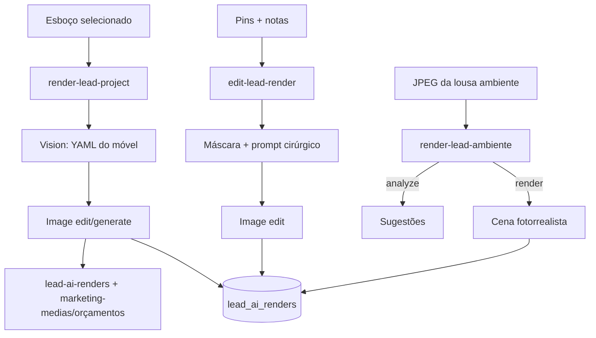

# PRD — Renderização de projetos (IA no card do lead)

**Produto:** CRM Selletos  
**Versão:** 1.0  
**Data:** 28/08/2026  
**Status:** Retrato completo do sistema de render em produção  
**Onde vive:** não é rota — é a subaba **Renderização de projetos** dentro de **Análise IA** no `LeadModal`  
**Componente:** `src/components/leads/LeadAIRenderTab.tsx`  
**Domínio curto:** [lead-ia.md](../04-dominios/lead-ia.md) · **Ficha do card:** [06-lead-modal.md](06-lead-modal.md)  
**Lousa operacional** (fotos do lead, outro módulo): `docs/prd/2026-08-03-lousa-whiteboard-prd.md`

Este capítulo descreve **todo o sistema de renderização**: os três botões que você marcou, a galeria de esboços, o antes/depois com **AMPLIAR**, a lousa de ambiente, o chat Íris Sky (aba irmã), os jobs em segundo plano e cada efeito visual.

---

## 1. O que é (linguagem simples)

No card do cliente, a equipe pode **transformar um desenho ou uma foto em uma imagem fotorrealista** do móvel/projeto — como um fotógrafo de estúdio, só que a “câmera” é a IA.

Há **três caminhos**, os três botões do cabeçalho **Esboço do projeto**:

| Botão | Analogia | O que sai |
|-------|----------|-----------|
| **Editar por pontos** | “Muda só este canto” | Nova imagem a partir da foto/esboço, só nas bolinhas que você cravou |
| **Renderizar projeto** | “Fotografa o móvel no estúdio” | Render do esboço (lousa, anexo, PDF, slide) |
| **Renderizar com ambiente** | “Coloca o móvel no cômodo da casa” | Desce até a lousa de ambiente; no fim gera a cena |

Tudo isso **não trava o CRM**. O job continua se você fechar o card. Um raio dourado no canto da tela avisa quando terminar.

**Não confundir:**

- **Análise visual** (subaba ao lado) = a IA **lê** as fotos e escreve um relatório.  
- **Íris Sky** = **chat** sobre esse relatório (não gera o render).  
- **Lousa do lead** (aba Detalhes) = desenho operacional do vendedor.  
- **Lousa do ambiente** (esta aba) = composição para o render de cômodo.

---

## 2. Onde clicar (mapa da ficha)

```
LeadModal
├── Aba Detalhes
└── Aba Análise IA          ← você marcou este tab (aria-selected)
    ├── Análise visual      (relatório + chat Íris Sky)
    └── Renderização de projetos   ← subaba ativa
        ├── Esboço do projeto      (grade de cards + 3 botões)
        ├── Compor ambiente        (#lead-ai-ambiente-composer)
        ├── Resultado              (Antes | Depois + AMPLIAR)
        └── Histórico
```

Visual das subabas: `TabsList` `max-w-lg`, fundo `bg-mahogany-muted/50`, ativo `bg-gold/15 text-gold`. Ícones Sparkles / ImageIcon.

Fundo do scroll do modal: radial ouro 4% no topo + `bg-mahogany-muted/10`.

---

## 3. Quem usa e o que precisa estar ligado

Config em **Pipeline → Configurações → IA** (`PipelineLeadAISettingsCard`):

| Interruptor | Sem ele |
|-------------|---------|
| Renderização de projetos (`renderAtivo`) | Banner âmbar; botão Renderizar projeto some/desativa |
| Renderização com ambiente (`renderAmbienteAtivo`) | Banner âmbar; botão ambiente e compositor travam |
| Chave OpenAI (`apiKeyConfigured`) | Banner: configure a chave. **A chave nunca vai ao browser** — só Edge Function |

Modelos típicos: visão `gpt-4o` (também mini / 4.1); imagem `gpt-image-1.5` (também `gpt-image-1`, `dall-e-2`). Prompts de análise e de imagem são editáveis no admin.

---

## 4. Esboço do projeto (a galeria)

Seção com kicker `ESBOÇO DO PROJETO` (Bebas-ish tracking `0.18em` ouro), fundo `from-mahogany-card/80 to-mahogany-elevated/40`, sombra inner.

A grade une **todas** as imagens que o lead já tem:

| Origem | Badge no card |
|--------|----------------|
| Anexo do card | Anexo |
| Lousa operacional | Lousa (ouro) |
| Slide de orçamento | Orçamento (sky) |
| PDF | PDF (âmbar) + escolha de página |

Card `MediaSelectCard`: proporção **4/5**, hover zoom `scale-[1.03]` 500 ms, entrada stagger 40 ms. Selecionado: borda ouro, `ring-2 ring-gold/40`, `scale-[1.02]`, véu dourado. Checkbox ouro no canto. Só **um** selecionado por vez.

PDF: primeiro thumbnail; ao marcar, dialog escolhe a **página** (a IA não renderiza o PDF inteiro de uma vez).

Empty: “Adicione um esboço na lousa ou anexe uma foto.”

Anexo e lousa podem ser apagados daqui (confirmação). Slide de orçamento não.

---

## 5. Os três botões (dinâmica)

### 5.1 Renderizar projeto (`Wand2`)

1. Precisa de um esboço selecionado (e página, se PDF).  
2. Abre `LeadAIRenderOptionsDialog`: opcionalmente **cor / material / detalhes** (switch “características extras”).  
3. Dispara job em background (`startBackgroundRender` → Edge `render-lead-project`).  
4. Na tela: `LeadAIRenderThinkingState` — frases que giram (“Lendo o esboço…”, “YAML técnico…”, “texturas de estúdio…”). Se houver cor/material, entram fases extras e **pills** douradas.  
5. Resultado: linha em `lead_ai_renders` + PNG no bucket `lead-ai-renders` **e** cópia na pasta **orçamentos** de `marketing-medias` (`render-ia-{id}.png` — é o arquivo que você viu no `emp_garbo/...`).

Passos no servidor: **vision** (entende o esboço) → **render** (gera a imagem). Erro vem com `step` para a mensagem ficar humana.

Pode gerar **quantas vezes quiser**. Cada uma entra no histórico.

### 5.2 Editar por pontos (`Pencil`)

Dois lugares:

| De onde | Dialog | Alvo |
|---------|--------|------|
| Botão no **esboço** | `LeadAIPhotoPointEditDialog` | A foto/desenho **ainda não renderizado** |
| Barra do quadro **Depois** | `LeadAIRenderEditDialog` | O **render já pronto** (versão atual) |

Fluxo:

1. Clica na imagem (`LeadAIRenderPointPicker`) — até **8** pins (`MAX_PONTOS`).  
2. Escreve o que mudar (**mínimo 5 caracteres**).  
3. O browser monta: **máscara** (círculos ~9% do menor lado) + **imagem marcada** (anel tracejado vermelho + pin ouro/mogno numerado).  
4. Edge `edit-lead-render` faz edição **cirúrgica** (`buildSurgicalEditPrompt`).  
5. Nova linha no histórico com `parent_render_id` = versão anterior → vira **cadeia de versões**.

Não é um chat: é “aponte + escreva o pedido”.

### 5.3 Renderizar com ambiente (`Sofa` + foil WebGL)

1. Precisa do interruptor de ambiente.  
2. Se houver esboço selecionado, a foto **desce** para a lousa (`incomingPhoto` + pulso de borda ouro) e a página **rola** até `#lead-ai-ambiente-composer`.  
3. Lá você descreve o cômodo, desenha, posiciona móveis.  
4. **Desmembrar** (visão): YAML de sugestões (`action: analyze`).  
5. **Gerar**: achata a cena em JPEG (`exportAmbienteCompositionToJpeg`) e chama `render-lead-ambiente` (`action: render`) em background.

O botão do cabeçalho tem `AmbienteAtmosphereFoil` por baixo do texto (véu quente animado) — `relative overflow-hidden`.

---

## 6. Resultado: Antes / Depois e AMPLIAR

`LeadAIRenderCompare`: grid `md:grid-cols-2`.

| Quadro | Variante | Visual |
|--------|----------|--------|
| Esboço | `before` | Borda sutil, label creme “Antes — …” |
| Render | `after` | `border-gold/30 bg-gold/5`, label ouro “Depois — Render fotorrealista” |

Hover no quadro: overlay mogno 55% + pílula **AMPLIAR** (uppercase tracking, borda ouro, sobe de `translate-y-2` / opacity 0). Clique abre comparação em tela cheia. No **Depois** há atalho “Tela cheia” só da imagem final.

Enquanto o job roda, o bloco vira `LeadAIRenderThinkingState` (não os dois frames).

Abaixo: texto da análise visual do render (`LeadAIFormattedContent`) + download + editar por pontos da versão atual.

---

## 7. Histórico e versões

`LeadAIRenderHistoryPanel`: lista todas as gerações do lead (mais nova primeiro).

Cadeia (`getRelatedVersionChain`): pai ← filhos via `parent_render_id`. Setas anterior/próxima só andam nessa família (edição pontual não mistura com um render de outro esboço).

Apagar: tira o registro e tenta limpar o anexo `render-ia-*` da pasta orçamentos.

---

## 8. Compositor de ambiente (a lousa desta aba)

`#lead-ai-ambiente-composer` — **não** é o chat. É um **estúdio 2D** para montar o cômodo.

### 8.1 Cabeçalho

Kicker `COMPOR AMBIENTE` + Sofa. Texto: descreva ou insira foto. Foil WebGL no header (`intensity 0.7`). Ações: Desfazer / Refazer / Salvar cópia na pasta do lead / Tela cheia.

Tela cheia: `AMBIENTE_FULLSCREEN_ATTR` — o LeadModal **não fecha** se clicar fora.

### 8.2 Prompt

Textarea “Prompt do ambiente”, máx. 2000. Exemplo de sala contemporânea no placeholder.

### 8.3 Barra da lousa (o que você marcou)

`data-ambiente-toolbar="true"`:

- Texto de ajuda: “Insira uma foto ou desenhe o cômodo na lousa”
- **PREENCHER** (formas com fill)
- **Cor personalizada** (presets)
- **LOUSA** + zoom **100%**
- **Limpar desenhos**

Ferramentas (`AmbienteDrawToolbar`): Selecionar · Lápis · Linha · Retângulo · Elipse · Triângulo. Atalhos V P L R O T. Shift: quadrado / círculo / linha 45°.

Tinta padrão `#f2d892`. Paleta:

| Id | Hex | Nome |
|----|-----|------|
| gold | `#f2d892` | Dourado |
| cream | `#fff6ea` | Creme |
| coral | `#e85d4c` | Coral |
| sky | `#4aa3ff` | Azul |
| lime | `#7dce7a` | Verde |
| ink | `#1c100c` | Escuro |

Fill: `rgba` da mesma cor ~18% (`inkFillFromStroke`).

A barra tem um **foil Three.js próprio** (plano ouro/mogno/creme, `pixelRatio 1`).

### 8.4 Área da cena

`role="application"` `aria-label="Área de composição do ambiente"`.  
`touch-action: none`. Altura `max-h-[min(52vh,420px)]`. Fundo `bg-muted/20`, grade de prancheta (`AmbienteDraftingGrid`).

Empty: “Insira a foto do cômodo ou desenhe… Inserir foto · Tirar foto · Do projeto · Objetos · Desfazer · Tela cheia”.

Camadas (de trás para frente):

1. Foto de fundo (escala + offset — “aproximar o cômodo”)  
2. Overlays (outras fotos, arrastar / redimensionar)  
3. Móveis (`AmbienteFurnitureObject` — módulos da lousa operacional, cor ouro)  
4. Formas geométricas (`AmbienteDrawLayer`)  
5. Marcadores de nome  

HUD: zoom %, editar objeto selecionado (`AmbienteObjectEditHud`). Teclado: `[` `]` rotacionam 15°, `-` `=` escala, Delete apaga.

### 8.5 Desmembrar × gerar

| Ação | Precisa | Servidor |
|------|---------|----------|
| Analisar / desmembrar | Texto **ou** foto | `render-lead-ambiente` `analyze` → YAML + chips clicáveis (`parseAmbienteSugestoes`) |
| Gerar render | Texto **ou** foto **ou** objeto na cena | Achata JPEG (composição + fonte) → `render` em background |

Sugestão com `tipoModulo` **coloca o móvel** na cena; senão vira um marcador de texto.

---

## 9. Chat: Íris Sky (aba Análise visual)

O chat **não** está na subaba de render. Ele mora em **Análise visual**, painel `LeadSkyChatPanel`.

| | |
|--|--|
| Nome | **Íris Sky** — “Consultora privada de projetos Sky” |
| Avatar | Círculo ouro, letra **Í**, blur dourado atrás |
| Edge | `chat-iris-sky` |
| Memória | Relatório da análise + chunks RAG (`index-lead-knowledge`) se ligado |
| Spots | Pode apontar um trecho do relatório (`iris-spot`) — chip com mira |
| Persistência | `lead_ai_chat_messages` |
| Sugestões | “Quais ambientes…”, “telefone…”, “riscos…” |

Bolhas: usuário à direita; Íris à esquerda, markdown formatado. Apagar conversa = AlertDialog.

**Render não conversa.** Pedido de mudança no render = pins + notas, não mensagem de chat.

WhatsApp do lead (aba Detalhes) é outro canal, comercial.

---

## 10. Jobs em segundo plano

`LeadAIRenderBackgroundContext` (e o irmão de **análise**).

Tipos de job: `preparing` → `running` → `completed` | `error`.

Três filas no mesmo contexto: render de projeto, edição pontual, render de ambiente.

UI do shell:

- Faixa na aba: “continuar em segundo plano… avisaremos”.  
- Ícone flutuante `FloatingLeadAIBackgroundIcon` (Zap, pulse + anel ouro se ativo, badge 9+).  
- Popup `LeadAIAnalysisBackgroundPopup` (também lista renders). Clique pode reabrir o card na subaba certa (`initialIaSubtab`).

Fechar o modal **não cancela** o fetch da Edge Function.

---

## 11. Três funções de backend (o motor)

Todas: auth + schema da empresa + config (`pipeline_lead_ai_config`). Segredo OpenAI só no servidor.



Cópia pública que você viu no DOM:

`…/marketing-medias/emp_garbo/render-ia-{uuid}.png`

---

## 12. Modelo de dados

`lead_ai_renders` (por empresa / master):

| Campo | Papel |
|-------|--------|
| `input_snapshot` | Qual esboço (source, id, label, url, `mode: studio \| ambiente`) |
| `analise_texto` | Texto da visão |
| `output_public_url` / `output_storage_path` | Imagem |
| `vision_model` / `image_model` | Auditoria |
| `render_prompt_snapshot` | Prompt usado |
| `parent_render_id` | Versão anterior (edição) |
| `edit_notas` / `edit_pontos` | Pedido cirúrgico |
| `criado_por` / `criado_em` | Quem / quando |

Chat: `lead_ai_chat_messages`. Análise: `lead_ai_analises`. Config: `pipeline_lead_ai_config`. RAG: `lead_ai_knowledge_chunks`.

---

## 13. Catálogo de efeitos visuais

Contrato WebGL (quando houver): `low-power`, `pixelRatio 1`, `prefers-reduced-motion` = frame estático.

| Peça | Arquivo | O que o olho vê |
|------|---------|-----------------|
| Véu do botão Ambiente | `AmbienteAtmosphereFoil` | Luz quente ouro/creme no botão Sofa |
| Véu do compositor | mesmo, `intensity 0.7` | Atmosfera no header da lousa |
| Foil da toolbar | `AmbienteDrawToolbar` | Brilho na barra PREENCHER / cores |
| Grade da cena | `AmbienteDraftingGrid` | Papel milimetrado (CSS/canvas leve) |
| Thinking | `LeadAIRenderThinkingState` | Ícone que troca de fase + pills ouro |
| Card esboço | `MediaSelectCard` | Zoom 1.03, anel ouro se marcado |
| AMPLIAR | `RenderImageFrame` | Overlay + pílula que sobe no hover |
| Quadro Depois | `variant=after` | Glow ouro interno |
| Íris avatar | `LeadSkyChatPanel` | Disco ouro + blur |
| Ícone background | Zap pulse + ring ouro | Job rodando |
| Pins de edição | canvas 2D | Anel vermelho tracejado + pin ouro |

**Não** use a lâmpada ciano do ateliê de Projetos. Aqui a tinta é **ouro de estúdio**.

CSS thinking: `.ai-render-pill-enter`. Reduced motion: foils congelam.

---

## 14. Dois chats / duas lousas (para não misturar)

| Nome | Onde | Função |
|------|------|--------|
| Íris Sky | Análise visual | Perguntar sobre o **relatório** |
| WhatsApp | Detalhes | Falar com o **cliente** |
| Lousa do lead | Detalhes | Esboço à mão (fonte do render) |
| Lousa de ambiente | Renderização | Montar o **cômodo** |
| Pins | Render | Pedir **retoque** na imagem |

---

## 15. Celular e acessibilidade

- Grade de esboços: 2 / 3 / 4 colunas.  
- Compositor: melhor tablet; `touch-none` no desenho.  
- AMPLIAR: `aria-label="Ampliar …"`, também no foco do teclado.  
- Toolbar da lousa: tooltips + atalhos.  
- Job: `aria-label` no ícone Zap.

---

## 16. Regras para reconstruir

1. **Três motores**, três Edges. Não funda “um botão gera tudo”.  
2. **Selecionar um esboço** antes de estúdio / pins no esboço.  
3. **Jobs fora do modal.** Sem isso o vendedor acha que travou.  
4. **Segredo OpenAI só no servidor.**  
5. **Versões** com `parent_render_id` — o “desfazer” do render é a cadeia, não Ctrl+Z da lousa.  
6. **Ambiente achata JPEG** no cliente; a IA não recebe objetos Three.js.  
7. **Máx. 8 pontos**; nota ≥ 5 caracteres.  
8. **PDF = uma página.**  
9. **Cópia em orçamentos** para o time achar o PNG junto dos anexos.  
10. **Fullscreen do ambiente** não pode fechar o LeadModal.  
11. Chat Íris **não** substitui pins.  
12. Interruptores `renderAtivo` / `renderAmbienteAtivo` independentes.

---

## 17. Mapa de arquivos

| Peça | Arquivo |
|------|---------|
| Abas IA | `LeadAIAnalysisTab.tsx` |
| Render | `LeadAIRenderTab.tsx` |
| Análise + chat | `LeadAIAnalysisVisualTab.tsx`, `LeadSkyChatPanel.tsx` |
| Ambiente | `LeadAIAmbienteComposer.tsx`, `ambiente/*` |
| Comparar / AMPLIAR | `LeadAIRenderCompare.tsx`, `LeadAIRenderFullscreenDialog.tsx` |
| Pins | `LeadAIPhotoPointEditDialog.tsx`, `LeadAIRenderEditDialog.tsx`, `LeadAIRenderPointPicker.tsx` |
| Opções de estúdio | `LeadAIRenderOptionsDialog.tsx` |
| Histórico | `LeadAIRenderHistoryPanel.tsx` |
| Thinking | `LeadAIRenderThinkingState.tsx` |
| Background | `LeadAIRenderBackgroundContext.tsx`, ícone/popup no layout |
| APIs | `render-lead-project-api.ts`, `render-lead-ambiente-api.ts`, `edit-lead-render-api.ts` |
| Edges | `supabase/functions/render-lead-project`, `render-lead-ambiente`, `edit-lead-render`, `chat-iris-sky` |
| Shared | `_shared/render-prompts.ts`, `openai-image-edit.ts`, `edit-mask.ts`, `ambiente-prompts.ts` |
| Config | `usePipelineLeadAIConfig`, `PipelineLeadAISettingsCard` |
| Migrations | `20260626120000_lead_ai_render.sql` e seguintes (`render_edits`, `iris_sky`, `render_ambiente`) |
