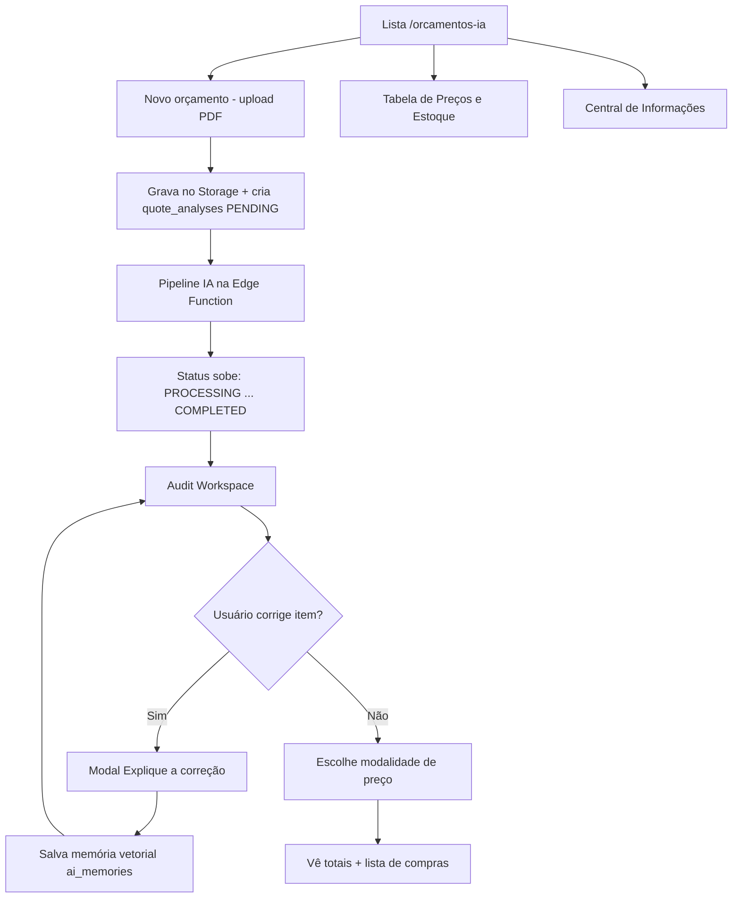

# PRD — Alterações Implementadas  
## Módulo **Orçamentos IA** no sistema GARBO Movelaria / CRM Selletos

| Campo | Valor |
|--------|--------|
| **Versão deste documento** | 1.0 |
| **Data** | 2026-09-22 |
| **Base normativa** | [`prd_sistema_orcamento_gpt-v8.md`](prd_sistema_orcamento_gpt-v8.md) (visão de produto) |
| **Plano técnico** | [`EXECUTION_PLAN.md`](../EXECUTION_PLAN.md) |
| **Escopo** | Tudo que foi **construído e integrado** no repositório Vite + React + Supabase (não Next.js) |

---

## 1. Resumo executivo (linguagem simples)

Foi criado um **módulo novo** dentro do app GARBO chamado **Orçamentos IA**.

**O que ele faz, em uma frase:**  
A pessoa envia o PDF do projeto de móveis → a inteligência artificial lê o desenho → monta a lista de materiais (chapas, fitas, ferragens, etc.) → a equipe revisa na tela lado a lado com o PDF → o sistema calcula o preço de venda → e ainda **aprende** com as correções da equipe.

**Por que existe:**  
Reduzir o tempo de orçamento (de horas/dias para minutos), com o mesmo nível de detalhe da **Planilha 4.0 Premium**, e evitar prejuízo por esquecer parafuso, fita ou chapa.

**Onde aparece no app:**  
Menu **Orçamentos → Orçamentos IA** → rota `/orcamentos-ia`.

---

## 2. Objetivos do produto (entregues)

| Objetivo | Status |
|----------|--------|
| Upload de PDF de projeto e armazenamento seguro | Entregue |
| Processamento assíncrono com barra de progresso em tempo real | Entregue |
| Extração multi-agente (Parser → Extrator → Auditor) via OpenAI | Entregue |
| Preço: estoque da empresa → se não achar, preço de mercado + alerta | Entregue |
| Tela de auditoria visual (PDF 200 DPI + caixas azuis `#0066FF`) | Entregue |
| Dual monitor (janela popout sincronizada) | Entregue |
| Memória de correções (RAG / aprendizado contínuo) | Entregue |
| 3 modalidades de precificação (MPC %, Material × N, R$/m²) | Entregue |
| Lista de compras “inteira” (chapa, rolo, barra 3 m) | Entregue |
| Central de preços e estoque editável na interface | Entregue |
| Lista de orçamentos com busca, exclusão e voltar da auditoria | Entregue |

---

## 3. Adaptação em relação ao PRD v8 original

O PRD v8 descrevia um app **Next.js**. No GARBO a implementação foi adaptada assim:

| Ideia do PRD v8 | Como ficou no GARBO |
|-----------------|---------------------|
| Next.js + API Routes | **Vite + React + TypeScript** (SPA já existente) |
| Tabela `companies` nova | **`company_id` = ID da empresa CRM** já existente (sem tabela duplicada) |
| Filas PgBoss / Inngest / Trigger.dev | Status no Postgres + **Supabase Realtime** + Edge Function |
| Secrets no servidor Next | **`OPENAI_API_KEY` só nas Edge Functions** (nunca no navegador) |
| Diretrizes em `.cursorrules` | Atualizadas para a stack Vite/Supabase do repositório |

Princípios de negócio da Planilha 4.0 **foram mantidos** (unidade individual de ferragem, puxador em barra de 3 m + tampinhas, 3 modalidades MPC, RAG, etc.).

---

## 4. Personas e permissões

| Quem | O que pode fazer |
|------|------------------|
| Admin CRM / Administrador fábrica | Acesso completo ao módulo |
| Vendedor / Projetista (CRM) | Usar Orçamentos IA conforme gate de path CRM |
| Cliente final (público) | **Não** acessa `/orcamentos-ia` (rota autenticada) |

Gate: `canAccessCrmPath` / papéis CRM + admin fábrica, alinhado às demais rotas do CRM.

---

## 5. Fluxo do usuário (fim a fim)



### 5.1 Lista de orçamentos
- Ver todos os jobs da empresa.
- **Buscar** por nome/arquivo.
- **Excluir** (remove análise + PDF/páginas/materiais relacionados).
- Abrir auditoria quando status = `COMPLETED`.
- Botão para **voltar à lista** a partir da auditoria.
- Botões de header:
  - **Tabela de Preços & Estoque**
  - **Central de Informações**
  - **Novo orçamento**

### 5.2 Upload
- PDF até ~100 MB.
- Escolha de modo: **Max** (auditoria mais profunda com `o3-mini`) ou **Pro**.
- Dispara pipeline após gravar arquivo e registro.

### 5.3 Processamento (status)
Estados usados na UI e no banco:

| Status | Significado para o usuário |
|--------|----------------------------|
| `PENDING` | Na fila |
| `PROCESSING` | IA trabalhando |
| `CONVERTING_PAGES` | Convertendo páginas do PDF |
| `READING_LAYOUT` | Lendo layout das pranchas |
| `EXTRACTING_MODULES` | Extraindo módulos e insumos |
| `FETCHING_MARKET_PRICES` | Buscando preços |
| `AUDITING_REVISION` | Auditoria construtiva |
| `COMPLETED` | Pronto para revisar |
| `FAILED` | Falhou (mensagem de erro no registro) |

Atualização ao vivo via **Supabase Realtime**.

### 5.4 Audit Workspace
- PDF renderizado a **200 DPI**.
- Overlay SVG com bounding boxes (coordenadas 0.0–1.0).
- Clique na lista → destaca no PDF (cor `#0066FF`).
- Hierarquia: **Ambiente → Módulo → Materiais**.
- Quantidade **exata** vs quantidade de **compra** (arredondada).
- Alerta quando o preço veio do **mercado** (`using_market_price`): confirmar ou informar custo.
- **Dual Monitor**: abre janela popout com sincronização (`BroadcastChannel`).
- Seletor das **3 modalidades** de preço + totais.
- Lista de compras inteira (chapas, rolos, barras 3 m + tampinhas).

### 5.5 Aprendizado
- Ao corrigir, o usuário explica a regra no modal **“Explique a correção à IA”**.
- Texto vira embedding (`text-embedding-3-small`) e vai para `ai_memories`.
- Próximos orçamentos consultam essas memórias (RPC `match_ai_memories`) e injetam no prompt do Extrator.

### 5.6 Central de preços e estoque
Modal **Tabela de Preços & Estoque**:
- Listar / filtrar / buscar insumos de `inventory_items`.
- Editar em lote (inline) e salvar no Supabase.
- Cadastrar novos materiais.
- Categorias cobertas na UI:
  - Chapas MDF (R$/m² e R$/chapa + perda %)
  - Fitas de borda (R$/m + metros do rolo)
  - Ferragens & acessórios (R$/unidade)
  - Puxadores perfil (R$/barra 3 m e tampinhas)
  - Mão de obra & serviços / consumíveis

### 5.7 Central de Informações
Modal de `company_standards` (padrões construtivos da Planilha 4.0: espessuras, método, descontos de puxador, etc.) — base entregue para parametrização da empresa.

---

## 6. Requisitos funcionais (RF)

### RF-01 — Infraestrutura de dados
O sistema **deve** criar e usar as tabelas do módulo com RLS para autenticados e vínculo por `company_id` (empresa CRM).

**Tabelas:**  
`company_standards`, `inventory_items`, `market_reference_prices`, `ai_memories`, `quote_analyses`, `quote_environments`, `quote_modules`, `quote_materials`.

**RPC:** `match_ai_memories`.

**Storage:** bucket `orcamentos-ia` (PDFs + páginas).

### RF-02 — Upload e criação de análise
O sistema **deve** aceitar PDF, gravar no Storage, criar `quote_analyses` em `PENDING` e iniciar o pipeline.

### RF-03 — Pipeline multi-agente
O sistema **deve** executar, na Edge Function `orcamentos-ia-pipeline`:
1. **Parser** — `gpt-4o-mini` (layout / classificação)
2. **Extrator** — `gpt-4o` + memórias RAG (detalhamento Planilha 4.0)
3. **Auditor** — `o3-mini` (checagens construtivas)

Orquestração cliente: LangGraph em `pipeline.ts` + invocação da Edge.

### RF-04 — Resolução de preço
Para cada material:
1. Tentar `inventory_items`
2. Senão `market_reference_prices` e marcar `using_market_price = true`
3. UI deve permitir confirmar / informar custo

**Regra de negócio:** ferragens/conectores/parafusos **sempre por unidade** (nunca por caixa).  
Puxador perfil: **barra de 3 m** + **tampinhas** laterais.

### RF-05 — Audit Workspace
Conforme seção 5.4 (DPI, SVG, sync, dual monitor, hierarquia, alertas).

### RF-06 — Memória RAG
Correções justificadas **devem** ser vetorizadas e reutilizadas em análises futuras da mesma empresa.

### RF-07 — Precificação MPC
Três modalidades obrigatórias:
1. Margem MPC % → `venda = custo / (1 − %)`
2. Material × N
3. R$/m² × metragem

Lista de compras com arredondamento de chapas (~2,75×1,85 + perda), rolos (20/50/100 m), barras 3 m.

### RF-08 — Gestão de estoque na UI
Botão no header + modal com CRUD de preços/insumos em `inventory_items`.

### RF-09 — Gestão da lista
Busca, exclusão permanente, navegação lista ↔ auditoria.

---

## 7. Requisitos não funcionais (RNF)

| ID | Requisito | Como atendido |
|----|-----------|---------------|
| RNF-01 | Chave OpenAI não no browser | Só Edge Functions |
| RNF-02 | UI consistente com o app | Tailwind + Lucide + componentes `ui/` (Shadcn) |
| RNF-03 | Bundle CRM não explode | Página `lazy()` em `App.tsx` |
| RNF-04 | Tipagem | TypeScript; `pnpm build` / `tsc` como gate |
| RNF-05 | Multi-empresa | Filtro por `company_id` da sessão CRM |
| RNF-06 | Feedback ao vivo | Realtime nos status de `quote_analyses` |

---

## 8. Modelos de IA utilizados

| Modelo | Papel no módulo |
|--------|-----------------|
| `gpt-4o` | Visão / extração técnica + bounding boxes |
| `gpt-4o-mini` | Parser / classificação / de-para leve |
| `o3-mini` | Auditor / raciocínio construtivo (modo Max) |
| `text-embedding-3-small` | Memórias RAG (1536 dimensões) |

---

## 9. Arquitetura técnica (como está no código)

```
src/pages/orcamentos-ia/          → tela principal
src/components/orcamentos-ia/     → UI do módulo
src/lib/orcamentos-ia/            → regras, API cliente, preços, pipeline
supabase/migrations/              → DDL + seeds + storage
supabase/functions/
  orcamentos-ia-pipeline/         → agentes OpenAI
  orcamentos-ia-memory/           → embeddings + gravação de memórias
```

### 9.1 Componentes de interface

| Arquivo | Função |
|---------|--------|
| `PdfUploadArea.tsx` | Upload + disparo do pipeline |
| `CompanyStandardsModal.tsx` | Central de Informações |
| `InventoryManagerModal.tsx` | Tabela de Preços & Estoque |
| `AuditWorkspace.tsx` | Auditoria visual + MPC |
| `ExplainCorrectionModal.tsx` | Aprendizado / RAG |

### 9.2 Bibliotecas (`src/lib/orcamentos-ia/`)

| Arquivo | Função |
|---------|--------|
| `storage.ts` | Bucket, upload, CRUD leve de análises, status |
| `pipeline.ts` | Orquestra job / chama Edge |
| `schemas.ts` | Zod da extração (caixaria, fitas, ferragens…) |
| `pricing.ts` | `resolveMaterialPrice`, MPC, lista de compras |
| `memory.ts` | Cliente de memórias |
| `quote-tree.ts` | Carrega árvore Ambiente→Módulo→Material + PDF assinado |
| `inventory.ts` | `getInventoryItems`, `updateInventoryItem`, lote, create |
| `openai-models.ts` | Nomes dos modelos |
| `index.ts` | Reexports do módulo |

### 9.3 Migrations

| Arquivo | Conteúdo |
|---------|----------|
| `20260921_init_orcamentos_ia.sql` | Extensão `vector`, tabelas, RLS, RPC, seeds Planilha 4.0 |
| `20260922_orcamentos_ia_storage.sql` | Bucket + policies Storage / Realtime |
| `20260922_orcamentos_ia_processing_status.sql` | Status intermediário `PROCESSING` |

### 9.4 Integrações no app existente
- Rota lazy `/orcamentos-ia` em `App.tsx`
- Item de navegação em `app-navigation.ts` (ícone `BrainCircuit`)
- Sem colisão com rotas públicas `/orcamento/:schema/:id` nem `/orcamento-slides`

---

## 10. Regras de negócio críticas (não negociáveis)

1. **Ferragens e acessórios:** sempre **unidade individual**.
2. **Puxador perfil:** barra de **3 metros** + tampinhas (não usar lógica de barra 6 m).
3. **Fallback de preço:** estoque → mercado → confirmação na UI.
4. **Correção com justificativa:** vira memória vetorial e influencia o próximo orçamento.
5. **PDF de auditoria:** mínimo **200 DPI**; highlight `#0066FF`.
6. **Três modalidades** de venda sempre disponíveis no Audit Workspace.
7. **`company_id`:** empresa CRM existente — não criar tabela `companies` paralela.

---

## 11. Seeds iniciais (Planilha 4.0)

Já incluídos na migration (catálogo global `company_id` nulo), exemplos:
- Chapas MDF (Branco TX 15/6 mm, Louro Freijó, Toronto) com R$/m² e R$/chapa
- Fitas de borda por metro
- Ferragens (dobradiça, corrediça, Minifix, VB35, cantoneira, parafuso…)
- Puxadores perfil 3 m + tampinha
- Preços de referência em `market_reference_prices` para fallback

A UI da Fase 7 permite **alterar e ampliar** esse cadastro sem editar SQL.

---

## 12. Critérios de aceite (checklist de produto)

- [x] Usuário autenticado com permissão abre `/orcamentos-ia`
- [x] Consegue enviar PDF e ver progresso até `COMPLETED` ou `FAILED`
- [x] Consegue abrir Audit Workspace e correlacionar item ↔ destaque no PDF
- [x] Consegue editar item e gravar memória de correção
- [x] Consegue alternar as 3 modalidades e ver totais / lista de compras
- [x] Consegue abrir Tabela de Preços & Estoque, editar e salvar
- [x] Consegue buscar e excluir orçamentos da lista
- [x] `pnpm exec tsc --noEmit` / build do módulo sem erro de tipagem

### Pendências operacionais (fora do código de feature)
- [ ] Garantir `pnpm migrate` aplicado no ambiente alvo
- [ ] Confirmar secret `OPENAI_API_KEY` nas Edge Functions do projeto Supabase
- [ ] Índice IVFFlat em `ai_memories` quando houver volume real de memórias

---

## 13. Riscos e mitigações

| Risco | Mitigação |
|-------|-----------|
| Tempo longo de IA (modo Max) | Processamento assíncrono + Realtime + status claros |
| Preço errado / item sem cadastro | Fallback mercado + alerta na UI + tela de estoque |
| Alucinação de quantidade | Auditor `o3-mini` + revisão humana no Audit Workspace |
| Chave OpenAI vazada | Só no servidor (Edge); nunca `VITE_*` |
| Confusão com orçamento slides / público | Rota isolada `/orcamentos-ia` |

---

## 14. Fora de escopo nesta entrega (explícito)

- App Next.js standalone (descartado em favor da SPA GARBO)
- Fila externa tipo Inngest/PgBoss (substituída por status + Edge + Realtime)
- Cobertura completa de todos os 32 PDFs da Planilha 4.0 como templates interativos na UI (regras mapeadas no PRD v8; UI de padrões ainda em evolução)
- Assinatura/créditos por empresa (`credit_balance` do schema conceitual v8 não foi o foco desta entrega)
- Testes automatizados E2E (o projeto usa `tsc`/`pnpm build` como gate principal)

---

## 15. Mapa fase × entrega

| Fase | Nome | Resultado |
|------|------|-----------|
| 1 | Banco + Storage | Migrations, seeds, RLS, bucket |
| 2 | Rota e layout | `/orcamentos-ia`, upload, Realtime, Central de Informações |
| 3 | Engine multi-agente | Edge pipeline + preços + regras Planilha 4.0 |
| 4 | Memória RAG | Edge memory + modal de correção |
| 5 | Audit Workspace | PDF 200 DPI, SVG, dual monitor |
| 6 | Motor MPC | 3 modalidades + lista de compras |
| 7 | Preços & Estoque | Modal + `inventory.ts` + botão no header |

---

## 16. Glossário rápido

| Termo | Significado |
|-------|-------------|
| **MPC** | Método de precificação com margem sobre custo |
| **RAG** | Busca de “memórias” parecidas para ensinar a IA |
| **Bounding box** | Retângulo que marca no PDF onde está o módulo/peça |
| **Edge Function** | Programa que roda no servidor Supabase (seguro para IA) |
| **Seed** | Dados iniciais já inseridos no banco (chapas, ferragens…) |

---

## 17. Referências

- Visão de produto: [`prd_sistema_orcamento_gpt-v8.md`](prd_sistema_orcamento_gpt-v8.md)
- Plano e checklists: [`../EXECUTION_PLAN.md`](../EXECUTION_PLAN.md)
- Diretrizes Cursor: [`.cursorrules`](../.cursorrules) / [`.cursorrule`](../.cursorrule)

---

*Este PRD documenta as **alterações efetivamente implementadas** no repositório GARBO Movelaria para o módulo Orçamentos IA. Em caso de divergência com o PRD v8 conceitual, prevalece o comportamento descrito neste documento + o código em `src/**/orcamentos-ia` e `supabase/**`.*
