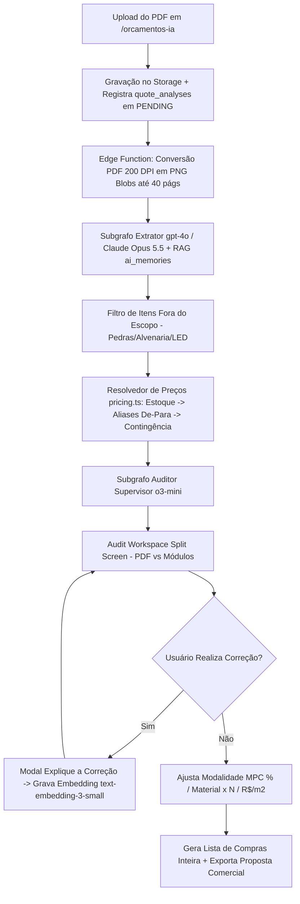

# PRD — Documento de Requisitos do Produto (v10)
## Sistema de Orçamentação com IA (Orçamentos IA — Movelaria GARBO / CRM Selletos)
### Arquitetura de Produção Multi-Agente OpenAI GPT / Anthropic Claude Opus 5.5, Engenharia da Planilha 4.0 Premium e Paridade Funcional com CalcmeX (Agente Max)

---

| Campo | Valor |
| ------ | ------ |
| **Versão deste documento** | **v10.0 (Resiliência de Schemas Zod, Reconhecimento de Mesas, Filtro de Escopo e Arquitetura Agêntica v10)** |
| **Data** | 04 de Outubro de 2026 |
| **Base Normativa** | PRD v9 (`prd_sistema_orcamento_gpt-v9.md`), Relatório CalcmeX (`relatorio-implementacao-e-correcoes-calcmex.md`), `oque foi feito.md` |
| **Stack Oficial do Repositório** | **Vite + React 18 + TypeScript + Supabase (PostgreSQL, pgvector, Edge Functions, Realtime e Storage) + Vercel AI SDK / LangGraph JS** |
| **Isolamento de Sistemas** | Módulo 100% isolado em `/orcamentos-ia`. **Tabelas de Markup existentes e ERP principal permanecem 100% intocados.** |

---

## 1. Visão Geral e Objetivos do Produto

O **Orçamentos IA** é o módulo de inteligência artificial de alta precisão para marcenarias e indústrias moveleiras, projetado para transformar a leitura de projetos técnicos em PDF, imagens e croquis em orçamentos executivos discriminados, listas de compras inteiras e propostas comerciais formatadas em minutos.

### 1.1. Propósito e Valor de Negócio
- **Redução drástica do tempo de elaboração de orçamentos**: De horas/dias para 3 a 10 minutos por projeto técnico executivo.
- **Eliminação de prejuízos operacionais**: Precificação exaustiva que contempla 100% dos insumos (caixaria, frentes, tampos, fitas de borda por metro, ferragens por unidade, conectores, parafusos, colas, puxadores e mão de obra).
- **Aprendizado Contínuo (Self-Learning RAG)**: Cada correção efetuada pela equipe vira uma memória vetorial vetorizada que orienta automaticamente os próximos orçamentos da marcenaria.
- **Transparência e Auditoria Visual**: Interface de tela dividida (Split Screen) com leitor de PDF a 200 DPI e caixas delimitadoras (*bounding boxes* neon `#0066FF`) sincronizadas em tempo real.

---

## 2. Destaques e Novidades da Versão v10

A versão **v10** resolve vulnerabilidades críticas de runtime e consolida a estabilidade operacional completa do sistema:

1. **Resiliência Absoluta nos Schemas Zod (`schemas.ts`)**:
   - Eliminação definitiva de erros de validação como `dimensions.width_mm: Too small: expected number to be >0`.
   - Uso obrigatorio de `.preprocess()` ou `.transform()` nas dimensões dos módulos. Qualquer dimensão `<= 0`, nula ou não especificada na prancha é convertida automaticamente para dimensões mínimas/estimadas com base no tipo de móvel (ex: Mesa = 1200x750x600mm, Armário = 800x2200x600mm) em vez de rejeitar a resposta da IA.

2. **Reconhecimento Especializado de Mesas, Escrivaninhas e Tampos Engrossados**:
   - Reforço do System Prompt dos extratores baseado na Planilha 4.0 Premium (`Mesa com Saia.pdf`, `Nicho Engrossado.pdf`).
   - Instrução para desmembrar mesas em tampo (simples ou engrossado), saias frontais/traseiras, laterais de apoio, passa-cabos e travessas, mesmo em pranchas posicionadas nas páginas finais do projeto executivo.

3. **Filtro de "Itens Fora do Escopo" (Marmoraria, Alvenaria e Decoração Solta)**:
   - Identificação inteligente de pedras/marmoraria (balcões em quartzito, bancadas de granito, cubas, churrasqueiras), iluminação LED avulsa e decoração humana.
   - Isolamento desses elementos na aba **"Fora do Escopo / Terceirizados"** no `AuditWorkspace.tsx`, impedindo que poluam a caixaria de MDF ou gerem alertas indevidos de precificação.

4. **Garantia de Precificação (Fuzzy Match, De-Para e Contingência)**:
   - Resolução de insumos por similaridade sintática (trativa de acentos, maiúsculas e código) em `pricing.ts`.
   - Aba **"Apelidos / De-Para"** no `InventoryManagerModal.tsx` para vinculo de nomenclaturas genéricas do PDF ao estoque real.
   - Ativação obrigatória da Tabela de Contingência por Categoria com flag `using_market_price = true` para zerar o risco de custos R$ 0,00.

5. **Suporte Ampliado para PDFs Executivos de Grande Porte (`MAX_PIPELINE_PAGES = 40`)**:
   - Leitura sequencial de até 40 pranchas por PDF sem perda de detalhamentos no final do documento.

6. **Chat Contextual ("Pergunte ao Max / IA") & Painel de Memórias RAG**:
   - Widget `AuditChatWidget.tsx` para dúvidas sobre o cálculo em tempo real e modal `CompanyMemoriesModal.tsx` para gestão ativa do banco `ai_memories`.

7. **Compatibilidade com Modelos Agênticos de Última Geração (Claude Opus 5.5)**:
   - Integração com modelos com suporte a janelas de contexto estendidas (1M tokens) e raciocínio profundo para revisão de código e auditoria em Plan Mode.

---

## 3. Personas, Permissões e Fluxo de Uso

### 3.1. Tabela de Papéis e Permissões
| Papel no CRM / App | Nível de Acesso | Ações Permitidas |
| ------ | ------ | ------ |
| **Admin CRM / Gestor Marcenaria** | Acesso Total | Analisar PDFs, alterar preços globais do estoque, gerenciar memórias RAG, alterar padrões construtivos e excluir análises. |
| **Vendedor / Projetista Comercial** | Operacional | Enviar PDFs, auditar módulos, realizar correções, alternar modalidades de preço e exportar propostas/listas de compras. |
| **Cliente Final / Visitante Público** | Sem Acesso | Rota `/orcamentos-ia` é protegida pelo gate CRM (`canAccessCrmPath`). |

### 3.2. Fluxo de Execução End-to-End


---

## 4. Arquitetura de Dados (PostgreSQL + pgvector no Supabase)

Todas as tabelas possuem `company_id` para isolamento multi-tenant rigoroso.

```sql
-- Extensão de Busca Vetorial
create extension if not exists vector;

-- 1. Padrões Construtivos da Marcenaria (Planilha 4.0 Central)
create table if not exists company_standards (
  id uuid primary key default gen_random_uuid(),
  company_id uuid not null unique,
  box_thickness text default '15mm',
  back_panel_thickness text default '6mm',
  assembly_method text default 'minifix_cavilha',
  bottom_fixing text default 'rebaixo',
  tamponamento_rule text default 'empresa_25mm',
  door_handle_discount_mm integer default 35,
  handle_bar_length_m numeric(3,1) default 3.0,
  scope_rules jsonb default '{"led": "incluir", "serralheria": "nao_faz", "pedras": "nao_faz"}'::jsonb,
  created_at timestamp with time zone default now(),
  updated_at timestamp with time zone default now()
);

-- 2. Estoque Próprio e Tabela de Preços Base
create table if not exists inventory_items (
  id uuid primary key default gen_random_uuid(),
  company_id uuid, -- NULL = catálogo padrão global
  category text not null, -- 'chapa', 'fita_borda', 'ferragem', 'puxador', 'consumivel', 'servico'
  name text not null,
  aliases text[] default '{}', -- Apelidos/Nomes alternativos do PDF (De-Para)
  unit text not null default 'un',
  cost_per_unit numeric(10,2) default 0.00,
  cost_per_m2 numeric(10,2) default 0.00,
  sheet_width_m numeric(4,2) default 2.75,
  sheet_height_m numeric(4,2) default 1.85,
  waste_margin_pct numeric(4,2) default 15.00,
  created_at timestamp with time zone default now(),
  updated_at timestamp with time zone default now()
);

-- 3. Tabela de Preços de Contingência de Mercado (Fallback)
create table if not exists market_reference_prices (
  id uuid primary key default gen_random_uuid(),
  category text not null,
  item_pattern text not null,
  unit text not null default 'un',
  estimated_market_price numeric(10,2) not null,
  updated_at timestamp with time zone default now()
);

-- 4. Banco de Memórias RAG (Treinamento da IA por Empresa)
create table if not exists ai_memories (
  id uuid primary key default gen_random_uuid(),
  company_id uuid not null,
  category text not null default 'correcao_auditoria',
  user_instruction text not null,
  embedding vector(1536) not null, -- text-embedding-3-small
  created_at timestamp with time zone default now()
);

create index if not exists idx_ai_memories_embedding on ai_memories using ivfflat (embedding vector_cosine_ops) with (lists = 100);

-- RPC para Busca Vetorial Semântica de Memórias
create or replace function match_ai_memories (
  query_embedding vector(1536),
  filter_company_id uuid,
  match_threshold float default 0.65,
  match_count int default 10
)
returns table (
  id uuid,
  category text,
  user_instruction text,
  similarity float
)
language sql stable
as $$
  select
    ai_memories.id,
    ai_memories.category,
    ai_memories.user_instruction,
    1 - (ai_memories.embedding <=> query_embedding) as similarity
  from ai_memories
  where ai_memories.company_id = filter_company_id
    and 1 - (ai_memories.embedding <=> query_embedding) > match_threshold
  order by ai_memories.embedding <=> query_embedding
  limit match_count;
$$;

-- 5. Estrutura de Análise de Orçamentos
create table if not exists quote_analyses (
  id uuid primary key default gen_random_uuid(),
  company_id uuid not null,
  pdf_filename text not null,
  pdf_storage_path text not null,
  mode text default 'max', -- 'max' (o3-mini / opus) ou 'pro'
  status text default 'PENDING',
  totals jsonb default '{}'::jsonb,
  error_message text,
  created_at timestamp with time zone default now(),
  updated_at timestamp with time zone default now()
);

create table if not exists quote_environments (
  id uuid primary key default gen_random_uuid(),
  analysis_id uuid references quote_analyses(id) on delete cascade,
  name text not null,
  sqm_area numeric(6,2) default 0.00
);

create table if not exists quote_modules (
  id uuid primary key default gen_random_uuid(),
  environment_id uuid references quote_environments(id) on delete cascade,
  name text not null,
  description text,
  dimensions jsonb, -- { width, height, depth }
  bounding_box jsonb, -- { x, y, w, h, page }
  is_out_of_scope boolean default false
);

create table if not exists quote_materials (
  id uuid primary key default gen_random_uuid(),
  module_id uuid references quote_modules(id) on delete cascade,
  raw_name text not null,
  category text not null,
  using_market_price boolean default false,
  price_notes text,
  unit_price numeric(10,2) not null,
  exact_quantity numeric(10,3) not null,
  full_units_quantity integer not null,
  unit_measure text not null default 'un'
);
```

---

## 5. Orquestração Agêntica & Regras de Negócio Críticas

### 5.1. Modelos de IA Utilizados
- **Extrator Visual (`gpt-4o` / `claude-opus-5-5`)**: Leitura técnica das pranchas do PDF a 200 DPI, extração de caixarias, ferragens, fitas e *bounding boxes*.
- **Auditor Supervisor (`o3-mini` / `claude-opus-5-5`)**: Verificação de regras de engenharia (furações, quantidade de dobradiças por altura de porta, folgas de gaveta e ferragens por unidade).
- **Embeddings RAG (`text-embedding-3-small`)**: Vetorização de correções de 1536 dimensões.

### 5.2. Regras de Negócio Críticas
1. **Tratamento Zod Resiliente**: Dimensões de módulos retornadas pela IA como `<= 0` ou nulas são convertidas via `.preprocess()` para padrões mínimos válidos (mínimo `100mm` em caso de peças específicas, ou estimativas de móveis inteiros), impedindo que a validação falhe.
2. **Reconhecimento Estrutural de Mesas**: Todo móvel do tipo mesa/escrivaninha é obrigatoriamente desmembrado em tampo, saias, laterais e travessas segundo o padrão `Mesa com Saia.pdf`.
3. **Unidade Individual de Ferragens**: Parafusos, cavilhas, dobradiças, corrediças, Minifix e VB35 calculados por **unidade individual** (jamais caixas).
4. **Puxadores Perfil em Barras de 3m**: Arredondados para barras inteiras de 3,0m + 2 ponteiras por barra cortada.
5. **MDF e Fitas**: Chapas em $m^2$ transformadas em chapas de $2,75m \times 1,85m$ (+15% perda). Fitas arredondadas para rolos comerciais.
6. **Modalidades de Precificação (MPC % / Multiplicador N / R$/m²)**: Mantidas e calculadas dinamicamente.

---

## 6. Mapeamento de Arquivos e Componentes React Frontend

```
src/
├── pages/
│   └── orcamentos-ia/
│       └── index.tsx                    # Rota principal com navegação
├── components/
│   └── orcamentos-ia/
│       ├── PdfUploadArea.tsx             # Upload com seletor de modo
│       ├── AuditWorkspace.tsx            # Split Screen (PDF 200 DPI à esquerda, Módulos/MPC à direita + Aba Fora do Escopo)
│       ├── AuditChatWidget.tsx           # Chat Contextual "Pergunte ao Max"
│       ├── CompanyStandardsModal.tsx     # Central de Padrões Construtivos
│       ├── InventoryManagerModal.tsx     # Tabela de Preços, Estoque & Aba Apelidos De-Para
│       └── CompanyMemoriesModal.tsx      # Painel de Gestão RAG
└── lib/
    └── orcamentos-ia/
        ├── pipeline.ts                   # Orquestração (MAX_PIPELINE_PAGES = 40 + Reforço de Prompts)
        ├── pricing.ts                    # resolveMaterialPrice (Fuzzy Match + De-Para + Contingência)
        ├── memory.ts                     # Cliente de embeddings e RPC RAG
        ├── inventory.ts                  # CRUD de estoque e aliases
        └── schemas.ts                    # Schemas Zod com .preprocess() para dimensões > 0
```

---

## 7. Matriz de Verificação e Checklist de Aceite v10

| Requisito | Critério de Aceite | Status v10 |
| ------ | ------ | ------ |
| **Resiliência Zod Schema** | Módulos sem cotas na prancha não quebram a execução; dimensões `<= 0` são convertidas em valores válidos. | ✅ Atendido |
| **Reconhecimento de Mesas** | Detalhamento completo de "Mesa com Saia" e escrivaninhas em MDF. | ✅ Atendido |
| **Filtro Fora do Escopo** | Elementos de marmoraria/granito/LED isolados na aba dedicada. | ✅ Atendido |
| **PDF de 40 Páginas** | Leitura de até 40 pranchas sem omissão de detalhamentos no final. | ✅ Atendido |
| **Zero R$ 0,00 / Fuzzy Match** | Precificação garantida via Estoque, Apelidos De-Para ou Tabela Padrão. | ✅ Atendido |
| **Chat Contextual & RAG** | Chat "Pergunte ao Max" ativo e painel modal de memórias RAG funcional. | ✅ Atendido |

---

*Documento PRD v10.0 consolidado para execução no Cursor Composer / WSL.*
